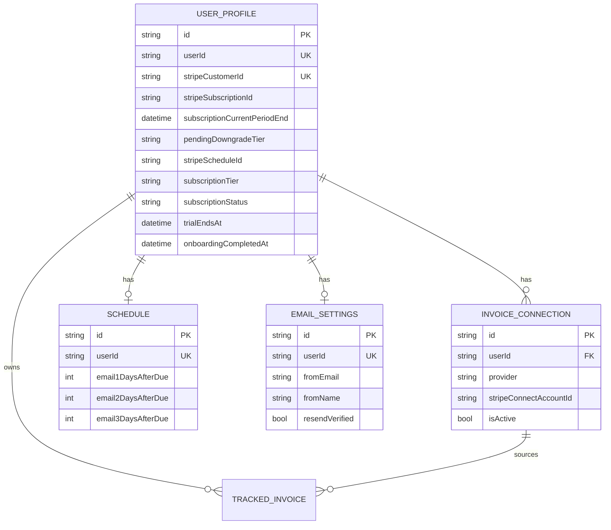
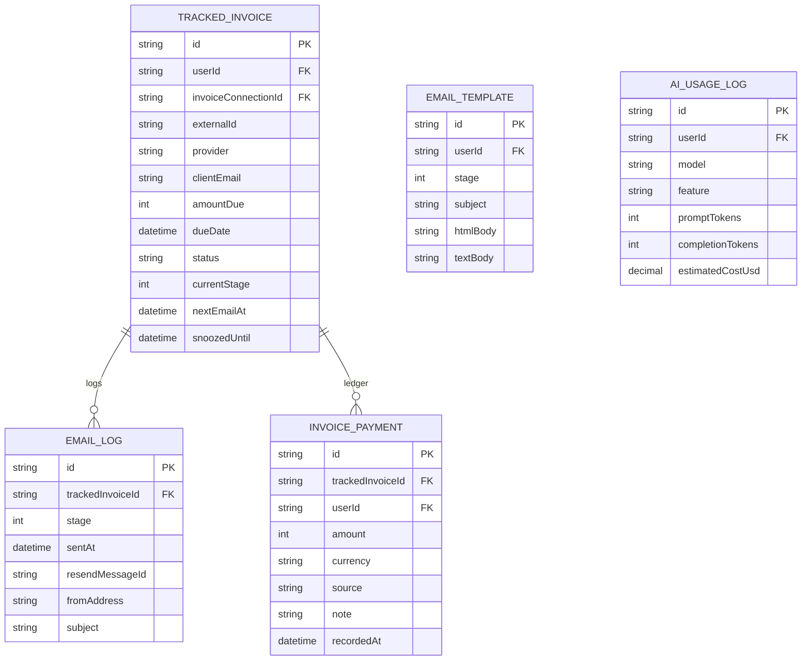
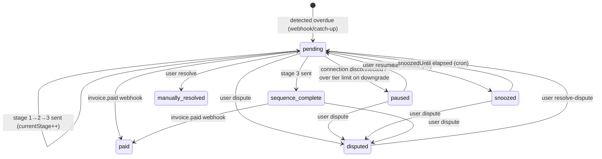

# Detailed Design Document — PaidSoon

> **Repository note.** The generation prompt targeted a `one-core` Django
> monorepo. **This repository is PaidSoon**, a single Next.js 16 (App Router)
> application. There are no Django apps, bounded contexts, vertical products,
> workflow engine, control library, or AI gateway. This document describes
> PaidSoon's actual implementation. Template sections without a code counterpart
> are marked **Not applicable to this repository**.

## 1. Purpose and Scope

This document describes the detailed implementation design of PaidSoon — a SaaS
app that automatically follows up on overdue invoices for freelancers. It is
derived from the current code, the OpenSpec change folders, and the operator
runbooks. It complements the high-level design in [HLD.md](HLD.md).

Scope: authentication and tenancy, the Stripe Connect invoice pipeline, the
three-stage email follow-up engine, subscription billing and entitlements,
data model, API surface, and runtime/infrastructure. Out of scope: anything not
present in the repository (it is documented as absent, not designed).

## 2. Source of Truth and Traceability

| Source | Path | Used for | Notes |
|---|---|---|---|
| Application code | `app/**`, `lib/**`, `proxy.ts` | Primary truth for all behaviour | App Router |
| Prisma schema | `prisma/schema.prisma` | Data model | User + admin models; includes arrangements |
| Initial migration | `prisma/migrations/20260531101711_init/migration.sql` | Tables, indexes, FKs | Single migration |
| RLS policies | `prisma/rls-policies.sql` | Tenant isolation | Applied manually in Supabase |
| Supabase config | `lib/config/supabaseEnvironment.ts`, `prisma.config.ts` | Canonical inputs and lifecycle-derived URLs | transaction `6543` vs session `5432` |
| OpenSpec changes | `openspec/changes/**` | Spec intent + status | Change deltas; baseline capabilities live in `openspec/specs/**` |
| Runbooks | `docs/runbooks/**` | Env vars, deployment | Canonical env matrix |
| Tests | `tests/**` | Pure-logic unit tests | `node --test` + `tsx` |
| Scripts | `scripts/verify-rls.ts` | RLS verification | Proves isolation |
| Config | `package.json`, `next.config.ts`, `vercel.json`, `tsconfig.json` | Runtime/build | — |

## 3. Domain Model Overview

There is one bounded context: the freelancer's invoice-chasing domain. The table
below maps logical areas to code modules (there are no Django apps).

| Logical area | Module(s) | Purpose | Key models/services | OpenSpec |
|---|---|---|---|---|
| Auth & tenancy | `lib/supabase/**`, `lib/db/**`, `proxy.ts` | Identity, session, RLS scoping | `UserProfile`; `withUserContext`, `prismaAdmin` | `changes/invoice-nudge-mvp/specs/user-auth`, `changes/enforce-rls-via-prisma` |
| Invoice connection | `lib/providers/**`, `app/api/stripe/connect/**` | Link Stripe, abstract providers | `InvoiceConnection`; `InvoiceProvider` | `.../specs/invoice-connection` |
| Invoice tracking | `lib/email/catchup.ts`, `app/api/webhooks/stripe-connect/route.ts` | Detect/track overdue invoices | `TrackedInvoice` | `.../specs/invoice-tracking` |
| Follow-up engine | `app/api/cron/send-emails/route.ts`, `lib/email/**` | Stage progression + send | `TrackedInvoice`, `EmailLog`, `Schedule` | `.../specs/follow-up-sequences`, `.../specs/schedule-config` |
| Email identity | `app/api/settings/email/route.ts`, `lib/email/send.ts` | Custom verified sender | `EmailSettings` | `.../specs/email-settings`, `changes/rename-to-paidsoon` |
| Billing & entitlements | `app/api/billing/**`, `app/api/webhooks/stripe-billing/route.ts`, `lib/billing.ts`, `lib/subscriptionPlans.ts` | Plans, checkout, gating | `UserProfile.subscriptionTier`; `PLAN_CATALOG` | `changes/restore-three-tier-pricing`, `.../specs/subscription-plan-tiers` |
| Dashboard & upsell | `app/dashboard/**`, `components/dashboard/**`, `lib/dashboardUpsell.ts` | Views + upgrade prompts | `DashboardUpsellModel` | `changes/sample-overdue-preview-upsell`, `changes/add-dashboard-overview` |
| SpendLeak brain | `lib/spendleak/**`, `lib/dashboard/loadSpendLeakDashboard.ts`, `app/api/spend-insights/[id]/route.ts`, `app/api/spendleak/export/route.ts`, `app/api/settings/spendleak/route.ts`, `prisma/schema.prisma` | Read-only spend ingestion, deterministic detection, grounded summaries, selected-source readiness settings, and analysis-only CSV/XLSX report export | `ImportedBill`, `ImportedBankTransaction`, `SupplierProfile`, `SpendInsight`, `SpendLeakSetting`; `SPENDLEAK_EXPORT_FIELDS`, `loadSpendLeakFindingsForExport`, `generateSpendLeakExportCsv`, `generateSpendLeakExportXlsx` | `changes/build-spendleak-brain`, `changes/export-spendleak-report`, `changes/configure-spendleak-source-selection` |
| Imported-spend classification foundation | `lib/providers/accounting/**`, `lib/spendImport/**`, `app/api/spend-imports/**`, `app/api/spend-classification/**`, `app/dashboard/spendleak/review/**`, `components/dashboard/spendleak/**`, `prisma/schema.prisma`, `prisma/rls-policies.sql` | Tenant-owned analytical category/tag/assignment schema, provider-independent transaction direction, deterministic resolver, authenticated review/correction APIs and UI, category and external-processing settings UI, and guarded TypeSafe worker are implemented; FinOps consumer integrations remain in progress | `SpendClassificationSetting`, `SpendCategory`, `SpendTag`, `SpendClassification`, `SpendClassificationRule`, `SpendClassificationEvent`, `SpendClassificationTag`, `SpendDirection` | `changes/classify-imported-spend-with-jev` |
| Cost Guard foundation | `lib/costGuard/**`, `prisma/schema.prisma`, `prisma/rls-policies.sql` | Shared cost-risk baseline, rule catalog, alerts, and month-end forecast state for the read-only Cost Guard module | `CostGuardSetting`, `CostGuardRule`, `CostGuardBaseline`, `CostGuardAlert`, `CostGuardAlertEvent`, `CostGuardForecast`; `calculateBaseline`, `evaluateMateriality`, `buildDefaultCostGuardRules` | `changes/cost-guard-foundation` |
| RunwayGuard | `lib/runwayGuard/**`, `app/api/runway-guard/**` | Cash resilience summary, runway timeline, scenario simulation, alert transitions, and tenant-scoped settings for the RunwayGuard module | `RunwayGuardSetting`, `RunwayGuardSnapshot`, `RunwayGuardAlert`, `RunwayGuardAlertEvent`, `RunwayGuardScenario`; `buildRunwaySummary`, `simulateRunwayScenario`, `buildRunwayGuardServiceOutput` | `changes/implement-runwayguard-finops-module` |
| Tax Buffer | `lib/taxBuffer/**`, `app/api/tax-buffer/**`, `app/dashboard/tax-buffer/**`, `app/settings/tax-buffer/**` | Tax reserve estimation, safe-to-spend composition, obligation tracking, and reserve override audit trail | `TaxBufferConfiguration`, `TaxReserveCategory`, `TaxBufferObligation`, `TaxBufferSnapshot`, `TaxBufferOverride`, `TaxBufferEvent`; `buildTaxBufferSummary`, `loadTaxBufferSummary`, `saveTaxBufferSettings` | `changes/add-tax-buffer-module` |
| CommitGuard | `lib/commitguard/**`, `app/api/commitguard/**`, `app/dashboard/commitguard/**`, `app/settings/commitguard/**` | Recurring commitment registry, detection/review queue, horizon projection, free-cash guardrails, and renewal/notice alerts | `CommitGuardSetting`, `Commitment`, `CommitmentDetectionCandidate`, `CommitmentEvent`; `summarizeCommitGuard`, `detectCommitmentCandidates`, `buildCommitmentHorizonTotals`, `calculateFreeCashBreakdown` | `changes/add-commitguard-module` |
| Owner's Digest | `lib/ownersDigest/**`, `app/api/owners-digest/**`, `app/dashboard/owners-digest/**`, `app/settings/owners-digest/**`, `app/api/internal/jobs/send-owners-digest/route.ts` | Cross-module executive digest with deterministic ranking, immutable snapshots, history, settings, and scheduled email delivery | `OwnersDigestSetting`, `OwnersDigestSnapshot`, `OwnersDigestItem`, `OwnersDigestMetric`, `OwnersDigestProviderRun`, `OwnersDigestDelivery`; `generateOwnersDigest`, `getCurrentOwnersDigest`, `sendOwnersDigest` | `changes/add-owners-digest-module` |
| DepositGuard | `lib/depositGuard/**`, `app/api/deposit-guard/**`, `app/api/internal/jobs/send-deposit-reminder/route.ts`, `app/dashboard/deposit-guard/**`, `app/settings/deposit-guard/**`, `app/pay/deposit/**` | Deposit-request lifecycle, commencement blocking, milestone/request generation, reminder automation, public payment request page, dashboard workspace/detail/settings surfacing, and service-level cash-plan/digest/runway/notification adapters. MVP uses external-link payment requests plus manual confirmation; Stripe connected-account collection and advanced reconciliation remain planned. | `DepositGuardJob`, `DepositRequest`, `PaymentMilestone`, `DepositPayment`, `DepositReminder`, `DepositGuardSetting`, `DepositGuardEvent`, `DepositPaymentWebhookEvent`; `listDepositGuardJobs`, `listDepositRequests`, `sendDepositRequest`, `processDepositReminder`, `getDepositGuardJobDetail`, `getDepositGuardSettings`, `buildDepositGuardCashPlanLineItems`, `loadDepositGuardOwnerDigestProvider`, `buildDepositGuardRunwayImpact`, `buildDepositGuardNotificationPlan` | `changes/implement-depositguard` |
| Spreadsheet invoice import | `app/api/invoice-imports/**`, `app/api/cron/invoice-import-cleanup/route.ts`, `lib/invoiceImport/**`, `app/settings/import-export/**`, `app/settings/import/**`, `components/settings/InvoiceImportClient.tsx` | CSV/XLSX invoice import: template, upload, mapping, validation, idempotent commit, retention cleanup | `InvoiceImportBatch`, `InvoiceImportColumnMapping`, `InvoiceImportStagingRow`, `InvoiceImportError`, `InvoiceImportMappingProfile` | `changes/csv-only-invoice-import`, `changes/combine-settings-import-export`, `changes/canonical-financial-data-model` |
| Settings import/export shell | `app/settings/layout.tsx`, `app/settings/import-export/**`, `app/settings/import/**`, `app/settings/export/**`, `components/settings/ExpenseImportClient.tsx` | Combined Settings page for invoice import, expense import, and invoice export, with legacy route aliases | Reuses existing import/export models and SpendLeak import workflow | `changes/combine-settings-import-export` |
| Invoice export | `app/api/invoices/export/route.ts`, `lib/invoices/exportFields.ts`, `lib/invoices/exportQuery.ts`, `lib/invoices/export.ts`, `app/settings/import-export/**`, `app/settings/export/**`, `components/dashboard/InvoiceExportButton.tsx`, `components/settings/InvoiceExportClient.tsx` | Filtered CSV/XLSX export of a tenant's invoices, gated by the `csv_export` feature | `EXPORT_FIELDS` data dictionary; `loadInvoicesForExport`, `generateExportCsv`, `generateExportXlsx` | `changes/add-invoice-export`, `changes/combine-settings-import-export` |
| MarginGuard export | `app/api/margin-guard/export/route.ts`, `lib/marginguard/export.ts`, `app/settings/import-export/**`, `components/settings/MarginGuardExportClient.tsx` | Dataset-based CSV/XLSX export for MarginGuard summary, customer profitability, alert inbox, and opportunities, gated by `csv_export` + `marginguard_core` | `loadMarginGuardExport`, `generateMarginGuardExportCsv`, `generateMarginGuardExportXlsx` | `changes/implement-marginguard-finops-module` |
| Live-mode gating | `lib/liveMode.ts`, `proxy.ts`, `app/layout.tsx` | Pre-launch lockout | — | `changes/live-mode-auth-gate-banner` |

## 4. Backend Application Design

There are no Django apps. The backend is route handlers + `lib` services. Each
subsection documents a functional module.

### 4.1 Auth & tenancy (`lib/db/**`, `lib/supabase/**`, `proxy.ts`)

- **Responsibility:** authenticate users, refresh sessions, enforce per-user DB
  isolation.
- **Key services:**
  - `createClient()` (`lib/supabase/server.ts`) — cookie-bound Supabase client
    for RSC/route handlers; `lib/supabase/client.ts` for the browser.
  - `withUserContext(userId, fn)` (`lib/db/withUserContext.ts`) — opens a Prisma
    `$transaction`, runs `SELECT set_config('request.jwt.claims', …, true)` and
    `SET LOCAL ROLE authenticated`, then runs `fn(tx)` so RLS applies.
  - `prismaAdmin` (`lib/db/admin.ts`) — singleton `PrismaClient` over
    `@prisma/adapter-pg` using the derived transaction-pooler URL; **bypasses RLS**; service paths
    only.
- **Permissions:** route handlers reject with 401 when `auth.getUser()` returns
  no user. `proxy.ts` redirects unauthenticated `/dashboard/*` to
  `/sign-in` and authenticated users away from auth pages.
- **Integration points:** Supabase Auth; Supabase Postgres.
- **Tests:** `scripts/verify-rls.ts` proves cross-user isolation (seed via
  `prismaAdmin`, read via `withUserContext`).

### 4.2 Invoice connection (`lib/providers/**`, `app/api/stripe/connect/**`)

- **Responsibility:** connect a user's Stripe account and normalise invoice data.
- **Key abstractions:** `InvoiceProvider` interface (`lib/providers/types.ts`)
  with methods `getOverdueInvoices`, `getInvoiceDetails`,
  `verifyWebhookSignature`, `parseWebhookEvent`. `getProvider(name)`
  (`lib/providers/index.ts`) resolves the registry (`stripe` only).
- **Stripe implementation:** `StripeInvoiceProvider` (`lib/providers/stripe.ts`)
  lists `status: "open"` invoices for a connected account and filters past-due;
  normalises to `NormalizedInvoice`.
- **Routes:**
  - `GET authorize` — checks connection-limit, redirects to Stripe OAuth with
    `state = user.id`.
  - `GET callback` — verifies `state == user.id`, exchanges code, enforces
    per-tier connection limit inside `withUserContext`, upserts
    `InvoiceConnection`.
  - `POST disconnect` — deactivates a connection and pauses its
    pending/snoozed invoices.
- **Integration points:** Stripe OAuth + Invoices API (per connected account via
  `{ stripeAccount }`).

### 4.3 Invoice tracking (`app/api/webhooks/stripe-connect/route.ts`, `lib/email/catchup.ts`)

- **Responsibility:** create `TrackedInvoice` rows for overdue invoices, mark
  paid.
- **Two ingestion paths:**
  1. **Webhook** (`stripe-connect`): verifies signature, handles
     `invoice.overdue` (create tracked invoice, idempotent — always created,
     never gated by allowance) and `invoice.paid` (mark paid).
  2. **Catch-up scan** (`runCatchUpScan`): cron-time poll across all active
     Stripe connections, creating missing tracked invoices.
- **Idempotency:** canonical unique key `(userId, sourceSystem, sourceId)` on
  `financial_invoices` + upsert-based ingestion paths (`lib/financial/ingest.ts`).
- **Chase-volume allowance is not enforced at ingest.** Every synced invoice
  (Stripe Connect, catch-up scan, and accounting sync — `lib/providers/accounting/sync.ts`)
  is created and stays visible on the dashboard regardless of the account's
  plan or remaining allowance. The allowance only governs whether follow-up
  *begins* for a given invoice — enforced once, in the cron (§4.4) — not
  whether the invoice is recorded. See the `chase-volume-entitlement` capability
  (`openspec/changes/monthly-chase-volume-limits`).

### 4.4 Follow-up engine (`worker/paidsoon_worker/**`, `lib/email/**`)

- **Responsibility:** advance each tracked invoice through stages 1→3 and send.
- **Scheduled flow:** Celery Beat dispatches due reminder claims to Railway workers; the
  worker invokes the internal Next.js job route for each invoice. The retained
  `GET /api/cron/send-emails` route is `CRON_SECRET`-protected and is not scheduled
  after cutover. Its fallback flow is auth via `Bearer CRON_SECRET` → `runCatchupAndSnoozeSweep()` →
  resume snoozed invoices whose `snoozedUntil` elapsed → **detect broken promises**
  (active promises whose `promisedPayBy` has passed; mark `broken`, notify freelancer) →
  **detect expired/broken arrangements** (active arrangements whose payment/expiry date has elapsed) →
  **exclude invoices with active promises or active arrangements** from the email queue → select `pending`
  invoices with `nextEmailAt <= now` and `currentStage < 3` → compute each
  distinct account's chase-volume allowance status once for the pass
  (`getChaseAllowanceStatusesForUsers`, `lib/billing.ts`) → for each invoice,
  resolve freelancer email/name via Supabase admin; if `currentStage === 0`
  (first chase) and the account has no remaining allowance, **hold** the
  invoice (skip it, leave its state untouched, retried on a later pass) —
  otherwise `sendFollowUpEmail`, set `firstChasedAt` on a first chase, and
  advance `currentStage`/`nextEmailAt` or mark `sequence_complete` after stage
  3. A single pass decrements the in-memory allowance figure after each first
  send so it can never exceed the allowance; the response includes `held`
  (invoices skipped this pass) and `usageByAccount` (per-account
  allowance/usage/remaining/atCapacity) so the held condition is observable.
  Stage 2/3 sends for a sequence already under way are never gated.
- **Chase-volume allowance model** (`chase-volume-entitlement` capability,
  `lib/billing.ts`): one unit of allowance is consumed once per invoice, at
  its first reminder send (not derivable from `EmailLog.stage`, since tone
  escalation can promote a first send from stage 1 to stage 2 — see §4.6).
  Consumption is recorded via `TrackedInvoice.firstChasedAt` (set once, never
  cleared). Usage is measured over `resolveAllowancePeriod()`'s resolved
  window: the account's billing period
  (`UserProfile.subscriptionCurrentPeriodStart/End`) → the trial window
  (account creation → `trialEndsAt`) → the current calendar month in
  Australia/Melbourne, in that order. No overage charging exists; reaching
  the allowance pauses new first chases until the period resets.
- **Services:**
  - `sendFollowUpEmail` (`lib/email/send.ts`) — resolves from-address, renders
    template (including `{{promiseToPayLink}}`, available on every paid tier), sends via Resend,
    writes an `EmailLog`. Generates and persists `p2pToken` on first send.
  - `sendP2PNotification` (`lib/email/send.ts`) — sends freelancer notifications for
    promise received and promise broken events. Goes to the freelancer (not the client).
  - `generateP2PToken` (`lib/email/send.ts`) — 32-byte cryptographically random hex token.
  - `resolveFromAddress` — sender-identity ladder: system address (Essentials) →
    custom reply-to + custom sender name (`custom_reply_to` + `custom_sender_name`, Business Control+) →
    verified custom from-domain (`verified_from_domain`, Small Business+, requires
    Resend verification).
  - `computeNextEmailAt` (`lib/email/schedule.ts`) — `dueDate + dayOffset`.
  - `renderTemplate` (`lib/email/templates.ts`) — stage 1/2/3 HTML+text.
- **Background tasks:** exactly one — this cron route. No queue/worker.

### 4.5 Email identity (`app/api/settings/email/route.ts`)

- **GET:** returns settings; if a custom `fromEmail` is set but unverified,
  polls `resend.domains.list()` and flips `resendVerified` when the sending
  domain reports `verified`.
- **PUT:** gated by `custom_reply_to` (available on Business Control+); a Resend
  domain-verification call is only triggered for tiers with `verified_from_domain`.

### 4.6 Billing & entitlements (`app/api/billing/**`, `app/api/webhooks/stripe-billing/route.ts`, `lib/billing.ts`, `lib/subscriptionPlans.ts`)

- **Plan catalog:** `PLAN_CATALOG` defines `essentials`/`business_control`/`small_business`/
  `business_pro` (public, customer-selectable) and `accountant_partner` (contact-only,
  hidden from plan listings via `visibility: "contact_only"`) with `limits` (chased invoices, seats,
  connected invoice sources; `-1` = unlimited) and a `features` map.
  `normalizeSubscriptionTier` falls back to `essentials` for unknown values and
  keeps compatibility aliases (`starter` → `essentials`, `solo` → `business_control`).
- **Entitlement checks:** `requireFeature(userId, feature)` reads the tier via
  `withUserContext` and consults `hasPlanFeature`. Limit helpers:
  `getInvoiceLimitForTier`, `getInvoiceSourceLimitForTier` (Stripe Connect +
  accounting connections combined, via `countActiveInvoiceSources`),
  `getUserSeatLimitForTier`. `getPublicPlans()` returns only customer-facing tiers,
  used by the pricing page, onboarding plan picker, and
  `getNextTierRecommendation` (never recommends the hidden contact-only tier).
- **Chase-volume allowance helpers** (`lib/billing.ts`, `chase-volume-entitlement`
  capability): `resolveAllowancePeriod(account, now)` resolves the current
  billing/trial/calendar-month window; `getChaseAllowanceStatus(tx, userId)`
  and the batched `getChaseAllowanceStatusesForUsers(tx, userIds)` return
  `{ period, allowance, usage, remaining, atCapacity, nearLimit }` for one or
  many accounts, accepting either a `withUserContext` tx or `prismaAdmin`.
  `usage` counts `TrackedInvoice` rows whose `firstChasedAt` falls inside the
  resolved period — **not** `EmailLog.stage`, because
  `applyToneEscalationStage` (`lib/promiseEscalationPolicy.ts`) can promote a
  debtor's first reminder from stage 1 to stage 2, so an invoice's first
  `EmailLog` row is not reliably `stage: 1`. `nearLimit` reuses
  `isNearLimit`/`DEFAULT_NEAR_LIMIT_THRESHOLD` (0.8) from
  `lib/dashboardUpsell.ts` as the single 80% threshold definition.
- **Checkout:** `POST checkout` maps requested tier → price id env var, creates
  (or reuses) a Stripe customer, returns a Checkout session URL.
- **Portal:** `POST portal` returns a Stripe billing-portal URL.
- **Webhook (`stripe-billing`):** signature-verified; handles
  `checkout.session.completed` (set tier/active, persist
  `subscriptionCurrentPeriodStart`/`End` from the Stripe invoice
  `period_start`/`period_end`), `customer.subscription.updated` (resolve tier
  from price id, persist the refreshed period start/end), `customer.subscription.deleted`
  (revert to `essentials`, pause invoices over the essentials limit — this is a
  separate, pre-existing concurrent-count safeguard on downgrade, distinct
  from the chase-volume allowance), and `invoice.payment_failed` (looks up the
  `UserProfile` by Stripe customer id and sets `subscriptionStatus = "past_due"`
  without changing `subscriptionTier` — see `changes/handle-stripe-payment-failed`).

### 4.7 Dashboard actions (`app/api/invoices/[id]/**`)

- `pause`, `resume`, `snooze` (7-day), `resolve` (`manually_resolved`), `dispute`
  (`disputed`), `resolve-dispute` (back to `pending`). All run inside
  `withUserContext` and re-check ownership via `findFirst` with
  `userId: user.id`, returning 404 when not found/ineligible.
- `dispute` accepts an optional Zod-validated `note` stored in `disputeNote`
  and sets `disputeRaisedAt`; excludes invoices already `paid`, `disputed`, or
  `manually_resolved`. `resolve-dispute` requires current status `disputed`,
  sets `disputeResolvedAt`, and replaces `disputeNote` with an optional
  resolution note (or clears it if none given). No cron changes were needed —
  the cron's `where: { status: "pending" }` allowlist already excludes
  `disputed`.

### 4.8 SpendLeak brain (`lib/spendleak/**`, `lib/dashboard/loadSpendLeakDashboard.ts`)

- **Responsibility:** ingest normalized spend records, detect deterministic
  insight families, and generate owner-facing summaries without inventing
  unsupported claims.
- **Core logic:** `normalizeSpendSyncInput()` deduplicates repeated provider rows;
  `detectSpendFindings()` creates recurring-spend, duplicate-spend, renewal,
  supplier-concentration, and cash-pressure findings from persisted spend data;
  `buildGroundedSummary()` turns the accepted findings into a safe narrative that
  falls back to an initial-sync or no-findings message when the evidence set is
  empty or stale.
- **Persistence model:** `ImportedBill`, `ImportedBankTransaction`, and
  `SupplierProfile` retain provider provenance and timestamps; `SpendInsight`
  stores the subject key, finding type, evidence payload, estimated impact, and
  lifecycle state so the same issue updates in place rather than creating a duplicate row.
- **Import flow and source boundary:** Xero/MYOB spend sync normalizes provider rows in
  `lib/providers/accounting/{xero,myob}.ts` and upserts them in
  `lib/providers/accounting/sync.ts`; CSV/XLSX rows pass through staging and validated
  commit in `app/api/spend-imports/**`, then become imported bills or bank transactions.
  Provider source records are not the PaidSoon classification store: user review and
  classification data belong in the separate `SpendClassification` family, and no
  classification is written back to Xero or MYOB. Provider sync writes source records
  through `prismaAdmin`; the authenticated CSV commit can write only rows linked to the
  tenant's dedicated `csv_import` / `spend-import` connection under the RLS policies.
- **Transaction semantics:** `ImportedBankTransaction.direction` uses `SpendDirection`
  (`outflow`, `inflow`, `unknown`) independently of `amountCents`. Xero `SPEND` is
  `outflow` even when Xero supplies a positive amount; MYOB direction follows its
  `SpendMoneyTxn` or `ReceiveMoneyTxn` family. CSV transaction rows with a negative
  signed amount are outflows; a positive amount alone does not prove a refund/inflow
  and remains `unknown`. The CSV commit retains its established negative outflow amount
  convention, while the submitted values remain in `rawSourceData`.
- **Account semantics:** `accountName` / `accountCode` on imported bank transactions
  describe the cash/bank account. `expenseAccountName` / `expenseAccountCode` are
  separate fields populated only from explicit expense coding (for example Xero bank
  transaction line items when exactly one account code is present, or CSV expense
  account columns). MYOB bill category coding remains on the bill's expense-account
  fields. A cash account is never substituted for expense coding.
- **Classification data boundary and status:** the additive schema provides one
  tenant-scoped `SpendClassification` per imported bill or bank transaction, optional
  `SpendClassificationTag` links, tenant-owned `SpendCategory` and `SpendTag` records,
  a default-disabled `SpendClassificationSetting`, tenant rules, and append-only
  `SpendClassificationEvent` history. `SpendClassification.refundForClassificationId`
  is an optional same-tenant self-reference for a user-confirmed refund link; the
  service validates source direction, currency, confirmed category, and cumulative
  credit amount. Composite tenant/source/category foreign keys,
  the exactly-one-source constraint, RLS, and explicit grants protect tenant data.
  `SpendClassificationClaim` stores service-only per-assignment claim tokens,
  fingerprints, and expiries; `SpendClassificationWorkerLease` is the service-only
  singleton that fences overlapping worker runs. Both tables have RLS enabled and no
  `anon` or `authenticated` privileges. Provider sync and CSV/XLSX finalization now
  hand off persisted records to deterministic classification and queue opted-in
  unresolved outflows. `runSpendClassificationBatch()` claims at most 25 records with
  concurrency capped at three, makes Jev requests outside database transactions, and
  fences completion against changed fingerprints and manual decisions. Network,
  timeout, 429, and 529 failures use three total attempts with durable 2s/8s backoff
  and a longer provider `Retry-After` when supplied; permanent or exhausted failures
  move to review with only a safe error code persisted. The `CRON_SECRET`-guarded
  cron route is scheduled daily at 06:00 UTC. Review APIs/UI support authenticated
  corrections, explicit future-only rules, manual transfer exclusions, and explicit
  refund links. Same-source refunds reduce that category/source subtotal; cross-source
  refunds remain separate credits and never net bills against bank transactions.
- **UI integration:** `loadSpendLeakDashboard()` reads findings and the latest
  spend sync timestamp and groups them into dashboard modules while surfacing
  stale or initial-sync states without fabricating opportunities. It also
  summarizes confirmed category assignments from imported bills and bank
  transactions, keeping source types and currencies separate and retaining
  imported record IDs for traceability. Same-source linked refund IDs are included
  in net category traceability; cross-source credits are displayed separately with
  both sides' source IDs. Unclassified and unconfirmed outflows,
  unknown-direction transactions, and excluded/voided/draft records are reported
  in separate buckets; inflows are not counted as spend. This additive summary
  includes imported records regardless of finding-source selection and preserves
  historical category IDs after a merge. In `empty`
  states where selected sources are synced and findings are zero, the dashboard
  also shows selected-source evidence coverage (sync status, latest sync time,
  and record counts) to distinguish "data present" from "no alert-grade
  findings".
- **Cost Guard category analysis:** `GET /api/cost-guard/categories` groups only
  confirmed PaidSoon category assignments from imported bills and normalized
  bank outflows. It keeps source types/currencies separate, returns unclassified
  and unconfirmed/excluded totals independently, and omits inflows and unknown
  direction from confirmed spend. Same-source linked refunds reduce their original
  category subtotal; cross-source refund credits are returned separately, and
  provider expense-account names are not used as the shared category taxonomy.
- **MarginGuard category context:** its summary returns confirmed PaidSoon
  spending-category totals beside the independent MarginGuard cost class for
  eligible imported outflows. `DIRECT_COST`, `VARIABLE_COST`, `OVERHEAD`, and
  their existing margin calculations remain unchanged; category labels provide
  context only.
- **Settings contract:** `GET/PUT /api/settings/spendleak` persists tenant
  source-selection expectations (`bills`, `bank_transactions`, `suppliers`) in
  `SpendLeakSetting`; dashboard readiness treats this as expected coverage and
  does not disable underlying ingestion pipelines.
- **Report export:** `GET /api/spendleak/export` returns tenant-scoped SpendLeak
  analysis rows as CSV/XLSX for the current dashboard filter scope (`?module=`),
  gated by the existing `csv_export` entitlement. Export rows intentionally stay
  analysis-only (`finding_type`, impact estimates, review outcomes, owner notes,
  confidence, source reference) and do not provide accounting import formats.
- **Tests:** targeted unit checks cover normalization, detector coverage, and
  grounded summary fallback behavior.

### 4.9 Settings (templates / AI / team)

- `settings/templates` — GET returns the saved or default template for a stage
  (gated by `basic_templates`); PUT is gated by `custom_reminder_templates` and
  persists to the `email_templates` table via `withUserContext`; DELETE resets a
  stage to the system default.
- `settings/ai` — GET reports `canRewrite`; POST accepts `{ text, stage }`,
  calls GPT-4o-mini via the Vercel AI SDK (`lib/email/ai-rewrite.ts`), and
  returns three tone variants (`friendly`, `firm`, `final_notice`). Token usage
  and estimated cost are written to `ai_usage_logs` via `prismaAdmin`
  (documented RLS bypass: token counts are only available after the call).
  **There is no standalone AI settings page** — AI controls are embedded in the
  Templates settings page (`app/settings/templates`).
- `settings/team/invite` — GET reports seats; POST validates email and seat
  limit but **does not persist** (no membership model).

### 4.10 Tax Buffer (`lib/taxBuffer/**`, `app/api/tax-buffer/**`)

- **Responsibility:** estimate required tax reserves, report safe-to-spend
  cash, and maintain an auditable trail of reserve configuration and override
  decisions.
- **Core service flow:** `loadTaxBufferSummary()` ensures default configuration,
  gathers canonical financial inputs (financial invoices, imported bills, cash
  forecast, near-term cash-plan outflows), runs deterministic category
  calculations via `buildTaxBufferSummary()`, stores a point-in-time
  `TaxBufferSnapshot`, and emits deduplicated `TaxBufferEvent` records for
  under-reserved/recovered, due-soon, and material reserve-delta conditions.
- **Settings flow:** `getTaxBufferSettings()` returns configuration, categories,
  and first-time suggested defaults when reliable source data exists. The
  settings UI can apply these suggestions and then persist category-level
  methods, recurrence, and configured inputs through `saveTaxBufferSettings()`.
- **API surface:** summary, obligations, settings, and overrides routes are
  session-authenticated, plan-gated via `requireFeature("tax_buffer_basic")`,
  and return safe JSON shapes.
- **Tenant controls:** all user-facing reads and writes run through
  `withUserContext`; all six Tax Buffer tables are covered by tenant-scoped RLS
  policies in `prisma/rls-policies.sql`.

### 4.11 CommitGuard (`lib/commitguard/**`, `app/api/commitguard/**`)

**Cash-protection remediation: UNMERGED / NOT DEPLOYED — local storage,
cash-context API/form, coverage, version-2 summary, evaluation/history and
section-7 workspace/settings/digest paths.** The contracts below describe local
source and regression fixtures, not merged/deployed behavior. The task ledger
is unchanged by task 8.5; checkboxes are not deployment evidence.
The bounded section-8 CashPlan paths exist locally; section 9 acceptance/rollout
remains pending. The [D9 boundary](#4113-bounded-cashplan-consumption--local--unmerged--not-deployed)
supersedes earlier section-8-pending notes without certifying rollout.
Earlier task-specific notes describe their original bounded scope; the
[current consumer/control contract](#4112-current-consumers-controls-and-digest-boundary--unmerged--not-deployed)
supersedes stale future-work statements about section-7 code.
Tasks 1.1–1.5 of `fix-commitguard-cash-protection-workflows` add schema,
reviewed supplemental CHECKs, targeted ACL/RLS, and a pure legacy report. They do
not establish end-to-end cash entry, atomic conversion, scheduled evaluation,
digest delivery, or CashPlan forecast consumption. The existing flows below are
not acceptance evidence for those replacement workflows. See the
[storage additions](#631-commitguard-cash-protection-storage),
[ordered migration review](runbooks/commitguard.md#5-cash-protection-storage--unmerged--not-deployed),
and [isolated verification evidence](release-notes/commitguard-storage-verification-2026-10-19.md).

- **Task 2.2 API (unmerged/not deployed):**
  [cash-context route](../app/api/commitguard/cash-context/route.ts) adds GET/PUT
  with authenticated subscription access and `commitguard_core`, independently
  of Tax Buffer. GET only selects saved safe fields; missing rows have revision
  zero and null financial inputs, without default writes. PUT accepts strict
  `expectedRevision` plus optional all-or-none cash/expense groups and independent
  tax currency. Dates are UTC calendar dates, amounts integer cents, and the
  eight supported currencies are lowercase; future dates are rejected.
  [The mutation service](../lib/commitguard/cashContextMutation.ts) serializes
  tenant writes with `pg_advisory_xact_lock(hashtext('commitguard:' || userId))`
  before cash row locks, then checks revision (including first creation).
  A material change increments cash revision and settings `calculationRevision`,
  inserts pending evaluation work, and records `COMMITGUARD_CASH_CONTEXT_UPDATED`
  in one `withUserContext` transaction. Audit metadata contains only
  `changedFields`, never old/new values or amounts. Identical saves check revision
  but do not write, increment or enqueue. Clearing one group retains the other
  group's currency/date and the tax attestation. Initial uniqueness races and
  conditional-update conflicts return 409. DTOs omit identities/internal fields;
  errors/logs omit financial values. See the
  [endpoint runbook contract](runbooks/commitguard.md#54-cash-context-endpoint--unmerged--not-deployed).
  This is not UI, worker, provider-sync, summary-consumer or deployment evidence.

- **Task 2.5 form (unmerged/not deployed):** the existing authenticated,
  core-entitled `/dashboard/commitguard#cash-inputs` surface now mounts a
  [cash-input panel](../components/dashboard/commitguard/CommitGuardCashContextPanel.tsx)
  using the unchanged GET/PUT contract. It provides labeled cash, weekly-expense
  and tax-currency groups, explicit owner-entered/not bank-verified wording,
  source dates, missing/stale edit actions, exact decimal-to-Int-cents conversion,
  and draft-only clear controls. 409 and unconfirmed saves preserve drafts and
  block resaving until explicit reload/revision review. Confirmed saves adopt
  their DTO, reload cash inputs and request a router refresh; failed reads offer
  a GET-only retry without replaying PUT. A concurrently newer DTO requires
  review. This does not wire shared summaries or complete task 7.2's coherent
  workspace refresh; `router.refresh()` completion is not observable here.
  No settings policy, fixed-buffer review, provider balances, tax coverage or
  mail delivery is added. See the
  [form/API operations contract and bounded verification](runbooks/commitguard.md#55-owner-input-form-contract--unmerged--not-deployed)
  and [user instructions](user/commitguard.md#owner-entered-cash-inputs--unmerged--not-deployed).

- **Responsibility:** track upcoming commitments, project near-term cash impact,
  and surface renewal / notice actions before commitments become cash stress.
- **Task 3.6 coverage (unmerged/not deployed):**
  [coverage CRUD](../app/api/commitguard/coverage/route.ts) exposes authenticated,
  subscription/core-gated GET/POST/PUT/DELETE over
  [tenant-locked services](../lib/commitguard/coverageService.ts). Material changes,
  settings calculation revision, pending evaluation and before/after audit commit
  atomically under the existing cash/settings tenant lock. Ownership, exact live
  UTC projected date, currency, aggregate occurrence and explicit unpaid-bill caps
  are checked before writing. No schema, ACL or plan change is added.
  [Pure reconciliation](../lib/commitguard/coverage.ts) retains the full commitment
  total and adds each enabled category's `max(0, R - aggregate C)`. Thus R=12000
  with C=10000 protects 12000; C=12000/15000 protects 12000/15000 respectively.
  Bill/tax portions are disjoint; missing, paid, disabled, settled or stale targets
  cannot reduce protection and require review. Existing explicit bill/category
  attribution is required for bill-covered tax portions; nothing is guessed from
  supplier names or amounts. Task 3.7 now composes this read-only integration
  point into summary v2; coverage editor controls and CashPlan consumption remain
  separate work. See the
  [bounded contract and evidence](runbooks/commitguard.md#56-coverage-crud-and-reconciliation--unmerged--not-deployed).
- **Local version-2 service flow (unmerged/not deployed):**
  `summarizeCommitGuard()` reads settings, saved owner cash, commitments,
  read-only tax category facts and coverage in one `withUserContext`
  RepeatableRead transaction using one evaluation clock. It does not call the
  writing `loadTaxBufferSummary()` orchestration. Missing settings are disabled
  in memory, not created by a read. See the calculation contract below.
- **Detection flow:** `detectCommitmentCandidates()` groups canonical spend
  signals by supplier/currency, applies deterministic recurrence + amount
  variance thresholds, and writes `CommitmentDetectionCandidate` rows with
  explainability and rejection-memory fingerprints.
- **Lifecycle and events:** create/update/pause/resume/cancel/confirm flows are
  audit-backed via `CommitmentEvent` and deduped event keys for
  `COMMITMENT_DUE_SOON`, `COMMITMENT_AMOUNT_CHANGED`,
  `COMMITMENT_RENEWAL_APPROACHING`, `COMMITMENT_NOTICE_PERIOD_APPROACHING`,
  `COMMITMENT_DETECTED`, `COMMITMENT_SHORTFALL`, and
  `COMMITMENT_BUFFER_LOW`.
- **Cross-module integration:** SpendLeak findings surface linked active
  commitment counts; Cost Guard alerts deep-link to CommitGuard filtered by
  `costGuardAlertId`; `GET /api/commitguard/cashplan` exposes an occurrence
  adapter, not proof that CashPlan's forecast consumes it.

Task 4.3's **UNMERGED / NOT DEPLOYED** lifecycle implementation now shares
tenant advisory and commitment row locks across PATCH/actions, applies the
owner-approved matrix, and atomically records changed-field before/after audit.
PATCH cannot change lifecycle status. Cancelled/expired records retain other
edits; archived records are read-only and no archive action exists. Repeated
pause/cancel/eligible confirm or identical PATCH does not write or audit; resume
is only paused → active. Confirm preserves status. See the
[exact matrix and conflict contract](runbooks/commitguard.md#tasks-4344-lifecycle-contract--unmerged--not-deployed)
and [verification evidence](release-notes/commitguard-lifecycle-verification-2026-10-19.md).
Task 4.4 subsequently added revision increments and durable evaluation requests
in the same mutation transaction; pending work alone proves no execution/delivery.

#### 4.11.1 Cash-protection calculation contract — UNMERGED / NOT DEPLOYED

Tasks 6.2–6.6 provide the local internal job admission/dispatch and evaluation
pipeline, **UNMERGED / NOT DEPLOYED, scheduler gate OFF**. `POST /api/internal/jobs/commitguard`
requires a configured `INTERNAL_JOBS_SECRET` bearer credential and a strict
identity-only body `{userId, workItemId, kind: "detect" | "evaluate"}`. Unknown
keys (including tier/permissions/lease/fence/source overrides) fail with 400;
missing/invalid/unconfigured credentials fail with 401 before database access.
Tenant/item/kind mismatches return the same safe skipped result. The documented
system exception reads/claims persisted work and successful-source metadata only;
financial reads and writes execute under tenant RLS in the task 6.1 transaction.
Current central effective access is checked before claim and again inside the
side-effect boundary before reads and before commit. Candidate/event/state writes
and completion share the revision/owner/lease/fence assertion, not independent
transactions. Detection uses current settings rather than ingestion revision zero.

The route returns only `{status}` or `{status, reason}`: no tenant/work IDs,
amounts, suppliers, recipients, source evidence or lease metadata. Detection can
complete real persisted accounting-run/import-batch work. Evaluation now runs
operational due/renewal and risk/material-amount evaluators with the canonical v2
saved-input summary under the same fence. Successful default dispatch returns
200 completed, not the historical 202 pending-pipeline response. Event relevance,
staged evaluation state and completion commit together after final checks; only
committed daily work records successful daily evaluation. Unavailable financial
inputs complete without an invented risk alert. The trusted optional composition
point runs after the default pipeline in that same transaction; it is not
request-injectable. No scheduler, new secret, standalone email or deployment is
enabled here. See [task 6.6 evidence](release-notes/commitguard-risk-evaluation-verification-2026-10-19.md).

**Task 6.3 — local / UNMERGED / NOT DEPLOYED:** the existing Railway Beat owner
has a code-disabled five-minute CommitGuard extension. The internal
`POST /api/internal/jobs/commitguard/dispatch` uses the same secret, strict optional
daily keyset cursor, and three independently bounded 100-item scans: enabled
tenants (current `getFinancialJobAccessSkip`), expired leases, and due pending
work. One `daily:<UTC date>` evaluation identity per eligible tenant survives
enqueue failure and repeated scans. Task 6.4 adds the independent daily source
repair pass described below. Financial execution remains in the existing tenant-RLS fence boundary;
Python receives only tenant/item/kind identities, never entitlement or finance.

The existing work fields carry six-attempt exponential retry (60/120/240/480/
960/1920 seconds), 60-second private fence renewal, expired-lease recovery,
safe failure reason and terminal exhaustion. Outdated evaluation revisions are
skipped; distinct ingestion sources execute under current settings. Lost enqueue
does not change pending state. The lifecycle helper retains generic dependency
deferral support, but default evaluation no longer uses it. Daily success is
staged only after the complete evaluator pipeline commits under its final fence.

`POST /api/admin/tenants/[id]/commitguard/retry` requires existing elevated
platform-admin/owner authorization and strict `{workItemId, expectedGeneration}`.
The system-only metadata exception rechecks role/session expiry/revocation inside
the conditional update, appends prior generation/attempt/reason and trusted
actor/session history, and resets only a failed matching generation. Source,
dedupe identity, calculation revision and monotonically increasing fence remain
unchanged. Safe responses contain only status. No tenant lifecycle UPDATE grants
are added; the targeted and canonical pending INSERT policies reserve the daily
identity namespace for the executor. No schema migration is needed for 6.3;
existing task-1 schema and reviewed ACL application remain deployment prerequisites.
See the [task 6.3 operations contract](runbooks/commitguard.md#task-63-queue-and-recovery--unmerged--not-deployed).

**Task 6.4 — local / UNMERGED / NOT DEPLOYED:** the same dispatch endpoint accepts
strict optional `repairState` (database UTC date, independent accounting/import
ID cursors and completion flags). Each five-minute tick advances at most 100
missing sources per stream until the daily pass completes; individual failures
advance rather than blocking subsequent sources. The next UTC day restarts the
pass, revisiting failed or late-completed sources. Restart safely replays hints.
The documented system exception discovers source identity/completion metadata
only, checking canonical tenant/kind/dedupe identity regardless of work state or
generation. Tenant-RLS transactions then reuse the original task-5.4 helper to
revalidate ownership and exact successful-completion predicates and insert only
minimal request fields with database-owned pending defaults/conflict no-op.
Failed/partial sources create no jobs; existing exhausted generations never reset.
Repair runs before pending discovery, without executing detection or evaluation.
The Railway release gate remains OFF; no schema/ACL/activation is changed.
See [repair operations and verification](runbooks/commitguard.md#task-64-source-completion-repair--unmerged--not-deployed).

Task 6.8's [operator procedures](runbooks/commitguard.md#task-68-operator-procedures--unmerged--not-deployed)
cover existing-secret authentication, exactly one scheduler owner, privacy-safe
backlog counts/ages/attempts/codes, and the precise repair/retry actions. Local
task 6.7 history is read-only, tenant scoped and paginated, with active versus
historical relevance and unavailable-evaluation context; it is not an email
receipt. Relevant-event integration with the existing Owner's Digest is now
present locally (task 7.7 checkbox unchanged); see §4.11.2. Shared SQL application and gate activation require separate
authorization under the ordered storage review; no deployment is asserted.

This task 3.8 reference documents the local D3 recurrence engine and task 3.7
summary, not completion of the broader dashboard, job, digest or forecast work.
Sources: [engine](../lib/commitguard/engine.ts),
[summary](../lib/commitguard/summary.ts),
[protection composition](../lib/commitguard/protectionComposition.ts),
[tax facts](../lib/commitguard/protectionFacts.ts) and
[coverage reconciliation](../lib/commitguard/coverage.ts).

- **Recurrence:** normalize to UTC calendar dates and project half-open windows
  `[today, today + days)` for 7/30/60/90 days. At 2026-10-19, seven days include
  October 19–25, not October 26. Commitment start/end dates are inclusive only
  inside that window. Active/upcoming/ending/review records contribute;
  archived/paused/cancelled/expired records do not. Weekly/fortnightly schedules
  skip historical occurrences mathematically. Monthly/quarterly/six-monthly/
  annual schedules retain the original `nextDueDate` anchor, not a previously
  clamped date or `startDate`. January 31, 2028 yields February 29 then March 31;
  an annual February 29, 2028 yields February 28 in 2029–2031, then February 29,
  2032. An actual February 29 monthly anchor instead yields March 29: no guessed
  month-end intent. Relevant legacy custom recurrence is unsupported, not
  one-off; new custom writes are rejected. Invalid schedules, emitted-row caps
  or integer-cent overflow produce incomplete quality, never silently truncated
  complete totals.
- **Conservative confidence:** confirmed is `confirmed`, high/medium are
  `probable`, low is `potential`. All three partitions contribute their **full**
  amounts without probability weighting. Pending detection suggestions are not
  commitments. Currency-specific partitions remain separately labeled.
- **Horizon and buffer:** `selectedHorizonDays` follows saved settings and controls
  commitment protection. The separately labeled **Committed (Next 30 Days)** hero
  metric and percentage buffer basis remain 30 days, not a calendar month or
  the selected horizon. The fixed buffer needs its own matching currency unless
  explicitly zero. Percentage buffer is the compatible 30-day total × percent / 100;
  weeks buffer is saved weeks × a dated, same-currency weekly operating-expense
  basis. Round the final product to integer cents. Four × 20000 = 80000 cents.
  Missing weeks/basis is not zero; even explicit zero weeks/basis requires the
  complete dated compatible basis group. Cash and expense dates independently
  remain fresh at UTC age 0–7 inclusive, stale at day 8. At evaluation 2026-10-19,
  October 12 is fresh and October 11 stale. Changing cash currency never relabels
  a retained fixed buffer or expense basis.
- **Full tax reserve and explicit coverage:** gross cash includes reserved cash,
  so use full `requiredReserveCents`, not reserved balance or reserve shortfall.
  Required 12000 with 5000 reserved still protects 12000, not 5000 or 7000.
  For each enabled category, aggregate valid same-currency selected-horizon
  coverage C before comparing to required reserve R. Keep full commitment total
  K and add `sum(max(0, R - C))`, then the safety buffer. Equivalently protect
  `max(R, C)` for each linked category plus uncovered commitments/unrelated
  reserves. R=12000/C=10000 protects 12000; two covered 6000 occurrences protect
  12000 once; C=15000 protects 15000, not 27000. Bill/direct-tax links consume
  disjoint portions of an occurrence; bill-covered tax requires explicit category
  attribution. Never match by supplier/amount/date similarity. Missing, paid,
  disabled, settled, stale or currency-invalid targets do not erase commitments;
  they require review. Unlinked tax-classified commitments require overlap review
  when tax protection is active. Other categories stay distinct: correct owner
  tax classification is necessary. Tax Buffer not entitled/explicitly disabled is
  zero/`not_applicable`; entitled but unconfigured or ambiguous is unavailable.
- **Currency and quality:** no FX. Keep source-currency 7/30/60/90 totals in
  `horizonsByCurrency`; the cash allowlist is AUD/USD/NZD/GBP/EUR/CAD/SGD/HKD.
  Unsupported stored currencies remain visible, not converted or relabeled.
  Foreign selected-horizon occurrences appear in `excludedCurrencies` and block
  consolidated free cash, even if a compatible component remains numeric. A
  percentage policy also requires compatible 30-day commitments outside a shorter
  selected horizon. Legacy `horizons` is null unless there is exactly one supported,
  completely projected currency group; its presence does not prove cash quality.
  Preserve all reasons/actions; primary-state precedence is disabled → missing →
  stale → unsupported_currency → incomplete → complete. Currency mismatch can
  therefore have primary state `unsupported_currency` even for two supported codes.
- **Unavailable is not risk:** only complete compatible inputs yield
  `protectedCashCents`, `freeCashCents` and a safety status. Otherwise these are
  **null**, never a fabricated zero or WATCH; saved cash and independently valid
  component/group totals may remain visible. For complete inputs, free cash is
  gross cash minus protected cash: negative → `shortfall`; nonnegative through
  25% of buffer → `at_risk`; above 25% through 100% → `watch`; above buffer →
  `safe`. Zero free cash with zero buffer is `at_risk`.
- **Read-only API:** summary GET returns `{summary}` with `version: 2`, evaluation
  `asOf`, cash `inputRevision`, settings `calculationRevision`, selected horizon,
  cash context, grouped horizons, protection/coverage lineage, source dates,
  quality reasons/actions and nullable free cash. The CashPlan adapter is also v2
  and exposes unnetted occurrences over 91 half-open UTC days with coverage IDs.
  Neither GET creates defaults, events, evaluation state, work or snapshots.
  Both reject **all query keys** with 400, including legacy cash/tax/expense
  overrides; save inputs through cash-context PUT instead. These endpoints do
  not alone prove consumer refresh, job execution or section 8 CashPlan
  assembly/deductions. Local consumers/controls are described next.

Exact numeric/date examples and their existing executable regression fixtures
are indexed in [the runbook](runbooks/commitguard.md#57-calculation-and-summary-v2-reference--unmerged--not-deployed).

#### 4.11.2 Current consumers, controls and digest boundary — UNMERGED / NOT DEPLOYED

- The CommitGuard page, overview and Owner's Digest cash metrics use the saved
  owner-entered context, v2 summary and shared quality/currency formatter. Cash
  entry does not require Tax Buffer. Supported cash codes remain AUD/USD/NZD/GBP/
  EUR/CAD/SGD/HKD, without FX; balances and weekly bases are independently fresh
  through UTC day 7, stale on day 8. Unavailable is null, never zero or WATCH.
  Selected 7/30/60/90-day protection remains distinct from the next-30-days metric
  and percentage-buffer basis. No automatic provider/bank balance path exists.
- [Workspace loader](../lib/commitguard/workspaceLoader.ts) supplies a version-1
  safe envelope around summary v2, cash/settings, commitments/upcoming selection,
  candidates/count, renewals and history from one tenant-RLS RepeatableRead
  snapshot/clock. [Client publication](../lib/commitguard/workspaceClient.ts)
  rejects mixed/stale revisions and refreshes all sections together after writes.
  Confirmed-save/read failure retains labeled old figures and GET-only retry,
  not mutation replay. Router refresh is requested, not proof of live RSC completion.
- [Validated URL filters](../lib/commitguard/workspaceFilters.ts) apply before
  twelve-row commitment pagination. Search/category/status/essentiality/frequency/
  source/currency/due dates/sort affect only upcoming selection. Due filters use
  saved next-due UTC dates with inclusive-from/exclusive-to bounds. Renewal and
  alert pages remain independent. SpendLeak uses `linkedSpendInsightId`, Cost
  Guard uses `costGuardAlertId`; neither relies on renamed display text.
  Missing/foreign IDs never disclose other tenants' data.
- The editor exposes classification, source-currency amount, recurrence/dates and
  renewal/notice/auto-renew/cancellable fields; status stays actions-only. Renewals
  show eight rows per independent page, notice deadline/missed context and
  annualized source-currency run rate, unavailable for one-off/custom schedules.
  Settings expose horizon, independent fixed-buffer currency, percent and weeks;
  the dated expense basis stays in owner inputs. Warning commas/clears remain
  drafts until save validates 1–12 integer entries of 1–365, then normalizes.
  Disabling retains editable records/history while suppressing protection,
  automated evaluation/detection, digest signals and adapter contribution.
  No coverage-editor UI is claimed.
- Tenant-scoped twelve-entry alert history distinguishes active-at-last-evaluation,
  resolved/superseded/suspended/historical impact and unavailable evaluation.
  `eventId` selects the actual event page; independent `commitmentId` navigation
  reaches owned inactive records outside filters. Stable event/candidate targets
  reveal no foreign records. History GET neither evaluates nor sends mail.
- [Digest adapter](../lib/commitguard/digestSignals.ts) is read-only and uses
  existing `loadCommitGuardProvider`, preserving event/entity identities, original
  source dates and current actionable relevance/preferences/access. Informational
  amount/detection events use existing UTC digest period bounds; risk requires
  complete current same-day episode/revision/horizon/currency state. An equivalent
  stored risk event and live summary signal do not both enter the digest. Existing
  AUD cash-pressure correlation never sums the overlapping impacts; foreign
  currencies stay separate, without AUD ranking amounts or FX.
- Only the existing enabled/opted-in/entitled Owner's Digest mail path delivers
  relevant ranked/material signals. Current category/advanced-alert checks still
  apply; detection additionally checks detection access/opt-in/current evidence.
  Existing cadence, recipient, UTC period/hour checks and delivery identity are
  unchanged. Disabled/not-due/unentitled mail creates no replacement subscription.
  Events/history/evaluation are not receipts; no generic notification framework,
  standalone immediate/weekly mail or exactly-once transport promise is added.
- **Bounded CashPlan local integration:** the v2 adapter remains external;
  summary/items/settings/overview/digest now use the internal assembler below,
  not opaque snapshot weeks or an empty zero-opening fallback. This is local
  offline evidence only, not completed rollout or full provider ingestion.

See [current runbook contracts](runbooks/commitguard.md#14-current-workspace-controls--unmerged--not-deployed),
[user controls](user/commitguard.md) and
[task 7.8 evidence](release-notes/commitguard-documentation-verification-2026-10-19.md).
All remain local/unmerged/not deployed; scheduler gate OFF, shared SQL/activation
and authenticated rollout acceptance require separate authorization/evidence.

#### 4.11.3 Bounded CashPlan consumption — LOCAL / UNMERGED / NOT DEPLOYED

[Canonical service](../lib/cashplan/service.ts),
[input selection](../lib/cashplan/inputLoader.ts),
[tenant fact loader](../lib/cashplan/factLoader.ts) and
[pure assembler](../lib/cashplan/factAssembler.ts) are shared by summary/items/settings,
the read-only Cash Plan review page, overview and CashPlan Owner's Digest provider.
The external CommitGuard adapter is not HTTP-called. Calendar/explanation/data-quality/
periods/export and unrelated scenario/ingestion paths are outside this rollout.

- Requested plans must be owned; otherwise latest existing createdAt/ID wins.
  Plan settings precede global settings then plan configuration. GET creates no plan.
  Only 13 weeks are supported, anchored at local evaluation-date midnight in the
  selected timezone. UTC obligation dates convert to that local calendar with DST.
- Opening balance is fresh saved owner-attested **gross cash** with currency,
  balance date and revision, never free cash or an old snapshot balance. UTC day
  7 is usable; day 8 stale. A still-fresh earlier balance has
  `unreconciled_balance_age`, not a claim of reconciled current bank cash.
  Missing/stale/incompatible inputs return null money/no displayed weeks, not zero.
- Exact sources: compatible eligible non-archived CommitGuard occurrences;
  explicitly covered unpaid in-window imported bills with supported persisted
  balances; v2 source facts reconstructed/validated from those live sources and
  dated manual items; latest valid exact-target overrides. Current bill support
  is numeric Xero `AmountDue`/MYOB `BalanceDue`, not total-as-balance, provider calls
  or full provider coverage. Untimed legacy manual rows remain `timing_review`.
- Coverage applies after overrides and only to included same-window/currency
  movements: included bill 6000 plus commitment residual 4000 represents a 10000
  occurrence once. Paid/absent/excluded/incompatible/out-of-window/unsupported
  bills leave the gross residual and coverage review. Tax reserves and buffers
  are **not cash movements**. No broad receivables/payments/DepositGuard feed,
  supplier similarity matching, bank-balance ingestion, reconciliation or FX.
  All forecasts stay preliminary; receivables missing/payables partial and
  commitment-only source coverage are explicit.
- GET/page/overview/CashPlan-provider reads write no defaults/events/work/CashPlan
  snapshots. Only explicit summary POST or trusted fenced evaluation appends v2
  snapshots; unavailable input persists no invented money. Metadata validates
  plan/scenario, local anchor/timezone/horizon, currency, cash/commitment/settings
  revisions, source references/hashes/dates, coverage, quality and input hash.
  Legacy and superseded v2 records remain unchanged history, never merged into
  active weekly totals. Changed sources invalidate reuse without writing on GET.
- Current subscription-only admission and Essentials core fallback are preserved;
  no extra CashPlan feature gate. Disable suppresses commitment/linked-bill reads
  and contribution but retains cash, editable records, coverage, manual items and
  history. Revoked subscription blocks reads, regardless of saved snapshots.

[Integration fixtures](../tests/cashplan-canonical-consumers.test.ts) execute actual
routes, services, settings page, overview formatter and digest provider with
synthetic rows and fail-closed GET guards. Overview page wiring is static evidence,
not live Next.js acceptance. See the [CashPlan runbook](runbooks/cashplan.md) for
the exact boundary and [verification record](release-notes/cashplan-bounded-integration-verification-2026-10-19.md).
No external DB/API/email, schema/SQL/ACL changes or scheduler activation is included.

### 4.12 Training content destination governance and fallback

### 4.12 Training content destination governance and fallback

- Destination keys are platform-defined identifiers resolved by
  `lib/help/destinations.ts`.
- Guide authoring stores destination keys on `TrainingContent.destinationKeys`
  and tracks validation status in `training_destination_usages`.
- Reader-facing resolution uses a safe fallback contract: unresolved,
  unauthorized, or unavailable destination keys resolve to top-level help
  (`/help`) rather than returning broken links.
- Audience compatibility is enforced at resolution time. A destination that
  requires signed-in access is never surfaced as a navigable route to anonymous
  readers.
- This keeps historic guide links stable during destination refactors while
  preserving least-privilege visibility.

### 4.13 Not applicable

Compliance/control-library, workflow engine, CMS, vertical_setup, RTO,
integrations registry, and any `apps/api/apps/**` modules — **not present**.

## 5. Frontend Application Design

| Concern | Path(s) | Notes |
|---|---|---|
| Root layout + LIVE banner | `app/layout.tsx` | Renders not-live banner when `LIVE` is falsey |
| Landing page | `app/page.tsx` | Hero, "How it works" (templates/AI items with `*` higher-plan markers), pricing, footer |
| Auth pages | `app/(auth)/sign-in/page.tsx`, `app/(auth)/sign-up/page.tsx` | Client components; email/pw + Google OAuth; `Spinner` loading state |
| Auth callback | `app/auth/callback/route.ts` | `exchangeCodeForSession` → `/dashboard` |
| Sign out | `app/auth/sign-out/route.ts` | `signOut()` → redirect `/` |
| Trial checkout gateway | `app/billing/checkout/page.tsx` | Server component; reads `?plan` param (falls back to profile tier), POSTs to `/api/billing/checkout`, and redirects to the Stripe Checkout URL. Entry point for both the trial-expired gate and the TrialBanner "Add payment" CTA. Renders an error UI if checkout session creation fails. |
| Dashboard shell | `app/dashboard/layout.tsx` | Nav with `UserMenu` dropdown (identity + sign-out); left-side vertical tab rail (`DashboardNavRail`) for Overview/Invoices/Resolved Invoices/DepositGuard; redirects unauthenticated to `/sign-in` |
| Dashboard Overview page | `app/dashboard/page.tsx` | Traffic-light summary cards (Overdue, Chase allowance, Broken promises, Held invoices), ungated for every tier; redirects legacy `?resolved=1` to `/dashboard/resolved` |
| Tax Buffer dashboard page | `app/dashboard/tax-buffer/page.tsx` | Tier-gated module showing reserve totals, safe-to-spend, category explainability, and 90-day obligations; includes setup guidance when disabled |
| SpendLeak dashboard page | `app/dashboard/spendleak/page.tsx` | Spend-side module summaries plus freshness/empty/partial/stale state copy; tier-gated to eligible dashboard tiers; supports `?module=` filters and an analysis-only "Export SpendLeak Report" action |
| DepositGuard dashboard pages | `app/dashboard/deposit-guard/page.tsx`, `app/dashboard/deposit-guard/new/page.tsx`, `app/dashboard/deposit-guard/[jobId]/page.tsx`, `app/settings/deposit-guard/page.tsx` | Deposit job summary cards, filters, search, guided create workflow, request counts, per-job detail timeline with reminders, payments, milestones, commencement status, and DepositGuard settings controls; tier-gated to `deposit_guard_access` / request-level settings access |
| DepositGuard public payment page | `app/pay/deposit/[token]/page.tsx` | Public token-based request page for customer-facing payment context; noindex/no-store headers and idempotent viewed-at tracking via hashed token lookup |
| CommitGuard dashboard page | `app/dashboard/commitguard/page.tsx` | Commitment horizons, free-cash status, upcoming commitment table, renewal/notice priorities, detection queue visibility; supports Cost Guard deep-link filter via `?costGuardAlertId=` |
| Owner's Digest dashboard page | `app/dashboard/owners-digest/page.tsx`, `components/dashboard/ownersDigest/OwnersDigestView.tsx` | Executive summary, prioritized attention/opportunity/positive sections, key numbers, source completeness status, and digest history |
| SpendLeak finding detail page | `app/dashboard/spendleak/[id]/page.tsx` | Evidence-first drill-down for a single finding, with structured evidence cards, raw evidence disclosure, and lifecycle controls |
| Dashboard Invoices page | `app/dashboard/invoices/page.tsx` | Active-invoice table; feature-gated module + upsell; supports `?filter=` from Overview card click-throughs |
| Dashboard Resolved Invoices page | `app/dashboard/resolved/page.tsx` | Paid/manually-resolved invoice table; feature-gated module + upsell |
| Settings pages | `app/settings/{account,schedule,email,templates,team,stripe,subscription,spendleak}/page.tsx` | Each pairs with a `*Client.tsx`; AI controls are embedded in the templates page; SpendLeak settings configure readiness source expectations |
| CommitGuard settings page | `app/settings/commitguard/page.tsx`, `components/settings/CommitGuardSettingsClient.tsx` | Tier-gated module settings for horizon defaults, safety-buffer strategy, detection thresholds, and event toggles |
| Tax Buffer settings page | `app/settings/tax-buffer/page.tsx`, `components/settings/TaxBufferSettingsClient.tsx` | Tier-gated settings with first-time suggested defaults, reserve account/manual balance controls, and category method/recurrence tuning |
| Owner's Digest settings page | `app/settings/owners-digest/page.tsx`, `components/settings/OwnersDigestSettingsClient.tsx` | Tier-gated digest settings for cadence, delivery, included sections, recipient scope, action-item cap, and materiality threshold |
| Dashboard components | `components/dashboard/{InvoiceTable,LockedDashboardPreview,UpgradeBanner,OverviewCards,DashboardNavRail}.tsx` | Table + locked preview + banner + Overview cards + nav rail |
| Settings clients | `components/settings/*Client.tsx` | Client-side forms calling the settings APIs |
| Shared UI | `components/ui/Spinner.tsx` | Only shared primitive |
| API clients | (none) | Components call route handlers via `fetch`; Supabase via `@supabase/ssr` |
| Env config | `process.env.NEXT_PUBLIC_*` | Supabase URL/key, `NEXT_PUBLIC_APP_URL` |

- **Auth/session logic:** browser client (`lib/supabase/client.ts`) for sign-in;
  server client (`lib/supabase/server.ts`) for RSC/route handlers; refresh in
  `proxy.ts`.
- **Tenant context:** implicit `user.id`; no tenant switcher.
- **RBAC helpers:** none; only `hasPlanFeature`/`requireFeature` entitlement
  gates.
- **Vertical-specific pages:** none.

## 6. Database Design

User-scoped application tables are owned by a single tenant (`userId`) and are
protected by RLS. FKs reference `user_profiles.userId` (or parent rows) with
`ON DELETE RESTRICT`.

### 6.1 Tenancy / profile / connections / config



### 6.2 Invoice tracking / email log



`USER_PROFILE ||--o{ EMAIL_TEMPLATE : has`
`USER_PROFILE ||--o{ AI_USAGE_LOG : logs`

### 6.3 Model reference

#### Trial-access persistence — in progress, not deployed

The pure effective-access resolver and fresh tenant/system loaders are now present
in this working change. Paid Stripe access wins over retained grants; Stripe trial
status remains authoritative even with a stale recorded trial end. Past-due grace
uses the billing plan with a warning and suppresses grants. Unpaid/incomplete and
known unresolved billing risk cannot be bypassed with grants. Missing profiles or
unknown states do not receive a default authorization tier.

**Platform-owner internal-access follow-up (2026-10-18): present in the working
tree, not a deployed/released claim.** After existing Stripe/grant/onboarding
sources, an existing exactly `active` profile with a recognized catalog tier,
no linked Stripe subscription and no blocking or unknown risk may use its own
freshly DB-verified exactly active `platform_owner` role. All other staff and
ordinary customers retain existing behavior; canceled/paused/delinquent/
incomplete/trialing/unknown profiles cannot use this fallback. Source
`platform_owner` is labeled “Platform owner internal access”, with null access/
trial expiries and expiry provenance, not a purchased subscription or trial.

The uncached server-only role-fact helper deliberately bypasses RLS **only for
platform_roles** because tenant roles have no SELECT access there. Single reads
select only role/status for the exact target user; batch reads select only
userId/role/status for requested IDs in one query. Missing/unavailable facts
default false. Profile/grant/risk/usage reads retain their existing tenant RLS
or documented guarded-system boundaries. Only an internal boolean reaches the
resolver; neither that fact nor raw role rows enter returned profile/client
shapes. Dashboard/API/chase/system jobs and admin target/preview/revocation/
audit/notification projections resolve the target owner's role, not the acting
operator's. Reminder dispatch rechecks fresh access, and AI retains its monthly
usage cadence. Existing catalog features, chase quotas, billing controls,
Stripe eligibility, prices, proration, auth/elevation and trial-operation source
enums are unchanged. No schema, policy, environment or provider mutation is
introduced by this follow-up. Its verification is offline/mocked only; existing
external acceptance gates remain open.

An eligible grant requires `startsAt <= now < expiresAt`; no cleanup is needed
for expiry. No-subscription onboarding trials remain a distinct bounded source,
not Stripe evidence. Preferred current plan/source and latest independent trial
expiry provenance are separate; a longer retained grant never promises continued
Stripe-plan access. Application grants do not postpone Stripe charges.

Shared `getSubscriptionTier()` returns null when access is denied and
`requireFeature()` then returns false. Catalog/readiness flags are unchanged.
Effective grant allowances use the original grant start and exclusive expiry;
extension/plan changes retain consumption and fresh post-lapse grants begin a new
window. Existing `firstChasedAt` lifetime invoice consumption and monthly AI
cadence are not reset. Other allowance sources retain billing/trial windows or
Australia/Melbourne calendar accounting; fallback accounting never grants access.
Owner preview, mutation, recovery, mandatory audit and notification services are
present in the working tree. Customer page/banner/subscription, API/effective
limits, onboarding intent, and job/worker integration (5.1–5.5/6.1–6.4) are also
present as of 2026-10-17, not deployed access controls. See the
[customer copy/date comparison](user/general-settings.md#copy-and-date-verification-scope)
and [candidate-versus-execution contract](runbooks/railway.md#candidate-selection-is-not-execution-authorization--trial-access-rollout).
Database/isolated security verification and reviewed application (3.8/3.9/9.3),
owner management UI (8.1–8.4), and cross-cutting release checks remain blockers.

The `add-superuser-tenant-trial-access` change adds the following schema foundation.
Runtime owner routes/services and application entitlement gates are present, but
database/security validation/application, owner UI, and release acceptance remain
rollout blockers.
“Organisation” means the existing single-owner billing tenant identified by
`UserProfile.userId`, not `Customer`/`FinancialContact` debtor identities or an
accounting provider's organisation ID. No new membership model is introduced.

| Model/field | Purpose and invariants | Planned access boundary |
| --- | --- | --- |
| `TenantTrialGrant` | One current grant per tenant; strict public plan; UTC-second start/expiry/revocation; same-tenant creator/last operation references. Extensions keep the window ID/start; a fresh post-lapse window replaces its logical ID. | Customer-safe SELECT columns under tenant RLS; no customer writes. Reasons and provider/operation internals are not readable. |
| `TenantTrialOperation` | Globally unique client UUID, immutable input/preview snapshots, reason, actor/session, provider key/result, lease/fencing, durable outcome. Previous logical grant IDs remain in snapshots, not FKs to a replaceable current row. | Server-only; mandatory audit/coordination present in working tree, not rolled out. |
| `TenantTrialNotification` | One delivery per operation with same-tenant FK, immutable resolved recipient/payload, independent outcome and provider key, lease/fencing. | Server-only; no debtor invoice or `EmailLog` linkage. |
| `TenantBillingRisk` | Independent invoice/dispute facts keyed by kind/provider object; tenant FK, blocking flag, reconciliation timestamp and private provider references. | Tenant-scoped safe-column SELECT; provider internals and all writes server-only. |
| `UserProfile.billingAccessVersion` / `pendingTrialOperationId` | Version starts at zero; durable pending owner Stripe-operation reservation. | No customer mutation; owner management and shared lock/version/fence coordination are present offline, not deployed. Full writer/access conversion remains unfinished. |
| `TenantBillingMutation` | In-progress schema/client and offline-generated, unapplied migration: UUID, tenant FK and unique `(userId, id)`, authenticated actor, action and immutable input/hash, starting version/binding/fingerprint, post-prerequisite execution version, same-tenant parent/prerequisite link, provider references/evidence, safe terminal response, attempts/times, lease/fence. Tenant/creation, parent and status/lease indexes retain recoverable history. | Server-only journal policies drafted, unapplied and not live-verified; no fabricated owner/admin-session identities. Coordinator, executors, mutation routes and own recovery are present in the working tree; isolated database validation/application and rollout remain pending. |
| `TenantBillingMutationStep` | In-progress schema/client and offline-generated, unapplied migration: same-tenant mutation FK; unique per-operation step key and sequence; globally unique provider idempotency key; frozen request/hash/method/object target, provider IDs/request/evidence, attempts, first/last attempt and completion times, outcome. | Planned server-only; raw requests may contain frozen authenticated email/metadata and must never be logged or returned. No customer/anonymous journal access. |
| `UserProfile.pendingBillingMutationId` | Nullable UUID in the offline-generated, unapplied migration. Intended to be mutually exclusive with `pendingTrialOperationId`; tenant ownership must be verified under the shared billing lock. | Server-only authority column. Separate exclusivity CHECK SQL and column-privilege protection are drafted but unapplied/unverified live. Lease expiry alone must never clear it. |
| `StripeBillingWebhookEvent.processingToken` / `processingLeaseUntil` | Immutable per-attempt claim token and 60-second lease; fenced status transitions through `received/processing/processed/skipped/failed`. Additive migration generated, not applied. | System-only ledger; no customer/anonymous access. Shared cross-writer commit coordination is present in the working tree, not a deployment claim. |

The task-3.8 customer-journal schema/client subset is **in progress, not deployed**.
`TenantBillingMutationAction` declares `customer_create`, `checkout_create`,
`upgrade`, local-only `cancel`, `cancel_portal_create`, `schedule_downgrade`,
`undo_downgrade` and `portal_create`. Journal statuses are `pending`,
`reconciliation_required`, `succeeded`, `failed` and `superseded`; step statuses
are `pending`, `reconciliation_required`, `succeeded` and `failed`. No provider
step or key is needed for local-only cancellation. Hosted-session creation success
does not assert later payment, cancellation or subscription completion.

The model supports a caller-stable root UUID and server-derived customer-create
prerequisite UUID with a same-tenant composite parent FK. Coordinating services must
atomically persist both, reserve the child, then commit verified customer binding,
child completion and handoff to the root with its post-binding execution version.
For multi-step downgrades, persist schedule-create evidence before freezing the
phase-update request. Requests, hashes, targets, keys and each step's first-attempt
time must be write-once; first-attempt time is persisted before dispatch and
anchors that step's strictly less-than-24-hour retained-key replay window.
The task-3.10 primitives below enforce the coordination boundary in mocked tests;
action executors/recovery and route/UI wiring are now present offline. This is not enforcement provided by
Prisma declarations. Unknown or partial outcomes retain the reservation; only
definitive, correctly fenced finalization can release it.

With explicit offline-generation approval on 2026-10-15, installed Prisma generated
`prisma/migrations/20261015095612_add_tenant_billing_mutation_journal/migration.sql`
from the preserved full before schema and current schema using `migrate diff`
schema-only inputs and `PRISMA_GENERATE_ONLY=true`. It is **unapplied**: three
enums, two tables, one nullable profile reservation column, seven indexes and
three FKs (including same-tenant parent/step references). No prior declaration,
webhook lease or historical migration was rewritten; no DB was contacted.

Prisma cannot express the actor-equals-tenant and mutually exclusive reservation
CHECKs. They are in separately reviewed, **unapplied**
`prisma/tenant-billing-mutation-constraints.sql`, not added to generated history.
Apply that artifact after the generated migration only following separate review.
Static contract tests verify exact columns/types, enums, indexes, FKs and CHECK
expressions, not PostgreSQL execution or isolation. Task 3.8 remains unchecked;
isolated application and constraint validation are explicitly deferred to the
reviewed deployment verification in task 9.3. Task 3.9's offline policy/probe
subset is prepared, but live constraint/RLS verification remains pending;
action executors/recovery and API/UI integration below are offline working-tree
evidence, not deployed functionality. The
coordination primitives below do not waive these blockers. Never deploy this
migration alone: migration, CHECKs and reviewed
policies require a controlled rollout with no exposed intermediate tables. This
offline subset is not permission to deploy tables, activate profile restrictions
or backfill invented customer operations. There is no live enforcement proof.
The existing unapplied webhook lease fields/migration are preserved separately.

The task-3.9 additions are **in progress, not deployed**. The matching canonical
block and `prisma/tenant-billing-mutation-policies.sql` enable RLS and revoke all
client table/column privileges on `tenant_billing_mutations` and
`tenant_billing_mutation_steps`, including inherited `PUBLIC` authority. There
are no customer journal policies or direct Data API reads. The existing owner
journal, notification and audit boundary remains server-only. The customer
status/recovery services now authenticate, retain RLS ownership reads and project
only safe own-operation fields through narrowly scoped server-only access;
policies alone do not implement or deploy those services.

The targeted addition revokes profile table UPDATE and explicit INSERT/UPDATE
on `pending_billing_mutation_id`, preserving only the existing safe UPDATE grant
for display name, onboarding completion and the Prisma timestamp. It supplements,
not replaces, the full trial-access policy's existing billing/version/owner
reservation and INSERT/DELETE restrictions. Apply both full policy artifacts only
after all billing/onboarding writers are converted and separately reviewed.
Creation-default revocation for the canonical `postgres` migration creator must
precede journal creation in the controlled rollout. It affects future public
tables, not existing ACLs; review any other creator/global defaults separately.
No containment SQL, generated migration or running database was changed by this
policy-only subset. It did not implement journal coordination, writer conversion
or new APIs.

#### Billing coordination — task 3.10 in progress, offline mocked verification

`lib/billing/tenantBillingMutationCoordinator.ts` adds server-only customer journal
primitives alongside `tenantBillingCoordinator.ts`; later customer route/executor
and recovery wiring is present below, but is not a deployed billing workflow.
Database/CHECK/RLS validation in tasks 3.8, 3.9 and 9.3 remains unfinished.
Drain old unjournaled provider writers and finish remaining onboarding/access
conversion before owner management or full profile restrictions are enabled.

The shared lock/fence order is:

1. Start the canonical privileged transaction and acquire the parameterized
  `billing-access:<userId>` advisory transaction lock.
2. Read the complete tenant billing profile, including **both** reservation IDs.
  Direct coordination, even a callback returning no projection, requires either
  both null or the exact recognized discriminated `owner`/`customer` fence with
  the other reservation null. Omitted reservation selects fail closed. An unknown
  customer outcome blocks owner grant/revoke/extension callbacks and vice versa.
3. Check the tenant-scoped operation row, current customer/subscription binding,
  unresolved status, lease owner, unexpired lease and monotonic fencing token.
  Customer fences also carry the durable `executionVersion`. Row CAS follows the
  tenant lock; matching lease-owner text without the current token is insufficient.
4. After any read-only provider verification, check the fence again before
  committing evidence, projection, handoff or release. Provider **mutations** run
  only after the pre-call transaction has committed, with no DB lock held.

Customer acceptance validates strict UUID/action/actor-equals-tenant identity and
a canonical normalized intent hash. Global ID conflicts (including owner-journal
IDs) fail without reinterpretation. Identical root replays precede today's version
check and use stored configuration/terminal response, not a new provider request.
Only unresolved operations' own root/prerequisite can be returned for execution;
terminal replay never hands the caller a newer unrelated reservation.

Acceptance commits the root, any deterministic customer-create prerequisite,
initial frozen step and reservation together, incrementing `billingAccessVersion`.
The unreserved root cannot claim or dispatch while its child is reserved. After
the child's step evidence is persisted, customer retrieval verifies tenant and
operation metadata and unique binding. One transaction binds the customer,
completes the child, reserves the root and records the root's post-binding
`executionVersion`, with another version increment and no unreserved gap. Proven
customer-create nonexecution can instead fail child/root and release atomically.
Verified discovered-subscription binding is similarly fenced and versioned; it
returns an updated execution-generation fence, not a generic profile patch.

Step requests, hashes, method/target, operation/step-derived keys and first-attempt
timestamps are immutable through these services. The initial attempt is committed
before dispatch. A dependent schedule phase step cannot be frozen until the prior
result evidence commits. Lease recovery changes the token, never the reservation;
even the same lease owner with its old token cannot dispatch/advance/finalize.
Exact keyed replay is blocked at or beyond the step's first attempt plus 24 hours.
Timeouts, cached errors, interrupted dispatch and success followed by DB failure
retain pending/reconciliation-required evidence rather than infer nonexecution.
Partial schedule effects remain reserved; no compensation is invented.

Finalization accepts neither a requested terminal status nor a billing-column
patch. It requires the closed action/step matrix's durable, attempted, correlated
provider evidence (including required object references), or definitive rejection
with no successful partial effect. Action-specific trusted **read-only** verifiers
supply sanitized step evidence; task 3.11's in-progress adapters are described below.
The coordinator re-reads current provider customer/subscription/schedule
state before projection and atomically stores the safe terminal response, clears
only the matching reservation and increments the version. Local cancellation has
no provider step/key and preserves independent grants. Unknown/partial results
cannot be relabeled success, failure or supersession just to release a reservation.

Webhooks may project verified current lifecycle/risk truth and increment the version
without clearing either reservation. Such a version advance alone does not strand
an accepted customer operation: its fence uses the stored execution generation,
not its pre-acceptance optimistic version or today's projection version. Current
binding and provider evidence must still verify; a changed binding fails closed.
Customer evidence recovery/status is described in the task-3.12 subsection below;
hosted completion remains task 3.13. Changed bindings remain blocked unless the
reserved operation can prove a safe outcome under its current fence; uncertainty
is never relabeled superseded to release the tenant.
Owner preview/audit/acceptance/finalization services remain tasks 4.1–4.5; direct
owner coordination now enforces the shared reservation/fence boundary. These
mocked transaction/race tests are not PostgreSQL constraint or live isolation proof.

#### Customer billing action/step matrix — task 3.11 in progress, offline only

`lib/billing/customerBillingPlan.ts` freezes accepted action configuration and
`lib/billing/customerBillingExecutors.ts` supplies internal server-only SDK
dispatch/read-only verification adapters. With the task-3.6 conversion below, the
current in-progress working tree
now connects mutation routes, hosted lifecycle (3.13) and safety-envelope UI (3.14).
This is not a deployment claim; isolated database/security verification remains
deferred and SQL unapplied. Stripe remains pinned to
`2026-05-27.dahlia`; no Trial Offer integration or new provider is introduced.

| Action | Immutable keyed step(s) and existing billing parameters | Verified evidence / terminal meaning |
| --- | --- | --- |
| `customer_create` prerequisite | `customers.create`: authenticated email if present; tenant and deterministic child-operation metadata. | Retrieve the customer; verify tenant/child correlation and unique binding. Coordinator atomically completes child, binds customer and hands reservation/version to root. Root cannot dispatch before handoff. |
| `checkout_create` | `checkout.sessions.create`: customer, subscription mode, selected configured price, quantity 1, existing positive finite trial-days setting, existing success/cancel URLs. Session and future subscription metadata include tenant, plan/source and root operation. | Retrieve session with line items; verify customer/mode/correlation, price/quantity and redirects. Session creation succeeds and releases reservation even while open; no claim of payment or active subscription. Disabled trial settings omit `trial_period_days`, retaining subscription correlation metadata. |
| `upgrade` | `subscriptions.update`: existing `items: [{ price }]` shape and `proration_behavior: create_prorations`, plus tenant/operation metadata. No anchor, trial, cancellation or payment-policy change. | Verify keyed returned object/price/correlation and current subscription binding. Final projection re-reads current status/price/period/trial fields, never synthesizes active status or requested tier. Downgrades still require their dedicated action; active/trialing same-plan requests conflict. |
| `cancel` | Local-only; no Stripe mutation, provider step or provider idempotency key. Caller UUID/version still required. Frozen existing cancellation redirect. | Fenced journal finalization requires no bound subscription and onboarding `trialing`. Preserve the existing route's canceled/default billing tier and cleared onboarding expiry/cancellation/pending-schedule fields. Independent grants, risk and invoice sequences remain untouched. |
| `cancel_portal_create` | `billingPortal.sessions.create`: existing customer/return URL and subscription-cancel flow, redirect with verified invoice period end or existing recorded-period fallback. | Verify authenticated keyed response customer/flow/subscription/redirect. Creation is not cancellation; no direct subscription cancel call. Current lifecycle state can reconcile without inventing a cancellation. |
| `portal_create` | `billingPortal.sessions.create`: existing customer and canonical return URL only. Same customer prerequisite when needed. | Verify keyed response customer/return URL. Pinned SDK has neither portal-session retrieval nor metadata support; do not fabricate either. Session creation releases reservation, not a lock for the hosted lifetime. |
| `schedule_downgrade` | `schedule_create`: only `from_subscription`, respecting the pinned SDK restriction on combining this with configuration. Persist created ID and returned first-phase start proof. Then freeze `schedule_phase_update`: existing first-phase start if present, current price/quantity 1/end at expanded invoice period end; second phase selected price/quantity 1; tenant/operation schedule metadata. No invented phase duration/end behavior or proration change. | Verify schedule/customer/subscription, then both intended prices/quantities, first-phase boundary/start and phase continuity. Persist create proof before freezing/dispatching update. Resume from durable returned-start evidence, not a changed live start/config; never create a replacement schedule. Pending downgrade projects only from verified schedule state. |
| `undo_downgrade` | `schedule_release`: frozen schedule target, empty parameters, distinct keyed POST options. | Retrieve released schedule and current subscription; verify released subscription/customer/current binding before clearing pending downgrade. Release leaves subscription intact; never call schedule cancel or subscription resume. |

Every step uses `billing/<operationId>/<stepKey>` and the journal's write-once
request/hash/method/target. Dispatch commits the fenced first attempt before any
provider mutation and never holds a DB transaction across it. The accepted root
stores canonical URLs, selected trial setting, selected/current prices, subscription/item,
schedule and invoice boundary plus the accepted four-plan price mapping. This
mapping also governs final projection, preventing environment price drift from
silently changing an accepted plan. Internal scoped lookup resolves identical
accepted intent before current configuration/version/provider reads; terminal
replay returns the stored safe result, never another create.

#### Customer billing mutation routes — task 3.6 in progress, offline only

The current working tree converts Checkout POST (new session or upgrade), general
portal POST, cancellation POST (local onboarding or cancellation portal), and
downgrade POST/DELETE to `customerBillingMutationRoute` →
`customerBillingOperations.start` → the shared executors/journal coordinator.
This is mocked code-development evidence only, not a merged/deployed or live-DB
verification claim. Tasks and planning artifacts are unchanged; tasks 3.8/3.9
database application/isolated validation remain deferred. Existing Checkout-success
GET continues through the separate shared hosted lifecycle service, without mutation
headers or POST Origin requirements.

All five mutation methods call `getUser()` first. Require exact same Origin
(reject missing/null/foreign origins and cross-site fetch metadata), a UUID
`Idempotency-Key` (normalized lowercase), and `X-Billing-Access-Version` containing
a canonical nonnegative safe integer decimal. Validate before provider work.
No query parameters are accepted. Checkout accepts no body or strict `{tier?}`;
downgrade POST requires strict `{tier}`; portal/cancel/DELETE accept no body or
strict `{}`. Malformed JSON, scalar/null/array bodies, unknown fields and hidden
Accountant Partner input return 400. Existing purchase-only tier normalization
retains aliases (`starter`, `solo`) and unknown-string fallback to Essentials;
grant input remains separate and strict.

RLS owns profile reads, with authenticated tenant identity verified before calling
the narrow server-only service. Only missing Checkout profiles use the existing
idempotent auth bootstrap and RLS re-read. No route writes billing columns through
the customer role, accepts a billing patch or gates recovery on effective access.
Initial purchase/downgrade comparisons use the verified actual Stripe price, not
an effective grant tier or stale local tier. Pricing, trial configuration, quantity,
proration, period-end scheduling and successful response shapes remain unchanged.

Root hashes identify normalized business intent; immutable accepted plans/steps
retain prices/catalog, redirects, metadata and trial configuration. Identical keys
resolve before today's version/config/provider reads. Terminal success/supersession
replays the stored safe result; terminal rejection remains 502. Pending retries
only observe their safe 202 state; explicit reconciliation performs the bounded
recovery attempt. A new accepted root executes only its reserved root or deterministic
customer prerequisite. Verified customer binding and child/root handoff are atomic.
Discovered subscriptions bind under the root reservation, never as RLS billing writes.

| Outcome | HTTP / body |
| --- | --- |
| Missing/rejected auth | 401 `{error: "Unauthorized"}` |
| Origin failure | 403 `{error: "Forbidden"}` |
| Invalid headers/body/query or unsupported purchase action | 400 safe validation error |
| Missing own profile after optional Checkout bootstrap | 404 `{error: "Profile not found"}` |
| Changed tenant/actor/action/hash, stale version, either reservation, binding conflict | Uniform 409 `{error: "billing_conflict"}`; no foreign operation details |
| Initial persistence/provider verification unavailable or unreadable accepted state | 503 `{error: "billing_operation_unavailable"}`; never fabricated 202 |
| Accepted but unknown/partial result, including proof/commit failure | 202 allowlisted operation projection with `operationId`, action/status, result/failure code, reconciliation flags, timestamps and own `statusUrl` |
| Definitive first-step rejection with no prior effects | 502 `{error: "billing_provider_rejected"}` |
| Verified success | 200 existing `{url}`, local-cancel `{redirectUrl}`, downgrade `{scheduledAt}`, undo `{cancelled: true}` |

Responses are private/no-store. No raw provider/DB errors, tenant/actor identities,
email, parameters, keys, provider IDs, fences or reservations are serialized/logged.
Every provider mutation follows committed reservation/first-attempt evidence and
runs outside a DB transaction. Successful hosted creation releases its reservation,
not the user's actual subscription; cancellation remains portal-backed. Partial
customer-create/root or schedule-create/phases rejection stays reserved/202 with
no replacement create, compensation, direct cancellation or synthetic active state.

New-action subscription discovery is read-only and paginates `status: all` to
completion. It rejects multiple live subscriptions, unsupported/paused states,
stored-binding conflicts, unknown prices, multiple/incomplete item lists and
nonmonthly/multi-quantity billing. A uniquely supported discovered subscription
is reverified and bound inside the root reservation with a new execution-generation
fence, before provider mutation. Retrieval errors never mean no subscription.
Downgrade discovery without a stored subscription retains the existing active-only
selection; a stored supported subscription (including trialing) is not falsely
required to be paid/active before creating its existing period-end schedule.

Only local known-unsent validation (with no earlier attempt) or explicit Stripe
invalid-request validation rejection with a provider request identity can be
definitive. Timeout/connection errors, cached 500, unclassified/card errors,
idempotency conflicts, failed proof persistence and interrupted execution retain
the reservation. Schedule create followed by rejected phases, or customer create
followed by rejected root creation, remains a partial reserved operation; no
automatic schedule release, compensation, new key or synthetic success is allowed.
The coordinator's strict per-step 24-hour replay boundary still applies. These
executors now share the task-3.12 evidence-discovery/late-unknown recovery path
described below. Delayed-session lifecycle handling is a separate task-3.13
coordinator described below; it never finalizes these creation operations.
Mocked SDK/transaction tests cover parameter shapes, keys/config drift, crash and
handoff resumption, discovered binding, partial outcomes and current projections;
they do not prove live provider behavior or database isolation.

#### Hosted Checkout lifecycle — task 3.13 in progress, offline only

`lib/billing/hostedCheckoutLifecycle.ts` is the narrow server-only lifecycle entry
point shared by authenticated Checkout success and signed `checkout.session.completed`
webhooks. This is **in-progress implementation, not deployed/live-verified**.
Tasks 3.8/3.9 isolated migration, CHECK and RLS verification/application remain
unapplied; task 3.6 mutation-route wiring and task 3.14 UI are in-progress offline
code only, not authorization to roll out without the database/security checks.
This subset changes no schema, SQL, provider configuration or purchased-plan rules.

**Creation proof is not lifecycle proof.** Existing keyed executors verify and store
the created Checkout/general portal/cancellation portal session, safe original URL,
originating operation and starting binding/version generation. Checkout correlates
both session and subscription metadata. A still-open Checkout session completes
`checkout_create` and releases its short reservation; portal creation does likewise
without claiming cancellation/payment. Replays retain the original creation result.
Hosted completion never updates either operation journal, acquires an execution
lease, clears/replaces a reservation or writes an owner's frozen trial target.
Portal edits continue through signed subscription/schedule current-state reconciliation;
there is no invented portal retrieval API, direct cancellation or hosted provider mutation.

**Lifecycle proof.** Under `billing-access:<userId>`, retrieve the actual session,
customer and expanded current subscription. Require completed subscription mode,
matching customer and consistent `userId`/`user_id` hints on all objects. Accept
paid completion or `no_payment_required` backed by actual trial start/end after
session creation; project Stripe's *current* status, never synthesize `active`.
Correlated sessions must match their own tenant/actor `checkout_create` journal,
starting customer/subscription, accepted execution generation, durable attempted
step, frozen session/subscription operation metadata and any stored session IDs.
A failed/foreign/future-generation or differently correlated operation is not proof.
Legacy sessions without operation metadata require the existing verified current
customer/tenant mapping and uniqueness; no historical operation or fence is invented.

Enumerate all customer subscriptions with cursor pagination (100 per page, bounded
to 100 pages), rejecting duplicate/cyclic/truncated enumeration; retrieve every
enumerated object and a different bound subscription even if absent from the list.
Multiple live subscriptions are ambiguous and remain retryable, never first-entry
selection. A completed old subscription may be skipped only after verifying it is
ended and the different bound subscription is uniquely live. Rebinding over another
ended subscription requires that exact recorded starting binding; metadata alone,
including a legacy session, cannot replace a newer binding. Provider read failures
remain unavailable, not evidence of supersession or nonexecution.

Genuine current paid/trial truth can project while **either** owner/customer
reservation is present, including an uncertain original creation. Both reservation
identities, all journal statuses/results, grants, independent billing risks and
invoice sequences remain untouched. Changed lifecycle fields increment the shared
version, invalidating earlier previews; unchanged same-session replay re-verifies
truth without another version increment. Actual owner preview routes remain task 4.2;
offline tests prove rejection at the shared expected-version boundary, not that UI.
Only separate operation-specific evidence and the correct current fence may later
finalize an unresolved operation. Hosted observations are never that finalizer.

`GET /api/billing/checkout/success` authenticates using `getUser()` and reads its
own profile via RLS before the privileged coordinator. It accepts only a validated
session retrieval ID, requires no POST Origin/idempotency/version headers and
preserves sign-in/success redirects. The displayed tier comes only from verified
current subscription price, not query/session plan hints. Failure preserves the
best-effort success redirect for signed webhook retry. No customer-role billing write.
The webhook verifies signature before receipt, retrieves the actual session for
tenant discovery and repeats verification under the tenant lock. Claim fencing
after provider reads, lifecycle projection/version and terminal ledger status commit
atomically; stale claims cannot write or acknowledge another executor's work.
Ambiguous/unverified completion returns sanitized retryable 503, not success.

#### Own customer operation recovery — task 3.12 in progress, not rolled out

The two operation routes and server-only services are an **in-progress offline
implementation**, not a deployment or completion claim. The journal migrations,
CHECKs and reviewed RLS/grants remain unapplied in this subset. Mutation routes/UI
now use the in-progress task-3.6/3.14 adapters; isolated database/security
verification still gates rollout. No SQL, live provider requests,
environment configuration or schema changes are part of this task.

Both routes call Supabase `getUser()` before database work, then read only the
authenticated tenant's profile with `withUserContext`. They remain reachable
without subscription access. The customer role does not gain journal SELECT:
the narrowly scoped server billing service reads only a root customer operation
whose tenant **and** actor equal the authenticated tenant. Foreign, absent,
malformed, owner-journal and internal prerequisite UUIDs return the same 404.
Only that root's deterministic customer prerequisite can participate in recovery;
neither an admin session nor a caller-supplied tenant/provider identity is used.

| Route | Request | Success / accepted response |
| --- | --- | --- |
| `GET /api/billing/operations/[operationId]` | Authenticated UUID path; no mutation headers or body. Read-only; never calls Stripe, acquires an executor lease or performs recovery. | 200 safe status projection below, including terminal operations. |
| `POST /api/billing/operations/[operationId]/reconcile` | Authenticated UUID path, exact same `Origin` as the request URL, no cross-site fetch metadata, JSON body strictly `{}`. Missing/null/cross-origin Origin is forbidden. No replacement parameters, keys, version, tenant or provider IDs. | 200 original safe terminal success result (`{url}`, `{redirectUrl}`, `{scheduledAt}` or `{cancelled:true}`); terminal calls are no-op reads. Still-unknown accepted operations return 202 safe status. Terminal definitive rejection returns 502 `{error:"billing_provider_rejected"}` without redispatch. |

Status fields are exactly `operationId`, `action`, `status`, `result`,
`failureCode`, `reconciliationRequired`, `canReconcile`, `createdAt`, `completedAt`
and a relative `statusUrl`. `result` is null or the strict action-specific safe
result above; stored extra fields cause omission rather than raw-row forwarding.
`failureCode` is null except the safe definitive `billing_provider_rejected`.
Times are ISO UTC; `completedAt` remains null until terminal commit.
No tenant/actor IDs, child IDs, raw parameters, email, provider object/request IDs,
provider keys/results, fingerprints, execution versions, leases or fences are
projected. The only externally returned provider value is the existing hosted
entry-point URL in an approved successful result; creation is not payment or
cancellation proof. All responses use `Cache-Control: private, no-store`.

| HTTP | Exact error/meaning |
| --- | --- |
| 400 | `{error:"Invalid recovery body"}`: missing/malformed JSON, non-object or any extra property. No journal/provider access. |
| 401 | `{error:"Unauthorized"}`: absent user or rejected authentication; before RLS/journal access. |
| 403 | `{error:"Forbidden"}`: reconcile Origin/fetch-site rejection, before journal/provider access. |
| 404 | `{error:"Not found"}`: malformed UUID, absent own profile or inaccessible/missing root operation, including owner/foreign/internal-child operations. |
| 409 | `{error:"billing_execution_in_progress"}`: live lease or racing live claim; no automatic retry. |
| 502 | `{error:"billing_provider_rejected"}`: durable terminal definitive rejection only. Earlier successful partial effects prevent terminal failure. |
| 503 | `{error:"billing_operation_unavailable"}`: authentication infrastructure, ownership persistence or safe journal read unavailable. No raw DB/provider errors. An unreadable accepted result is not fabricated as successful or safely failed. |

`reconciliationRequired` is true for both durable `pending` and
`reconciliation_required`, including interrupted dispatch and failed final DB
commit. `canReconcile` is advisory permission for a useful explicit attempt, **not
a promise of success, safe mutation or extended provider retention**. It is false
for terminal state, live leases, absent/mismatched own reservation/binding,
durable partial rejection and an unknowable late portal create. It may remain
true beyond 24 hours for retrievable/discoverable objects because an attributable
object can still be found; that never enables a late POST replay. Reconcile still
returns 202 if no evidence can resolve the operation, preserving its reservation.
Clients must not automatically loop POST; task 3.14 owns bounded GET polling/UI.

#### Customer billing UI safety — task 3.14 in progress, not rolled out

Checkout (including pricing links), invoice upgrade, subscription settings and
cancellation callers share a frozen-intent client controller. Existing RLS profile
loads supply only `billingAccessVersion` and an opaque hash of authenticated
user/verified JWT `session_id`, never raw billing rows, tenant/session IDs or
provider bindings. Token refresh and another device's sign-in do not rotate this
scope; a different authenticated session does. Unavailable verified claims fail closed.
Onboarding's local plan PATCH and pricing navigation do not create billing sessions
and are unchanged. Task-3.6 mutation routes now enforce these headers and journal
the accepted intent; the offline code and UI are **not** safe for rollout before
reviewed database/security application and isolated validation.

Before an explicit mutation click dispatches, tab `sessionStorage` retains its
UUID, original version, endpoint/method and minimal plan intent. It stores no
result, hosted URL, email, provider ID or secret. A terminal marker prevents a
return from hosted checkout from automatically redirecting back into it. Same
intent clicks retain identity even after a version refresh. Unknown outcomes block
replacement intents; 409 refreshes server data without minting a new key or
automatically repeating POST/DELETE. Terminal failure/supersession refreshes only.
Only a separately labelled, explicit terminal acknowledgement clears the completed
intent; that action refreshes details without generating a key or dispatching.
The customer must then choose/confirm a new request. Unknown intents cannot be cleared.
Successful `url`/`redirectUrl` navigates; `scheduledAt`/`cancelled` refreshes current
server-rendered details instead of synthesizing access or billing state.

Status observation uses at most six GET attempts per mounted operation identity,
two seconds apart, with a ten-second request timeout and abort on unmount/session
change. After that, an accessible status notice offers manual GET checks and,
only when `canReconcile`, one explicit same-origin-credential POST with `{}`.
There is no automatic mutation/reconciliation retry. Safe pending guidance makes
no charge, cancellation, plan or access-change claim. The authenticated
`/billing/checkout` entry restores recovery outside the dashboard entitlement gate,
including contact-only plan display. Missing profile version disables new mutation
dispatch. Scope changes/sign-out/401 clear browser intent; late results are ignored.
Server status/reconcile ownership checks remain authoritative regardless of storage.

One explicit recovery claims the existing reservation with the coordinator's
monotonic fence, reads immutable steps, and makes one bounded evidence attempt
per unfinished step. Deterministic customer handoff and two-step schedule workflow
may advance their existing frozen steps; they never start unrelated work. Provider
mutation calls have SDK network retries disabled. No database lock spans them.
Before each dispatch/step commit/finalization the existing binding/lease/fence
contract applies. Step replay uses the original stored request/key only, strictly
before that step's durable `firstAttemptAt + 24h`; equality is already expired.
An unattempted dependent step gets its own first-attempt timestamp, never an
invented original dispatch time. Config drift cannot regenerate prices/URLs/email.

Known customer/Checkout/subscription/schedule references are retrieved and passed
through the same action-specific verifier and fenced evidence commit as original
execution. Checkout verifies customer, subscription mode, tenant/operation
metadata, complete single line item/price/quantity and frozen redirects. Upgrade
recovery additionally requires operation correlation, not just a matching current
price. Schedule release verifies the uniquely frozen schedule and released
subscription/current binding. Durable successful step proof may finish a failed
final DB commit without repeating the mutation, including portal creation.

Create discovery explicitly paginates customers (the default non-test-clock
population matching frozen customer requests, with no email filter), all Checkout
sessions for the bound customer, or all schedules for that customer. No misleading
subscription-only or status filter excludes old results. Enumeration must complete
and find exactly one tenant/operation-correlated object. It is bounded to 100 pages
of 100; budget exhaustion, duplicate/cyclic pages, ambiguous matches or provider
read failure leave uncertainty. List absence is **never** nonexecution proof.
The pinned `from_subscription` schedule create cannot carry metadata: a unique
schedule for the same subscription alone cannot attribute creation. Missing
operation correlation/provider proof therefore blocks late recovery; no fabricated
schedule outcome or replacement key is used. Portal SDK exposes neither retrieve
nor list: only already durable verified step proof or within-window identical
key replay can recover it; late unknowable creation remains reserved for operator
and provider investigation.

A separate terminal-only supersession path handles a fully proven upgrade,
downgrade or undo-downgrade whose subscription binding has since changed. It
requires all expected steps' durable successful evidence matching the historical
customer/subscription, unchanged customer binding, the exact own reservation,
expired prior lease and a fresh monotonically fenced claim. It retrieves both
subscriptions: the old must be ended (`canceled`/`incomplete_expired`), the current
must be non-ended and both must map consistently to the tenant/customer and
accepted price catalog. Only then can it store `superseded`, retain the original
safe result, release its reservation and increment the version without projecting
old billing fields. The historical-binding CAS is checked again after provider
reads. Its token is never returned to an executor or used to dispatch. Missing
proof, still-live/ambiguous old binding, foreign/unmapped new state, expired fence
or failed atomic commit stays unknown and reserved. Session/unknown-create
operations cannot use this path to escape uncertainty.

Timeout, connection loss, cached500, failed proof/final commit and interrupted
schedule dispatch remain pending/reconciliation-required, never fabricated success,
nonexecution or supersession. A validation rejection on a *later* replay does not
prove the earlier uncertain dispatch had no effect. Known schedule-create success
can resume its frozen phase update; rejected phases after create remain partial
and reserved, with no compensation/release or automatic mutation retry. Customer
recovery atomically verifies/binds the same child then hands off to its own root;
late unknown customer creation cannot dispatch the waiting root. Existing access
is not revoked just because billing recovery remains uncertain.

Future isolated verification code is available through `scripts/verify-rls.ts`
with `--billing-mutations-staged` (stage unapplied artifacts) or
`--billing-mutations` (verify already-deployed artifacts). Both require a single
`--reviewed-isolated-target=<project-ref>` matching the canonical adapter's
`SUPABASE_PROJECT_REF`; the flag acknowledges a prior separate review, not
permission to probe a shared target. No new environment variable/URL override is
introduced. Staging conditionally includes the initial trial schema, pending
webhook lease and customer journal migration, supplemental CHECKs with their
outer BEGIN/COMMIT removed in memory, and both targeted policy blocks. Partial
CHECK deployment fails for review rather than repairing data. One outer
transaction always rolls back DDL/defaults/ACLs/fixtures on success or failure;
these modes never invoke the older persistent seed/cleanup path or write SQL
files/migration history. They still require live authorization and were **not
executed** for this offline subset.

Probes cover two tenants and anonymous roles, safe own-profile/grant/risk reads
and name edits, denied own/foreign journal/step reads and all client DML, denied
profile INSERT/DELETE and billing/reservation/version updates, retained evidence,
tenant FK/parent/step matching, actor equality, each allowed single reservation
and rejected dual reservations in both directions. Catalog checks include column
ACLs and creator defaults. The existing containment-only mode remains unchanged;
default full verification/grant checks now expect the customer journal/security
rollout. Static contracts and mocked/offline tests are not live proof. Tasks 3.8,
3.9 and 9.3 remain unchecked pending separately reviewed isolated validation.

Canonical policies and the targeted trial-access policy deployment restrict profile
writes to display name, onboarding completion and the Prisma update timestamp.
Profile settings now use the existing idempotent bootstrap only when missing, then
update the name under RLS; an existing trial is not recreated by a name edit.
Before enabling these policies in a deployed environment, verify all billing
writers use the scoped server coordinator and drain old instances/in-flight
requests. Checkout creation/upgrade/binding are now wired in the working tree.
Task 5.4's onboarding conversion is now present: validated selection is purchase
intent only, with tenant-RLS writes limited to completion/lifecycle timestamps.
Verify that exact converted build is deployed before activating restrictions;
working-tree completion does not prove deployed writer compatibility.

The initial trial-access migration was applied to the development database on
2026-10-15 as an unexpected pending-migration side effect of Prisma
`migrate dev --create-only` while generating the ledger lease migration. Its file
was not modified; the additive ledger lease migration remains unapplied. No
production deployment or feature rollout is claimed. With explicit approval,
`prisma/tenant-trial-tables-policies.sql` was applied on 2026-10-15 to enable RLS
and restrict privileges on only the four new tables. Live verification with
`npm run verify-rls -- --trial-access-tables` passed tenant-safe reads, private-data
denial and customer/anonymous write denial; all fixtures rolled back. Profile
table/column privileges were verified unchanged. Profile restrictions remain
deferred pending reviewed deployment/verification of the converted writers.
Historical trial-only staged verification is
rollback-only, not authorization for further shared-dev probing or deployment.
Customer-journal verification now requires the separately reviewed isolated-target
confirmation and modes in the Supabase runbook below. Default RLS
verification and grant checks expect the schema/security contract to be deployed.
Do not reset tenant data, auto-grant access or rewrite existing trial dates.
After rollout, rollback disables management while retaining the resolver, grants,
journal and audit; reconcile pending provider changes first. Never shorten Stripe
trials automatically or deploy a version that ignores existing grants.

The following model inventory includes working-tree trial/customer additions,
**not** a claim that those models' full live security contract is deployed.
For reviewed generation provenance, exact CHECK names, isolated confirmation
flags and applied/unapplied artifact status, see
[Supabase §11](runbooks/supabase.md#11-trial-access-and-customer-journal-database-gate).
The ordered [release/rollback checklist](runbooks/vercel.md#12-trial-access-and-customer-billing-journal-release-gate)
requires isolated migration/CHECK/RLS proof **before** separate shared-target
authorization; safe creation defaults/no exposed intermediate tables; deployment
of the converted onboarding/billing writers; and old-writer drain before owner enablement. Rollback retains
both journals/reservations, versions, recovery/current-state lifecycle, grants and
ACL restrictions. Never restore billing privileges or recreate late unknown
provider objects. The optional shadow check is not recorded as passed.

| Model | Path | Purpose | Key fields | Relationships | Tenant scoped? | Notes |
|---|---|---|---|---|---|---|
| `UserProfile` authority additions | [schema](../prisma/schema.prisma) | Shared billing generation and mutually exclusive reservations | `billingAccessVersion`, `pendingTrialOperationId`, `pendingBillingMutationId` | Own owner/customer operations, verified under tenant lock | Server-only writes | Version increments on acquire/release and changed verified lifecycle; pending customer column/CHECK/full ACLs remain unapplied. No lease-expiry release. |
| `TenantTrialGrant` | [schema](../prisma/schema.prisma) | Current application-only access window | `userId`, `plan`, `startsAt`, `expiresAt`, `revokedAt`, creator/last operation | Unique tenant; same-tenant operation FKs | Safe own-column SELECT | Dev initial migration/containment only; cannot postpone Stripe charges or bypass risk. |
| `TenantTrialOperation` | [schema](../prisma/schema.prisma) | Durable owner preview/mutation | UUID, actor/session/reason, immutable input/preview, provider key/proof, first attempt, lease/fence/outcome | Tenant; grants/notification | Server-only | Runtime management/saga/audit present, not rolled out; preserve original session/history. |
| `TenantTrialNotification` | [schema](../prisma/schema.prisma) | Independent delivery evidence | Unique operation/key, frozen recipient/payload, delivery state, attempts/lease/fence | Same-tenant owner operation | Server-only | Runtime delivery present, not rolled out; separate from debtor email history/access result. |
| `TenantBillingRisk` | [schema](../prisma/schema.prisma) | Independent subscription debt/dispute facts | Unique `(kind, stripeObjectId)`, binding/provider references, status/blocking/reconciled time | Tenant, historical/current Stripe subscription | Safe own-column SELECT | Only that verified resolved fact can clear; unrelated payment/cancellation cannot erase debt. |
| `TenantBillingMutation` | [schema](../prisma/schema.prisma) | Durable customer root/prerequisite intent | UUID, actor=tenant, action, frozen input/hash/configuration, starting/execution versions, binding/fingerprint, parent, safe result, attempts/lease/fence | Tenant; composite same-tenant parent; steps | Server-only; no Data API access | Offline-generated migration/CHECK/policies unapplied. Internal child is never exposed by customer status/reconcile. |
| `TenantBillingMutationStep` | [schema](../prisma/schema.prisma) | Write-once provider request and evidence | Per-operation unique key/sequence, global Stripe key, method/target/hash/request, IDs/proof, `firstAttemptAt`, outcome | Composite same-tenant mutation FK | Server-only; no Data API access | Strict per-step retained-key replay before +24h; partial/unknown effects retain reservation. |
| `StripeBillingWebhookEvent` lease additions | [schema](../prisma/schema.prisma) | Fenced signed-delivery processing | `processingToken`, `processingLeaseUntil`, ledger status | Stripe event ID | Server-only | Additive migration unapplied; receipt is not terminal success, stale claims cannot commit. |
| `UserProfile` | `prisma/schema.prisma` | Per-user billing/sub state | `userId` (UK), `stripeCustomerId` (UK), `stripeSubscriptionId`, `subscriptionCurrentPeriodStart`, `subscriptionCurrentPeriodEnd`, `pendingDowngradeTier`, `stripeScheduleId`, `subscriptionTier`, `subscriptionStatus`, `trialEndsAt`, `onboardingCompletedAt`, `displayName`, `subscriptionCancelAt` | 1—N connections/invoices; 1—1 schedule/email settings | Yes (RLS) | New users start with `subscriptionStatus: "trialing"` and `trialEndsAt: now + 14 days`; `onboardingCompletedAt` is null until plan is chosen on `/onboarding`; `displayName` is used as `{{yourName}}` in reminder emails; `subscriptionCurrentPeriodStart` anchors the chase-volume allowance period (§4.6) and is populated from Stripe's invoice `period_start` alongside `subscriptionCurrentPeriodEnd` |
| `InvoiceConnection` | `prisma/schema.prisma` | Linked Stripe account | `provider`, `stripeConnectAccountId`, `isActive` | N—1 profile; 1—N invoices | Yes | Comment claims app-layer encryption (not implemented) |
| `Schedule` | `prisma/schema.prisma` | Day offsets for stages | `email{1,2,3}DaysAfterDue` | 1—1 profile | Yes | Defaults 3/10/21 |
| `EmailSettings` | `prisma/schema.prisma` | Custom verified sender | `fromEmail`, `fromName`, `replyTo`, `resendVerified` | 1—1 profile | Yes | Used when tier has `custom_sender_name`/`verified_from_domain` |
| `FinancialContact` | `prisma/schema.prisma` | Canonical debtor/customer identity (provider-neutral) | `userId`, `sourceSystem`, `sourceId`, `sourceUpdatedAt`, `syncedAt`, `accountingConnectionId`, `name`, `email`, `emailLower`, `rawSourceData` | N—1 profile; N—1 accounting connection (opt); 1—N financial invoices | Yes (RLS) | Unique `(userId, sourceSystem, sourceId)` and `(userId, emailLower)`; part of the canonical financial layer (openspec/changes/canonical-financial-data-model) — identity moved off `Customer`/`TrackedInvoice` |
| `FinancialInvoice` | `prisma/schema.prisma` | Canonical AR invoice facts (provider-neutral) | `userId`, `sourceSystem`, `sourceId`, `sourceUpdatedAt`, `syncedAt`, `contactId`, `invoiceNumber`, `amountDueCents`, `currency`, `dueDate`, `issueDate`, `paymentUrl`, `rawSourceData` | N—1 profile; N—1 contact (opt); 1—1 tracked invoice (opt) | Yes (RLS) | Unique `(userId, sourceSystem, sourceId)`; `currency` has no default (always from source); written by every ingestion path via `lib/financial/ingest.ts` |
| `FinancialPayment` | `prisma/schema.prisma` | Canonical payment facts recorded at the source | `userId`, `sourceSystem`, `sourceId`, `financialInvoiceId`, `amountCents`, `currency`, `paidAt`, `rawSourceData` | N—1 profile; N—1 financial invoice (opt) | Yes (RLS) | Unique `(userId, sourceSystem, sourceId)`; distinct from the chasing `InvoicePayment` ledger |
| `TrackedInvoice` | `prisma/schema.prisma` | Chasing workflow state for a canonical invoice | `financialInvoiceId` (FK), `status`, `currentStage`, `nextEmailAt`, `snoozedUntil`, `firstChasedAt`, `p2pToken`, `disputeNote`, `disputeRaisedAt`, `disputeResolvedAt` | N—1 profile/connection; 1—1 financial invoice; 1—N logs/promises/payments | Yes | Unique `financialInvoiceId`; workflow state only — invoice facts live on `FinancialInvoice`; `p2pToken` unique, nullable; `firstChasedAt` set once on first reminder (sole chase-volume usage source, §4.6); `status` includes `disputed`; current outstanding = `FinancialInvoice.amountDueCents` minus sum of `InvoicePayment` rows via `computeOutstanding` |
| `InvoicePayment` | `prisma/schema.prisma` | Append-only ledger of payments applied against an invoice | `trackedInvoiceId`, `userId`, `amount`, `currency`, `source` (`manual` \| `import_reconciliation`), `note`, `recordedAt` | N—1 tracked invoice | Yes (RLS SELECT + INSERT only — no UPDATE/DELETE, append-only) | Written by `recordInvoicePayment` (`lib/invoices/payments.ts`), the single code path shared by manual payment recording (`POST /api/invoices/[id]/payments`), "mark as paid" (`POST /api/invoices/[id]/mark-paid`), and CSV/XLSX import reconciliation; flips `TrackedInvoice.status` to `paid` once the ledger fully covers `amountDue` |
| `Customer` | `prisma/schema.prisma` | Per-tenant chasing preferences for a debtor (identity lives on `FinancialContact`) | `userId`, `financialContactId` (FK), `neverAutoChase`, `unsubscribed`, `cadenceOverride` (`Json?`) | N—1 profile; N—1 financial contact; 1—N tracked invoices, 1—N arrangements | Yes (RLS) | Unique `(userId, financialContactId)`; created/matched via `findOrCreateCustomer` (`lib/db/customers.ts`) from every ingestion path; `neverAutoChase`/`unsubscribed` exclude from the reminder cron; `cadenceOverride` overrides the tenant's `Schedule` when well-formed |
| `EmailLog` | `prisma/schema.prisma` | Per-send record | `stage`, `resendMessageId`, `fromAddress`, `subject`, `htmlBody`, `textBody`, `status` | N—1 tracked invoice | Yes (via join policy) | Insert via service role; `htmlBody`/`textBody` (nullable) persist the exact rendered content sent, added for the dashboard's email-detail modal — `null` for rows sent before this column existed; `status` (`sent`/`delivered`/`bounced`/`complained`, default `sent`) is updated by the Resend delivery-status webhook (`app/api/webhooks/resend/route.ts`) matching on `resendMessageId` |
| `WeeklyDebtorSummaryDelivery` | `prisma/schema.prisma` | Internal idempotency/audit log for weekly debtor summary sends | `userId`, `weekStart`, `status`, `resendMessageId`, `lastError`, `subject`, `sentAt` | — | No (service role only) | Unique `(userId, weekStart)`; used by the weekly debtor summary sender to ensure one send per tenant per week |
| `EmailTemplate` | `prisma/schema.prisma` | Per-user custom stage template | `userId`, `stage` (1–3), `subject`, `htmlBody`, `textBody` | N—1 profile | Yes | Unique `(userId, stage)`; upserted by templates PUT; deleted by templates DELETE |
| `AiUsageLog` | `prisma/schema.prisma` | AI token usage + cost record | `userId`, `model`, `feature`, `promptTokens`, `completionTokens`, `estimatedCostUsd` | N—1 profile | Yes (SELECT only; INSERT via `prismaAdmin`) | Written after each GPT-4o-mini rewrite call |
| `ImportedBill` | `prisma/schema.prisma` | Imported provider or CSV/XLSX bill facts | `userId`, `accountingConnectionId`, `sourceId`, supplier/reference/document fields, `expenseAccountCode`, `expenseAccountName`, `amountCents`, `gstCents`, `currency`, dates/status, `rawSourceData` | N—1 profile and accounting connection; optional classifications and tax obligations | Yes (tenant RLS; provider sync via `prismaAdmin`; authenticated writes restricted to the tenant's CSV-import connection) | Unique `(accountingConnectionId, sourceId)`; source facts remain separate from analytical category assignments |
| `ImportedBankTransaction` | `prisma/schema.prisma` | Imported provider or CSV/XLSX bank transaction facts | `userId`, `accountingConnectionId`, `sourceId`, cash/bank `accountName`/`accountCode`, `expenseAccountName`/`expenseAccountCode`, description/reference/counterparty, `amountCents`, `direction`, `currency`, `transactionDate`, `rawSourceData` | N—1 profile and accounting connection; optional classifications, MarginGuard classifications, and Tax Buffer obligations | Yes (tenant RLS; provider sync via `prismaAdmin`; authenticated writes restricted to the tenant's CSV-import connection) | Unique `(accountingConnectionId, sourceId)`; `direction` is `SpendDirection` (`outflow`/`inflow`/`unknown`) and does not replace the amount or raw source representation |
| `SupplierProfile` | `prisma/schema.prisma` | Provider-linked or CSV-import supplier identity and source defaults | `userId`, `accountingConnectionId`, `sourceId`, `supplierName`, contact/default-account metadata, `rawSourceData` | N—1 profile and accounting connection | Yes (tenant RLS; provider sync via `prismaAdmin`; authenticated writes restricted to the tenant's CSV-import connection) | Unique `(accountingConnectionId, sourceId)`; supplier/account metadata is not itself a PaidSoon category |
| `SpendClassificationSetting` | `prisma/schema.prisma` | Tenant opt-in setting for external spend classification | `userId`, `enabled` (default false), timestamps | 1—1 profile | Yes (tenant RLS) | Default-off opt-in API and disclosure UI are implemented |
| `SpendCategory` | `prisma/schema.prisma` | Tenant-owned analytical spending category | `userId`, stable `id`, optional `key`, `name`, `normalizedName`, `description`, `isSystem`, lifecycle `status`, `mergedIntoCategoryId` | N—1 profile; optional merge target; 1—N classifications/rules | Yes (tenant RLS) | Unique `(userId, normalizedName)` and `(userId, key)`; default taxonomy provisioning, rename/merge/retire behavior, reserved `Other` protections, authenticated API, and settings UI are implemented |
| `SpendTag` | `prisma/schema.prisma` | Tenant-owned optional analytical label | `userId`, `name`, `normalizedName`, lifecycle `status` | N—1 profile; linked through `SpendClassificationTag` | Yes (tenant RLS) | Unique `(userId, normalizedName)`; lifecycle service and authenticated management API are implemented |
| `SpendClassification` | `prisma/schema.prisma` | One current analytical assignment/suggestion per imported source, with optional refund link | `userId`, optional source FKs (`importedBillId` / `importedBankTransactionId`), `sourceType`, `sourceRecordId`, optional `categoryId` and same-tenant `refundForClassificationId`, `status`, `origin`, confidence/probabilities/model/rule, fingerprint, retry/claim fields | N—1 profile/category/rule; one imported source; optional self-reference to original spend; 1—N events/tag links; optional active worker claim | Yes (tenant RLS; composite tenant FKs; exactly-one-source DB check) | Unique per tenant/source; provider/CSV handoff and deterministic resolution are implemented; Jev suggestions are asynchronous and non-authoritative; refund links are explicit, same-currency, confirmed-outflow links; user-marked transfers are excluded with audit history |
| `SpendClassificationClaim` | `prisma/schema.prisma` | Durable service-only claim for one classification assignment | `userId`, `classificationId`, unique `claimToken`, `sourceFingerprint`, `leaseExpiresAt`, `claimedAt` | 1—1 classification (cascade delete) | No (RLS enabled; no `PUBLIC`, `anon`, or `authenticated` privileges; worker service only) | Expired claims can be reclaimed; token and fingerprint fence completion |
| `SpendClassificationWorkerLease` | `prisma/schema.prisma` | Global singleton lease preventing overlapping classification batches | singleton `id`, `ownerToken`, `leaseExpiresAt`, `updatedAt` | — | No (RLS enabled; no `PUBLIC`, `anon`, or `authenticated` privileges; worker service only) | Owner-token release and expiry recovery; one invocation claims at most 25 records with concurrency capped at three |
| `SpendClassificationRule` | `prisma/schema.prisma` | Tenant-owned deterministic classification rule | `userId`, `name`, `ruleType`, `categoryId`, `priority`, `enabled`, `matchConfig`, actor/timestamps | N—1 profile/category; 1—N classifications | Yes (tenant RLS) | Deterministic source mapping/rule resolution, conflict-to-review, authenticated rule APIs, and explicit future-only rules from corrections are implemented |
| `SpendClassificationEvent` | `prisma/schema.prisma` | Append-only assignment/category audit history | `userId`, optional `classificationId`, `eventType`, `actorId`, old/new category IDs, `reason`, `metadata`, `createdAt` | N—1 profile and optional classification | Yes (tenant RLS; authenticated SELECT/INSERT only, no UPDATE/DELETE) | Assignment, category lifecycle, Jev completion, retry, transfer exclusion, and refund-link event writes are implemented |
| `SpendClassificationTag` | `prisma/schema.prisma` | Tenant-scoped join between an assignment and optional tag | `userId`, `classificationId`, `tagId`, `createdAt` | N—1 assignment and tag | Yes (tenant RLS) | Unique `(userId, classificationId, tagId)` |
| `PromiseToPay` | `prisma/schema.prisma` | Client payment commitment history per invoice | `trackedInvoiceId`, `userId`, `promisedPayBy`, `promisedAmount`, `clientNotes`, `status`, `breachNotifiedAt` | N—1 tracked invoice | Yes (SELECT only; INSERT/UPDATE via `prismaAdmin`) | `status`: `active` → `kept` / `broken` / `superseded`; indexes on `(trackedInvoiceId, createdAt)` and `(status, promisedPayBy)` |
| `Arrangement` | `prisma/schema.prisma` | Freelancer-managed agreement for one debtor (single or multi-invoice scope) | `userId`, `debtorEmail`, `arrangementType`, `status`, `promisedPayBy`, `agreedAmount`, `planSchedule`, `expiresAt`, `breachedAt`, `fulfilledAt` | N—1 profile; 1—N coverages | Yes (RLS CRUD) | `arrangementType`: `full_payment` / `partial_payment` / `instalment_plan`; `status`: `active` → `broken` / `fulfilled` / `expired` / `cancelled` |
| `ArrangementInvoiceCoverage` | `prisma/schema.prisma` | Joins arrangements to covered invoices for suppression/resume behavior | `arrangementId`, `trackedInvoiceId`, `userId` | N—1 arrangement; N—1 tracked invoice | Yes (RLS CRUD) | Unique `(arrangementId, trackedInvoiceId)`; FK `(arrangementId, userId)` → arrangements |
| `TaxBufferConfiguration` | `prisma/schema.prisma` | Per-tenant Tax Buffer settings baseline | `userId`, `enabled`, `accountingBasis`, `businessType`, `gstRegistered`, `gstFrequency`, `reserveBalanceSource`, `reserveBalanceCents`, `reserveAccountName`, `reserveHealthWatchThreshold`, `reserveHealthCriticalThreshold` | 1—1 profile; 1—N reserve categories/obligations/snapshots/events | Yes (RLS CRUD) | Defaults created lazily on first Tax Buffer access |
| `TaxReserveCategory` | `prisma/schema.prisma` | Per-tenant reserve categories (GST/PAYG/income/custom) | `userId`, `categoryType`, `name`, `enabled`, `calculationMethod`, `recurrence`, `ratePercent`, `fixedAmountCents`, `manualAmountCents`, `sourcePreference` | N—1 configuration/profile; 1—N obligations/overrides/events | Yes (RLS CRUD) | Seeded with default categories; updated through Tax Buffer settings route |
| `TaxBufferObligation` | `prisma/schema.prisma` | Upcoming tax obligations with reserve coverage tracking | `userId`, `reserveCategoryId`, `name`, `dueDate`, `estimatedAmountCents`, `reservedAmountCents`, `status`, `confidence`, `source`, `metadata` | N—1 reserve category/profile; 1—N overrides/events | Yes (RLS CRUD) | Queried by 30/60/90-day horizons with sort options |
| `TaxBufferSnapshot` | `prisma/schema.prisma` | Immutable reserve and safe-to-spend summary snapshots | `userId`, `availableCashCents`, `totalRequiredCents`, `totalReservedCents`, `reserveGapCents`, `committedOutflowsCents`, `safeToSpendCents`, `healthStatus`, `warnings` | N—1 profile/configuration | Yes (RLS CRUD) | Written on summary load for trend/audit history |
| `TaxBufferOverride` | `prisma/schema.prisma` | Manual override records for category or obligation values | `userId`, `reserveCategoryId`, `obligationId`, `calculatedValueCents`, `overrideValueCents`, `reason`, `basedOnAccountant`, `createdBy` | N—1 profile; optional N—1 category/obligation | Yes (RLS CRUD) | Preserves human decision context for audit and explainability |
| `TaxBufferEvent` | `prisma/schema.prisma` | Deduplicated event trail for reserve health and configuration changes | `userId`, `eventType`, `severity`, `dedupeKey`, `title`, `message`, `metadata` | N—1 profile; optional N—1 category/obligation/configuration | Yes (RLS CRUD) | Powers in-app Tax Buffer notifications and auditability |
| `CommitGuardSetting` | `prisma/schema.prisma` | Per-tenant CommitGuard defaults and alert/detection policy | `userId`, `enabled`, `defaultHorizonDays`, safety-buffer controls (`safetyBufferMode`, `safetyBufferFixedCents`, `safetyBufferPercent`, `safetyBufferWeeks`), detection thresholds, alert toggles, `renewalWarningDays` | 1—1 profile; 1—N commitments/detection candidates/events | Yes (RLS CRUD) | Created lazily; canonical source for dashboard/settings behavior |
| `Commitment` | `prisma/schema.prisma` | Tracked recurring or one-off commitment outflows | `userId`, `name`, `category`, `amountCents`, `frequency`, due/start/end dates, source/status/confidence, renewal + notice metadata, SpendLeak/Cost Guard linkage ids | N—1 profile; 1—N commitment events | Yes (RLS CRUD) | Indexed by `(userId,nextDueDate)`, `(userId,status)`, `(userId,renewalDate)` for horizon and renewal views |
| `CommitmentDetectionCandidate` | `prisma/schema.prisma` | Deterministic candidate queue before commitment confirmation | `userId`, `name`, `category`, `frequency`, `typicalAmountCents`, `source`, `confidence`, `confidenceScore`, `status`, `evidence`, fingerprint fields, detection/review timestamps | N—1 profile; 1—N commitment events | Yes (RLS CRUD) | Rejection-memory fingerprint prevents repetitive re-suggestions without material evidence changes |
| `CommitmentEvent` | `prisma/schema.prisma` | Deduplicated lifecycle + risk events for commitments and candidate review | `userId`, `commitmentId`, `detectionCandidateId`, `eventType`, `severity`, `dedupeKey`, `title`, `message`, `actorId`, `metadata`, `occurredAt` | N—1 profile; optional N—1 commitment/candidate | Yes (RLS CRUD) | Powers timeline views and event-level notification planning |
| `OwnersDigestSetting` | `prisma/schema.prisma` | Per-tenant Owner's Digest cadence, materiality, section, and recipient controls | `userId`, `enabled`, `emailEnabled`, `frequency`, `deliveryDay`, `deliveryTime`, `timezone`, section toggles, `maxActionItems`, `minimumMaterialityCents`, `recipientScope` | 1—1 profile; 1—N snapshots/deliveries | Yes (RLS CRUD) | Defaults created lazily on first digest/settings access |
| `OwnersDigestSnapshot` | `prisma/schema.prisma` | Canonical immutable per-period Owner's Digest snapshot | `userId`, `frequency`, `periodStart`, `periodEnd`, `status`, `summary`, `dataAsOf`, provider counts, section counts, completeness metadata | N—1 profile; 1—N items/metrics/provider runs/deliveries | Yes (RLS CRUD) | Unique per `userId + frequency + periodStart + periodEnd`; reused for current-period regeneration |
| `OwnersDigestItem` | `prisma/schema.prisma` | Ranked owner-facing findings stored inside a digest snapshot | `snapshotId`, `source`, `signalType`, `severity`, `priorityScore`, `section`, `title`, `summary`, `recommendedAction`, `actionUrl`, `financialImpactCents`, comparison fields | N—1 snapshot/profile | Yes (RLS CRUD) | Correlated items preserve `contributingSources` provenance |
| `OwnersDigestMetric` | `prisma/schema.prisma` | Snapshot-scoped key numbers used in dashboard and email digest surfaces | `snapshotId`, `metricKey`, `label`, `unit`, `displayValue`, numeric/monetary comparison fields, `sortOrder` | N—1 snapshot/profile | Yes (RLS CRUD) | Keeps executive summary metrics historically stable |
| `OwnersDigestProviderRun` | `prisma/schema.prisma` | Provider execution completeness and freshness metadata for one digest snapshot | `snapshotId`, `source`, `status`, `signalCount`, `surfacedCount`, `stale`, `entitled`, `configured`, `available`, `dataAsOf`, error fields | N—1 snapshot/profile | Yes (RLS CRUD) | Makes partial and stale digests explainable |
| `OwnersDigestDelivery` | `prisma/schema.prisma` | Deduplicated delivery state for one digest period and recipient scope | `snapshotId`, `deliveryScope`, `channel`, `status`, `deliveryKey`, `messageId`, `requestedAt`, `sentAt`, `failedAt`, error fields | N—1 snapshot/profile | Yes (RLS CRUD) | Prevents duplicate sends across retries and manual refreshes |
| `AccountingConnection` | `prisma/schema.prisma` | OAuth connection to Xero or MYOB | `userId`, `provider`, `organisationId`, `organisationName`, `encryptedAccessToken`, `encryptedRefreshToken`, `tokenExpiresAt`, `scopes`, `status`, `lastSyncedAt` | N—1 profile; 1—N sync runs, provider mappings | Yes (RLS) | Unique `(userId, provider, organisationId)`; tokens encrypted with AES-256-GCM via `TOKEN_ENCRYPTION_KEY` |
| `AccountingSyncRun` | `prisma/schema.prisma` | Sync run history per accounting connection, including sanitized worker-dispatch failures | `accountingConnectionId`, `provider`, `userId`, `startedAt`, `completedAt`, `status`, `invoicesCreated`, `invoicesUpdated`, `invoicesSkipped`, `errorMessage` | N—1 connection | Yes (SELECT; INSERT only for same-user owned connections; no user UPDATE/DELETE; background sync writes via `prismaAdmin`) | Index on `(accountingConnectionId, startedAt)`; dispatch errors use fixed `worker_dispatch_failed` messaging |
| ~~`ProviderInvoiceMapping`~~ | — | **Retired** by canonical-financial-data-model — absorbed into `FinancialInvoice` provenance (`sourceSystem`/`sourceId`/`sourceUpdatedAt`) | — | — | — | — |
| ~~`ProviderContactMapping`~~ | — | **Retired** by canonical-financial-data-model — absorbed into `FinancialContact` provenance | — | — | — | — |
| `OauthState` | `prisma/schema.prisma` | CSRF nonce for accounting OAuth callbacks (10-min TTL) | `userId`, `provider`, `nonce`, `expiresAt` | — | Yes (by userId; SELECT/INSERT/DELETE) | Unique `(nonce)`; expired rows cleaned up by `/api/cron/sync-accounting` |
| `InvoiceImportBatch` | `prisma/schema.prisma` | One uploaded spreadsheet import, tracked through its lifecycle | `userId`, `fileName`, `fileType`, `contentHash`, `duplicateMode`, `status` (`uploaded`→`mapping`→`validated`→`processing`→`completed`/`failed`/`cancelled`), `rowsTotal/Valid/Warning/Skipped/Failed` | 1—N mappings, staging rows, errors | Yes (RLS; no user DELETE — cleanup via `prismaAdmin` cron) | No raw file bytes are persisted; `mapping` JSON also holds `sourceColumns`/`suggestions`/`commitResult` |
| `InvoiceImportColumnMapping` | `prisma/schema.prisma` | Saved source-column → canonical-field mapping for one batch | `batchId`, `sourceColumn`, `targetField`, `suggested` | N—1 batch (cascade delete) | Yes (join via `batchId`→`invoice_import_batches.user_id`) | Unique `(batchId, sourceColumn)` |
| `InvoiceImportStagingRow` | `prisma/schema.prisma` | One parsed spreadsheet row awaiting validation/commit | `batchId`, `rowNumber`, `raw`, `normalized`, `status` (`pending`/`valid`/`warning`/`error`), `validationErrors` | N—1 batch (cascade delete) | Yes (join via `batchId`; no user DELETE) | Purged by the retention cleanup cron 24h after the batch reaches a terminal state |
| `InvoiceImportError` | `prisma/schema.prisma` | Sanitised row/field validation error for review and CSV export | `batchId`, `rowNumber`, `invoiceNumber`, `fieldName`, `errorCode`, `message`, `severity` | N—1 batch (cascade delete) | Yes (join via `batchId`) | Never stores raw spreadsheet cell values, only derived error metadata |
| `InvoiceImportMappingProfile` | `prisma/schema.prisma` | Saved per-tenant column-mapping profile for reuse across uploads | `userId`, `name`, `schemaVersion`, `mapping` | — | Yes (RLS CRUD) | Unique `(userId, name)`; reused only when current headers remain compatible |
| `PlatformRole` | `prisma/schema.prisma` | Platform staff membership | `userId`, `role` (`platform_owner`/`platform_admin`/`platform_support`), `status` (`active`/`disabled`), `grantedBy` | — | No (deny-all RLS; `prismaAdmin` only) | Max one active role per user; `grantedBy` = granting user id |
| `AdminDevice` | `prisma/schema.prisma` | Enrolled admin SSH public keys | `userId`, `name`, `publicKeyBytes`, `fingerprint` (UK), `keyType`, `status` (`pending`/`active`/`revoked`/`expired`) | N—1 platform role user; 1—N challenges/sessions | No (deny-all RLS) | Supported key types: `ssh-ed25519`, `ecdsa-sha2-nistp256`; `fingerprint` = `SHA256:<base64>` |
| `AdminChallenge` | `prisma/schema.prisma` | Single-use SSH signing nonce | `userId`, `adminDeviceId`, `nonce` (UK), `expiresAt`, `usedAt` | N—1 device | No (deny-all RLS) | Nonce is 32 bytes / 64 hex chars; `usedAt` marks replay prevention |
| `AdminSession` | `prisma/schema.prisma` | Elevated admin session after key verification | `userId`, `adminDeviceId`, `sessionToken` (UK), `expiresAt`, `revokedAt`, `ipAddress`, `userAgent` | N—1 device | No (deny-all RLS) | Token stored as `admin_session` cookie (HttpOnly/Secure/SameSite=Strict); `revokedAt` enables soft revocation |
| `AdminAuditEvent` | `prisma/schema.prisma` | Append-only admin action log | `actorUserId`, `action` (enum, 23 values including `admin_tenant_action`), `targetUserId`, `tenantId`, `success`, `metadata` (JSON, action-specific context), `ipAddress`, `requestId` | — | No (deny-all RLS; `prismaAdmin` only) | Never deleted; no UPDATE policy; fire-and-forget write via `logAdminEvent()` |
| `StaffInvitation` | `prisma/schema.prisma` | Pending platform staff invite | `invitedEmail`, `role`, `token` (UK), `invitedBy`, `status` (`pending`/`accepted`/`expired`/`revoked`), `expiresAt`, `acceptedBy` | — | No (deny-all RLS) | Token is 32 bytes / 64 hex chars; accepted by matching Supabase user email |
| `TrainingContent` | `prisma/schema.prisma` | DB-backed help/training guide record | `slug` (UK), `title`, `summary`, `content` (JSON), `lifecycleState`, `audience`, `destinationKeys`, `publishedAt`, `createdBy`, `updatedBy` | 1—N revisions; 1—N destination usages | No (deny-all RLS; `prismaAdmin` only) | Lifecycle: `draft` → `review` → `published`; only `published` rows are reader-visible |
| `TrainingRevision` | `prisma/schema.prisma` | Immutable snapshot history for TrainingContent | `trainingContentId`, `revisionNumber`, `snapshot`, `snapshotState`, `changeNote`, `actorUserId`, `restoredFromRevisionId` | N—1 TrainingContent; optional self-reference for restore lineage | No (deny-all RLS; `prismaAdmin` only) | Unique `(trainingContentId, revisionNumber)`; restore writes a new revision instead of mutating history |
| `TrainingDestinationUsage` | `prisma/schema.prisma` | Tracks destination-key validation state per guide | `trainingContentId`, `destinationKey`, `validationStatus`, `lastValidatedAt`, `validationDetails` | N—1 TrainingContent | No (deny-all RLS; `prismaAdmin` only) | Unique `(trainingContentId, destinationKey)`; supports governance of destination key drift |

> ERDs for compliance/controls/obligations/evidence, workflow, and vertical models are **not applicable** — no such tables exist.

### 6.3.1 CommitGuard cash-protection storage

**UNMERGED / NOT DEPLOYED — storage implementation only**, against [the current Prisma schema](../prisma/schema.prisma).
The [generated additive migration](../prisma/migrations/20261018111014_fix_commitguard_cash_protection_workflows/migration.sql)
adds four tables, 26 columns on six existing tables, 15 explicit indexes plus
four primary-key indexes, and eight RESTRICT/RESTRICT foreign keys. No trial or
billing model is altered. New inverse profile FKs intentionally restrict profile
deletion while these records exist; account-erasure ordering needs review, not
an unreviewed cascade.

| Model / storage | Additions and compatibility | Reviewed authenticated access (not deployed) |
| --- | --- | --- |
| `CommitGuardCashContext` / `commit_guard_cash_contexts` | Unique `userId`; nullable signed Int `amountCents`, `currency`, UTC `balanceAsOf`; independent optional weekly-expense amount/currency/date and `taxProtectionCurrency`; revision/timestamps | Own SELECT; column-allowlisted INSERT/UPDATE; no owner/id reassignment or DELETE. Clear inputs by UPDATE, not row deletion. |
| `CommitmentCoverage` / `commitment_coverages` | Commitment, UTC occurrence date, currency, positive Int covered cents, discriminant and typed bill/category IDs; unique per tenant/commitment/date/target | Own SELECT/INSERT/UPDATE/DELETE, with immutable owner/id; same-tenant composite FKs to commitment, bill and tax category. Remove coverage explicitly before deleting referenced financial rows. |
| `CommitGuardWorkItem` / `commit_guard_work_items` | `detect`/`evaluate`, unique `(userId,kind,dedupeKey)`, source/revision identity, state, attempts, generation/history, requested/next-attempt/completion dates, lease owner/expiry, fence, safe error | Own safe-column SELECT and pending-request INSERT only; no tenant UPDATE/DELETE. Lifecycle/fence/history writes require the future trusted executor, not tenant privileges. |
| `CommitGuardEvaluationState` / `commit_guard_evaluation_states` | Unique `userId`; last evaluation/daily success, calculation/cash revisions and risk-episode/status/relevance/resolution fields | Own SELECT; no tenant INSERT/UPDATE/DELETE. System-write-only storage does not mean a worker exists. |
| `CommitGuardSetting` | `safetyBufferCurrency` nullable; `calculationRevision` defaults to zero | Existing ACL unchanged. Legacy positive untagged fixed buffers remain stored for explicit currency review. |
| `CommitmentDetectionCandidate` | Nullable tenant-unique `candidateKey`; `connectionId`, observation/anchor/suggested dates, suppression evidence, user corrections/fingerprint, `conversionReviewRequired` default false | Existing ACL unchanged; no new connection FK or automatic evidence validation is implied. |
| `Commitment` | Nullable `sourceDetectionCandidateId`, unique per tenant, composite same-tenant candidate FK | Existing ACL unchanged. Storage uniqueness alone does not make confirmation atomic/idempotent or enforce the plan allowance. |
| `CommitmentEvent` | `cycleKey`, `inputRevision`, UTC `occurrenceDate`, `relevance` default `historical`, `resolvedAt`; relevance/time index | Existing ACL unchanged; metadata is not proof of operational alerts or digest consumption. |
| `CashPlanSnapshot` | `inputVersion` defaults to **1**, nullable anchor/currency/cash and commitment revisions, canonical facts, coverage and input quality | Local D9 ACL dependency: plan-owned SELECT and column-allowlisted base-snapshot INSERT; no UPDATE/DELETE or non-null scenario insertion. Explicit summary POST/trusted fenced job appends v2. Legacy/superseded history retained; GET never persists/merges opaque weeks. Not deployed. |
| `CashPlanOverride` | Nullable UTC `plannedDate` | Local D9 ACL dependency: plan-owned SELECT/column-allowlisted INSERT; no UPDATE/DELETE/reassignment. Legacy timing remains unknown until explicitly supplied. Not deployed. |

Composite `(userId,id)` unique targets are added to commitments, candidates and
tax categories; the imported-bill target already exists. Coverage and conversion
FKs use `ON DELETE RESTRICT ON UPDATE RESTRICT`, including their inverse FK
triggers; no financial history is merged/deleted.

The [23 supplemental CHECKs](../prisma/commitguard-constraints.sql) enforce
all-or-none cash/expense groups, independent lowercase currency allowlists
(`aud`, `usd`, `nzd`, `gbp`, `eur`, `cad`, `sgd`, `hkd`), nonnegative expenses
and revisions/counters, exactly one correctly typed coverage target, positive
coverage, attempts 0–6, paired leases and pending/processing/completed row
shapes. PostgreSQL INTEGER bounds cents. Signed/zero cash and zero expenses are
valid; no cash, FX or default AUD is inferred. Future dates/freshness require
later clock-aware validation. **Cross-row occurrence and unpaid-bill coverage
caps are not enforced by these CHECKs: tenant-locked aggregate validation is
pending task 3.6.**

The [targeted policy artifact](../prisma/rls-commitguard-policies.sql) matches the
marked canonical block in [the RLS catalog](../prisma/rls-policies.sql). It enables
RLS and resets PUBLIC/anon/authenticated table **and column** grants on only the
four new tables, then installs ten ownership policies and explicit allowlists.
Work INSERT fixes pending/zero attempts/fence/generation/null lease/completion/
error/history through grants, defaults and policy checks. Retries may retain
counters/history under system control. Work SELECT is limited to `id`, `kind`,
`state`, `attempts`, `requested_at`, `completed_at`, `safe_error_code`,
`created_at`, `updated_at`: **use explicit ORM `select` and returning columns;
default return-all / `SELECT *` / `RETURNING *` fails by design.** Tenant DTOs
must still omit user IDs and internal metadata.

The separately scoped [CashPlan D9 policy artifact](../prisma/rls-cashplan-commitguard-policies.sql)
is mirrored exactly in canonical RLS. It touches only plans, overrides and
snapshots: plans are tenant-readable with no client writes; child ownership is
derived from the actual `plan_id` to `cash_plans.user_id`, not descriptive
`owner`/`created_by`. INSERT allowlists include Prisma-emitted creation timestamps.
It replaces only five named policies and refuses unknown overlapping client
SELECT/INSERT/ALL policies, preserving unrelated-operation policies. Both table
and column client grants are reset on those three tables only; no schema/default
ACLs, roles, trial/billing/profile or other CashPlan tables change. Application
twice, 53 raw role/identity probes and real refresh/fenced publication pass in a
disposable local clone; this is not shared/deployed RLS evidence. See the
[9.2 verification record](release-notes/commitguard-task-9-2-verification-2026-10-19.md).

[The legacy conversion report](../lib/commitguard/legacyConversionReport.ts) is
a pure advisory `buildLegacyConversionReport()` with `dryRun: true`, not a DB
loader, endpoint, CLI backfill or flag writer. It accepts a caller-provided
complete snapshot (including archived commitments), trusts only unique
tenant-matching creation-event `sourceCandidateId` audit evidence, and reports
unambiguous/missing/duplicate/conflicting cases without mutation. A proposed
link is not applied; review-required results do not yet block legacy runtime
confirmation. Loader authorization, backfill and lifecycle enforcement remain
future work.

Apply nothing to a shared target on the strength of isolated tests. Review its
actual pending trial/journal migrations, profile/reservation/effective-access
ACLs and exact order first. The runbook requires generated migration → CHECK
transaction **once** → targeted policies atomically; never full canonical SQL or
blanket migrate-deploy while unrelated pending changes remain unapproved.

### 6.4 RLS design

`prisma/rls-policies.sql` enables RLS on user-scoped tables. Policies key on
`auth.uid()::text = "userId"` for SELECT/INSERT/UPDATE. `email_templates` has a
DELETE policy (users reset a stage to defaults). Other tables have no DELETE
policy (app never hard-deletes rows; FKs are `RESTRICT`). `email_logs` SELECT
and INSERT both use a join-based `EXISTS` check against `tracked_invoices`
(ownership via `userId`); the cron worker bypasses RLS entirely via `prismaAdmin`
(service role), so the tightened INSERT policy does not affect it. `ai_usage_logs`
has a SELECT policy for own rows; INSERTs are `prismaAdmin`-only (no user INSERT
policy). `spend_insights` keeps row-scoped UPDATE via RLS, and Postgres column
grants restrict `authenticated` updates to lifecycle fields only (`state`,
`resolved_at`). `arrangements` and `arrangement_invoice_coverages` have full
tenant-scoped CRUD policies.

The six **platform admin tables** (`platform_roles`, `admin_devices`,
`admin_challenges`, `admin_sessions`, `admin_audit_events`, `staff_invitations`)
all have deny-all RLS — no `anon` or `authenticated` role may SELECT, INSERT,
UPDATE, or DELETE from them. All reads and writes go through `prismaAdmin`
(service role) in admin route handlers that have first passed the three-layer
admin guard. See `prisma/rls-policies.sql`.

The three **training content tables** (`training_content`, `training_revisions`,
`training_destination_usages`) also have deny-all RLS. They are platform-authored
content stores, so user/session roles cannot read or mutate them directly. Reader
and admin APIs access them via `prismaAdmin`, with audience visibility checks
enforced server-side before content is returned.

## 7. API Design

The customer mutation, own-operation recovery and hosted lifecycle rows below
describe current **offline working-tree wiring**, not rollout completion. Tasks
3.6/3.12/3.13 are recorded complete for that subset; remaining database, owner and
access gates still apply. Mutation/recovery JSON responses are private/no-store;
strict mutation UUID/version headers do not apply to read-only Checkout-success
GET. Own-status GET does not call Stripe or acquire a lease; reconcile requires
same-origin strict `{}` and performs at most one stored-intent recovery attempt.
See the [exact recovery contract](#own-customer-operation-recovery--task-312-in-progress-not-rolled-out)
and [Stripe diagnostics](runbooks/stripe.md#112-status-and-explicit-reconciliation-diagnostics)
for safe fields, 202/404/409/502/503 semantics and no automatic POST retry.

| Route | Handler | Validation | Permission | Tenant scoping | Request → Response | Status |
|---|---|---|---|---|---|---|
| `PATCH /api/onboarding` | `app/api/onboarding/route.ts` | `zod` `{tier}` | session | `withUserContext` profile | `{tier}` → `{ok}` | Implemented |
| `POST /api/billing/checkout` | `app/api/billing/checkout/route.ts` | Strict optional `{tier?}`, UUID/version headers; no query | `getUser()` + same-origin | RLS own profile; narrow privileged durable journal/projection | → existing `{url}`; safe202/400/401/403/404/409/502/503 | Offline wiring; not rolled out. Keyed customer prerequisite/new Checkout/verified upgrade |
| `POST /api/billing/portal` | `app/api/billing/portal/route.ts` | Strict optional `{}`, UUID/version headers; no query | `getUser()` + same-origin | RLS own profile; narrow privileged durable journal/projection | → existing `{url}`; safe202/errors | Offline wiring; not rolled out. Keyed customer prerequisite and portal creation |
| `POST /api/billing/cancel` | `app/api/billing/cancel/route.ts` | Strict optional `{}`, UUID/version headers; no query | `getUser()` + same-origin | RLS own profile; narrow privileged durable journal/projection | → existing `{redirectUrl}` or `{url}`; safe202/errors | Offline wiring; not rolled out. Local onboarding cancel or keyed cancellation portal, never direct Stripe cancel |
| `GET /api/billing/operations/[operationId]` | `app/api/billing/operations/[operationId]/route.ts` | UUID path (scoped404) | `getUser()` | RLS own profile then server-only own-root journal projection | → safe operation status; no provider/mutation | Offline wiring; not rolled out |
| `POST /api/billing/operations/[operationId]/reconcile` | `app/api/billing/operations/[operationId]/reconcile/route.ts` | UUID path, strict `{}`, same-origin | `getUser()` | RLS own profile then fenced stored own intent/prerequisite | → original terminal result or safe202; exact errors above | Offline wiring; not rolled out |
| `GET /api/stripe/connect/authorize` | `.../authorize/route.ts` | — | session | `withUserContext` count | → redirect to Stripe | Implemented |
| `GET /api/stripe/connect/callback` | `.../callback/route.ts` | query `code,state` | session + `state==user.id` | `withUserContext` upsert | → redirect to settings | Implemented |
| `POST /api/stripe/connect/disconnect` | `.../disconnect/route.ts` | optional `{connectionId}` | session | `withUserContext` | → `{success}` | Implemented |
| `GET /api/billing/checkout/success` | `app/api/billing/checkout/success/route.ts` | Validated `session_id`; no mutation headers | `getUser()` | RLS own profile, then narrow privileged hosted lifecycle coordinator | → existing307 sign-in/success redirect; verified tier only | Offline wiring; not rolled out. Independent of immutable session creation and both reservations |
| `POST /api/webhooks/stripe-billing` | `.../stripe-billing/route.ts` | Stripe signature/raw body | signature before receipt | Server-only current provider reconciliation + fenced ledger | Stripe event → `{received}` or retryable503 | In-progress reconciliation: Checkout uses shared verified hosted lifecycle; subscription/schedule/risk retain their coordinators. Terminal ledger/projection atomic under tenant lock; timestamps informational, not supersession proof. Not a rollout claim. |
| `POST /api/webhooks/stripe-connect` | `.../stripe-connect/route.ts` | provider signature | signature | `prismaAdmin` by account id | Stripe event → `{received}` | Implemented |
| `POST /api/webhooks/resend` | `.../resend/route.ts` | Svix-style signature (`svix-id`/`svix-timestamp`/`svix-signature`, HMAC-SHA256, 5-min tolerance) | signature | `prismaAdmin` by `resendMessageId` | Resend delivery event → `{received}` | Implemented — updates `EmailLog.status`; always returns 200 for unmatched/unknown events |
| `GET /api/cron/send-emails` | `.../cron/send-emails/route.ts` | — | `Bearer CRON_SECRET` | `prismaAdmin` | → `{emailsSent,errors,processed,held,usageByAccount}` | Implemented |
| `GET /api/cron/scheduling-watchdog` | `.../cron/scheduling-watchdog/route.ts` | — | `Bearer CRON_SECRET` | `prismaAdmin` | → `{ok,stale,lastRunAt}` | Implemented — alerts via email if the Railway Celery Beat heartbeat is stale/missing |
| `GET /api/cron/margin-guard-snapshots` | `.../cron/margin-guard-snapshots/route.ts` | — | `Bearer CRON_SECRET` | `prismaAdmin` | → `{ok,snapshots,alerts,opportunities}` | Implemented — runs tenant snapshot upserts first, then alert and opportunity sweeps |
| `GET /api/cron/spend-classification` | `app/api/cron/spend-classification/route.ts` | — | `Bearer CRON_SECRET` | `prismaAdmin` worker service | → `{ok,leaseAcquired,claimed,completed,needsReview,retryScheduled,stale,failed,skipped}` | Implemented — daily at 06:00 UTC; response contains aggregate operational counters only |
| `GET/POST /api/spend-classification/categories` | `app/api/spend-classification/categories/route.ts` | list; strict `{name,description?}` | session | tenant-scoped category service (`withUserContext`) | → `{categories}` / `{category}` | Implemented — GET idempotently provisions the tenant's default categories |
| `PATCH /api/spend-classification/categories/[categoryId]` | `app/api/spend-classification/categories/[categoryId]/route.ts` | path ID; strict rename/retire/merge action | session | tenant-scoped category service (`withUserContext`) | action → `{category}` | Implemented — reserved `Other` protections enforced by service |
| `GET/POST /api/spend-classification/tags` | `app/api/spend-classification/tags/route.ts` | list; strict `{name}` | session | tenant-scoped tag service (`withUserContext`) | → `{tags}` / `{tag}` | Implemented |
| `PATCH /api/spend-classification/tags/[tagId]` | `app/api/spend-classification/tags/[tagId]/route.ts` | path ID; strict `{action:"retire"}` | session | tenant-scoped tag service (`withUserContext`) | → `{tag}` | Implemented |
| `GET/POST /api/spend-classification/rules` | `app/api/spend-classification/rules/route.ts` | list; strict source-account, merchant, or text-match payload | session | tenant-scoped rule service (`withUserContext`) | → `{rules}` / `{rule}` | Implemented |
| `PATCH /api/spend-classification/rules/[ruleId]` | `app/api/spend-classification/rules/[ruleId]/route.ts` | path ID; strict `{enabled:boolean}` | session | tenant-scoped rule service (`withUserContext`) | → `{rule}` | Implemented |
| `GET/PATCH /api/spend-classification/settings` | `app/api/spend-classification/settings/route.ts` | list; strict `{enabled:boolean}` | session | tenant-scoped settings service (`withUserContext`) | → `{enabled}` | Implemented — Jev processing is opt-in and defaults off |
| `GET /api/spend-classification/review` | `app/api/spend-classification/review/route.ts` | optional status, limit (≤100), offset | session | tenant-scoped review service (`withUserContext`) | → `{items}` | Implemented — returns safe imported-source context, rule details, and linked original-spend context |
| `GET /api/spend-classification/review/[classificationId]` | `app/api/spend-classification/review/[classificationId]/route.ts` | path classification ID | session | tenant-scoped refund-candidate query (`withUserContext`) | → `{candidates}` | Implemented — returns only same-currency confirmed outflows with enough remaining unrefunded value |
| `PATCH /api/spend-classification/review/[classificationId]` | `app/api/spend-classification/review/[classificationId]/route.ts` | path ID; strict correction, `mark_transfer`, `link_refund`, or `unlink_refund` action | session | atomic tenant-scoped review service (`withUserContext`) | → `{classification}` | Implemented — transfer exclusion and refund-link actions are explicit and audited; refunds cannot exceed original spend |
| `POST /api/spend-classification/review/bulk-confirm` | `app/api/spend-classification/review/bulk-confirm/route.ts` | strict explicit unique ID list (1–100), category, optional reason | session | atomic tenant-scoped review service (`withUserContext`) | → `{classifications}` | Implemented — one audit event per assignment; manual assignments cannot be overwritten |
| `POST /api/internal/jobs/send-reminder` | `.../internal/jobs/send-reminder/route.ts` | `zod` `{userId,trackedInvoiceId}` | `Bearer INTERNAL_JOBS_SECRET` | `withUserContext` | → `{outcome,...}` | Implemented — called by the Railway Celery `reminder_email` task, not public |
| `POST /api/internal/jobs/commitguard` | `app/api/internal/jobs/commitguard/route.ts` | Strict Zod `{userId,workItemId,kind}`; kind `detect` / `evaluate` only | Configured `Bearer INTERNAL_JOBS_SECRET`; fresh central execution access | System metadata claim; tenant RLS financial transaction with atomic work fence | 200 completed/skipped; 400/401/500 safe fixed DTOs | Tasks 6.2–6.6 local/unmerged: detection or operational/risk evaluation, staged state and completion in one fence. Gate OFF; no deployment/email guarantee |
| `POST /api/internal/jobs/commitguard/dispatch` | `app/api/internal/jobs/commitguard/dispatch/route.ts` | Strict Zod optional nullable `dailyCursor` and `repairState` | Configured `Bearer INTERNAL_JOBS_SECRET`; central access before daily creation | System metadata-only daily requests/source discovery, tenant-RLS source repair, bounded recovery/pending scan | Identity-only jobs, daily cursor, repair state/new-request/failure counts and recovery count; safe 400/401/500 | Tasks 6.3/6.4 local/unmerged; existing Railway Beat gate remains OFF |
| `POST /api/admin/tenants/[id]/commitguard/retry` | `app/api/admin/tenants/[id]/commitguard/retry/route.ts` | Strict Zod tenant path and `{workItemId,expectedGeneration}` | Existing elevated platform-admin/owner; atomic role/session recheck | System metadata-only failed-generation update and retained private retry history | Status-only pending / 409 not-retryable; safe 400/401/403/500 | Task 6.3 local/unmerged; no worker-secret or tenant lifecycle-write authority |
| `GET/POST /api/deposit-guard/jobs` | `app/api/deposit-guard/jobs/route.ts` | query `includeArchived?`; create payload (`zod`) | session + DepositGuard entitlement checks | `withUserContext` via service | → `{jobs}` / `{job}` | Implemented — supports preview-mode and active-job-limit upgrade responses |
| `PATCH/DELETE /api/deposit-guard/jobs/[jobId]` | `app/api/deposit-guard/jobs/[jobId]/route.ts` | path `jobId`; patch payload (`zod`) | session + DepositGuard entitlement checks | `withUserContext` via service | → `{job}` / `{archived}` | Implemented |
| `POST /api/deposit-guard/jobs/preview` | `app/api/deposit-guard/jobs/preview/route.ts` | guided create-workflow payload (`zod`) | session | preview-only calculation helper | → `{preview}` | Implemented — server-authoritative preview totals for the DepositGuard create wizard |
| `GET/POST /api/deposit-guard/requests` | `app/api/deposit-guard/requests/route.ts` | query `jobId?`; create payload (`zod`) | session + `deposit_guard_deposit_requests` feature | `withUserContext` via service | → `{requests}` / `{request}` | Implemented |
| `PATCH/POST /api/deposit-guard/requests/[requestId]` | `app/api/deposit-guard/requests/[requestId]/route.ts` | path `requestId`; patch payload (`zod` dueDate); action payload (`zod` send/resend/cancel) | session + `deposit_guard_deposit_requests` feature | `withUserContext` via service | → `{request}` | Implemented |
| `POST /api/deposit-guard/requests/[requestId]/payment-link` | `app/api/deposit-guard/requests/[requestId]/payment-link/route.ts` | path `requestId`; body `provider?` | session + request access | `withUserContext` + provider abstraction | → `{request}` | Implemented — `manual_external_link` is the MVP path; `stripe_connect` can return setup-required |
| `POST /api/deposit-guard/payments` | `app/api/deposit-guard/payments/route.ts` | payment payload (`zod`) | session + DepositGuard entitlement checks | `withUserContext` via service | → payment sync result | Implemented — manual payment recording with idempotency key support |
| `GET/POST /api/deposit-guard/milestones` | `app/api/deposit-guard/milestones/route.ts` | query `jobId?`; create payload (`zod`) | session + `deposit_guard_payment_schedules` feature | `withUserContext` via service | → `{milestones}` / `{milestone}` | Implemented |
| `PATCH/DELETE /api/deposit-guard/milestones/[milestoneId]` | `app/api/deposit-guard/milestones/[milestoneId]/route.ts` | path `milestoneId`; patch payload (`zod`) | session + `deposit_guard_payment_schedules` feature | `withUserContext` via service | → `{milestone}` / `{ok}` | Implemented |
| `POST /api/deposit-guard/milestones/[milestoneId]/generate-request` | `app/api/deposit-guard/milestones/[milestoneId]/generate-request/route.ts` | path `milestoneId`; body `dueDate` (`zod`) | session + milestone/request access | `withUserContext` via service | → `{request,milestone}` | Implemented |
| `GET/PUT /api/deposit-guard/settings` | `app/api/deposit-guard/settings/route.ts` | strict settings payload (`zod`) | session + DepositGuard access checks | `withUserContext` via service | → `{settings}` | Implemented |
| `POST /api/internal/jobs/send-deposit-reminder` | `app/api/internal/jobs/send-deposit-reminder/route.ts` | `zod` `{reminderId}` | `Bearer INTERNAL_JOBS_SECRET` | `prismaAdmin` delivery helper | → `{status,...}` | Implemented — worker-internal reminder dispatch endpoint |
| `POST /api/webhooks/deposit-payments?provider=` | `app/api/webhooks/deposit-payments/route.ts` | provider-specific webhook payload/signature checks | signature | `prismaAdmin` idempotent webhook-event persistence | provider event → `{received,...}` | Implemented — Stripe signature required for `stripe_connect`; unsupported/invalid signatures are acknowledged safely |
| `POST /api/internal/jobs/sync-connection` | `.../internal/jobs/sync-connection/route.ts` | `zod` `{accountingConnectionId}` | `Bearer INTERNAL_JOBS_SECRET` | `syncConnection` (`prismaAdmin`) | → `SyncResult` | Implemented — called by the Railway Celery `accounting_sync` task, not public |
| `POST /api/internal/jobs/promise-arrangement-sweep` | `.../internal/jobs/promise-arrangement-sweep/route.ts` | — | `Bearer INTERNAL_JOBS_SECRET` | `prismaAdmin` | → `{brokenPromises,arrangementsUpdated}` | Implemented — called by the Railway Celery sweep task, not public |
| `POST /api/internal/jobs/catchup-snooze-sweep` | `.../internal/jobs/catchup-snooze-sweep/route.ts` | — | `Bearer INTERNAL_JOBS_SECRET` | `prismaAdmin` | → `{snoozedResumed}` | Implemented — called by the Railway Celery sweep task, not public |
| `POST /api/invoices/[id]/pause` | `.../pause/route.ts` | path `id` | session | `withUserContext` | → `{success}` | Implemented |
| `POST /api/invoices/[id]/resume` | `.../resume/route.ts` | path `id` | session | `withUserContext` | → `{success}` | Implemented |
| `POST /api/invoices/[id]/snooze` | `.../snooze/route.ts` | path `id` | session | `withUserContext` | → `{success,snoozedUntil}` | Implemented |
| `POST /api/invoices/[id]/cancel-snooze` | `.../cancel-snooze/route.ts` | path `id` | session | `withUserContext` | → `{success}` | Implemented — manually ends an in-progress snooze early, clearing `snoozedUntil` and returning the invoice to `pending` |
| `POST /api/invoices/[id]/resolve` | `.../resolve/route.ts` | path `id` | session | `withUserContext` | → `{success}` | Implemented |
| `POST /api/invoices/[id]/dispute` | `.../dispute/route.ts` | path `id`, `zod` `{note?}` | session | `withUserContext` | → `{success,disputeRaisedAt}` | Implemented |
| `POST /api/invoices/[id]/resolve-dispute` | `.../resolve-dispute/route.ts` | path `id`, `zod` `{note?}` | session | `withUserContext` | → `{success}` | Implemented |
| `POST /api/invoices/[id]/payments` | `.../payments/route.ts` | path `id`; `zod` `{amount (positive int cents), currency, note?}` | session | `withUserContext` | → `{success,outstanding,markedPaid}` | Implemented — records an `InvoicePayment` (`source: "manual"`); 404 for a terminal (`paid`/`manually_resolved`) or not-owned invoice; 400 if `currency` doesn't match the invoice's currency; flips status to `paid` once the ledger fully covers `amountDue` |
| `POST /api/invoices/[id]/mark-paid` | `.../mark-paid/route.ts` | path `id`; `zod` `{note?}` | session | `withUserContext` | → `{success,outstanding,markedPaid}` | Implemented — thin wrapper recording a payment for the invoice's full remaining outstanding balance via the same path as `POST /api/invoices/[id]/payments`; 400 if the invoice has no outstanding balance |
| `POST /api/arrangements` | `app/api/arrangements/route.ts` | body `{invoiceIds[], arrangementType, promisedPayBy?, agreedAmount?, currency?, termsNotes?, planSchedule?}` | session | `withUserContext` | → `{arrangement}` | Implemented — freelancer-managed arrangement creation for single/multi-invoice scope |
| `POST /api/arrangements/[id]/status` | `app/api/arrangements/[id]/status/route.ts` | path `id`; body `{status}` | session | `withUserContext` | → `{arrangement}` | Implemented — lifecycle transitions (`active`, `broken`, `fulfilled`, `expired`, `cancelled`) |
| `GET /api/arrangements/[id]` | `app/api/arrangements/[id]/route.ts` | path `id` | session | `withUserContext` + explicit `userId` check | → `{arrangement}` (with full `coverages`, each including the covered invoice's `clientName`/`clientEmail`/`amountDue`/`currency`/`status`) | Implemented — full arrangement detail for the dashboard's arrangement-detail modal; 404 if not found or not owned by the requesting user |
| `POST /api/promise/[token]` | `.../promise/[token]/route.ts` | path `token`; body `{promisedPayBy, promisedAmount?, clientNotes?}` | none (public) | `prismaAdmin` | → `{ok}` | Implemented — client-initiated single-invoice P2P; arrangement-like payloads rejected |
| `GET/PUT /api/settings/schedule` | `.../schedule/route.ts` | `zod` ascending offsets | session + `email_reminder_sequence` | `withUserContext` upsert | → `{schedule}` / `{success}` | Implemented |
| `GET/PUT /api/settings/email` | `.../email/route.ts` | `zod` email/name | session + `custom_reply_to` (PUT) | `withUserContext` | → `{settings}` / `{success}` | Implemented |
| `GET/PUT /api/settings/spendleak` | `app/api/settings/spendleak/route.ts` | `zod` `{enabledSourceTypes[]}` (strict, non-empty, enum: bills/bank_transactions/suppliers) | session + SpendLeak tier access | `withUserContext` via `lib/spendleak/sourceSettings.ts` | → `{settings}` (`enabledSourceTypes`, `isDefault`) | Implemented |
| `GET /api/runway-guard/summary` | `app/api/runway-guard/summary/route.ts` | query `openingCashCents, protectedCashCents?, reserveBufferCents?, committedOutflowsCents?, horizonDays?` (`zod`) | session + `runwayguard_core` feature | `withUserContext` via service output | → `{summary,scenario,alert,materialChange}` | Implemented |
| `POST /api/runway-guard/scenarios` | `app/api/runway-guard/scenarios/route.ts` | body `{openingCashCents, protectedCashCents?, reserveBufferCents?, committedOutflowsCents?, scenarioType?, inflowMultiplier?, outflowMultiplier?, horizonDays?}` (`zod`) | session + `runwayguard_scenarios` feature | `withUserContext` via service output | → `{summary,scenario,alert,materialChange}` | Implemented |
| `GET /api/runway-guard/timeline` | `app/api/runway-guard/timeline/route.ts` | query `openingCashCents, protectedCashCents?, reserveBufferCents?, committedOutflowsCents?, horizonDays?` (`zod`) | session + `runwayguard_core` feature | `withUserContext` via service output | → `{summary,timeline}` | Implemented |
| `GET /api/runway-guard/drivers` | `app/api/runway-guard/drivers/route.ts` | query `openingCashCents, protectedCashCents?, reserveBufferCents?, committedOutflowsCents?, horizonDays?` (`zod`) | session + `runwayguard_core` feature | `withUserContext` via service output | → `{summary,drivers,recommendations}` | Implemented |
| `GET /api/runway-guard/history` | `app/api/runway-guard/history/route.ts` | query `limit?` (`zod`) | session + `runwayguard_core` feature | `withUserContext` snapshot history + trend calculation | → `{history,trend}` | Implemented |
| `GET/PUT /api/runway-guard/settings` | `app/api/runway-guard/settings/route.ts` | query/strict payload for runway thresholds and confidence settings | session + `runwayguard_core` feature | `withUserContext` (settings contract) | → `{settings}` | Implemented |
| `GET /api/cron/runway-guard-snapshots` | `app/api/cron/runway-guard-snapshots/route.ts` | — | `Bearer CRON_SECRET` | `prismaAdmin` snapshot sweep | → `{ok,startedAt,processedUsers,upserted,failed}` | Implemented |
| `GET /api/tax-buffer/summary` | `app/api/tax-buffer/summary/route.ts` | — | session + `tax_buffer_basic` feature | `withUserContext` (via service) | → `{summary}` | Implemented |
| `GET /api/tax-buffer/obligations` | `app/api/tax-buffer/obligations/route.ts` | query `horizonDays` (30/60/90), `status?`, `sortBy?`, `sortOrder?` (`zod`) | session + `tax_buffer_basic` feature | `withUserContext` (via service) | → `{obligations}` | Implemented |
| `GET/PUT /api/tax-buffer/settings` | `app/api/tax-buffer/settings/route.ts` | `zod` settings payload (strict) | session + `tax_buffer_basic` feature | `withUserContext` (via service) | → `{configuration,categories,suggestedDefaults}` / `{configuration}` | Implemented |
| `GET/PUT /api/settings/tax-buffer` | `app/api/settings/tax-buffer/route.ts` | Alias to `/api/tax-buffer/settings` | session + `tax_buffer_basic` feature | same as canonical route | same as canonical route | Implemented (compat alias) |
| `GET/POST /api/tax-buffer/overrides` | `app/api/tax-buffer/overrides/route.ts` | `zod` override payload (strict) | session + `tax_buffer_basic` feature | `withUserContext` (via service) | → `{overrides}` / `{override}` | Implemented |
| `PATCH /api/settings/profile` | `.../profile/route.ts` | `zod` `{displayName}` 1–100 chars | session | `withUserContext` profile update | → `{displayName}` | Implemented |
| `GET/PUT/DELETE /api/settings/templates` | `.../templates/route.ts` | `zod` subject/body | session + template features | `withUserContext` (PUT/DELETE) | → `{...template}` / `{success}` | Implemented |
| `GET/POST /api/settings/ai` | `.../ai/route.ts` | `zod` text/stage | session + `ai_rewrite` | `prismaAdmin` (`ai_usage_logs`) | → `{canRewrite}` / `{success, friendly, firm, final_notice}` | Implemented (GPT-4o-mini) |
| `POST /api/billing/downgrade` | `app/api/billing/downgrade/route.ts` | Strict `{tier}`, UUID/version headers; no query | `getUser()` + same-origin | RLS own profile; narrow privileged durable journal/projection | → existing `{scheduledAt}`; safe202/errors | Offline wiring; not rolled out. Keyed schedule-create/phase-update, verified actual paid plan |
| `GET /api/diagnostics/db-check` | `.../diagnostics/db-check/route.ts` | — | none (public); 404s unless `DEBUG=true` | `prismaAdmin` `SELECT 1` only | → `{ok,message,latencyMs,error?}` | Implemented — debug-only connectivity probe surfaced by a homepage button when `DEBUG=true` |
| `DELETE /api/billing/downgrade` | `app/api/billing/downgrade/route.ts` | Strict optional `{}`, UUID/version headers; no query | `getUser()` + same-origin | RLS own profile; narrow privileged durable journal/projection | → existing `{cancelled: true}`; safe202/errors | Offline wiring; not rolled out. Verified keyed schedule release |
| `GET/POST /api/settings/team/invite` | `.../team/invite/route.ts` | `zod` email | session | (none) | → seats / `{success}` | **Scaffold (not persisted)** || `GET /api/integrations/xero/connect` | `.../xero/connect/route.ts` | — | session + `accounting_integrations` feature | `prismaAdmin` oauth_state insert | → redirect to Xero OAuth | Implemented |
| `GET /api/integrations/xero/callback` | `.../xero/callback/route.ts` | query `code,state` | session + nonce validation | `withUserContext` upsert accounting_connections | → redirect to settings | Implemented |
| `POST /api/integrations/xero/disconnect` | `.../xero/disconnect/route.ts` | `zod` `{connectionId}` | session | `withUserContext` status update | → `{success}` | Implemented |
| `POST /api/integrations/xero/sync` | `.../xero/sync/route.ts` | `zod` `{connectionId}` | session + ownership check | `withUserContext` verify; `prismaAdmin` sync | → `SyncResult` | Implemented |
| `GET /api/integrations/myob/connect` | `.../myob/connect/route.ts` | — | session + `accounting_integrations` feature | `prismaAdmin` oauth_state insert | → redirect to MYOB OAuth | Implemented |
| `GET /api/integrations/myob/callback` | `.../myob/callback/route.ts` | query `code,state,businessId,businessName` | session + nonce validation | `withUserContext` upsert accounting_connections | → redirect to settings | Implemented |
| `POST /api/integrations/myob/disconnect` | `.../myob/disconnect/route.ts` | `zod` `{connectionId}` | session | `withUserContext` status update | → `{success}` | Implemented |
| `POST /api/integrations/myob/sync` | `.../myob/sync/route.ts` | `zod` `{connectionId}` | session + ownership check | `withUserContext` verify; `prismaAdmin` sync | → `SyncResult` | Implemented |
| `GET /api/cron/sync-accounting` | `.../cron/sync-accounting/route.ts` | — | `Bearer CRON_SECRET` | `prismaAdmin` | → `{totalConnections,succeeded,failed,invoicesCreated,invoicesUpdated}` | Implemented |
| `GET /api/cron/invoice-import-cleanup` | `.../cron/invoice-import-cleanup/route.ts` | — | `Bearer CRON_SECRET` | `prismaAdmin` | → `{ok,ranAt,candidates,purged,markedAbandoned}` | Implemented — enforces the spreadsheet-import retention policy (`lib/invoiceImport/retention.ts`) |
| `GET /api/invoice-imports/template` | `.../invoice-imports/template/route.ts` | query `format=csv\|xlsx` | session | none (static template) | → file download | Implemented |
| `POST /api/invoice-imports/upload` | `.../invoice-imports/upload/route.ts` | multipart `file` | session | `withUserContext` create batch + staging rows | → `{batchId,sourceColumns,suggestions,...}` | Implemented |
| `GET /api/invoice-imports` | `app/api/invoice-imports/route.ts` | — | session | `withUserContext` | → `{batches}` | Implemented — import history listing |
| `GET /api/invoice-imports/[batchId]` | `.../invoice-imports/[batchId]/route.ts` | path `batchId` | session | `withUserContext` + ownership check | → batch status/detail | Implemented |
| `POST /api/invoice-imports/[batchId]/mapping` | `.../[batchId]/mapping/route.ts` | `zod` `{mapping, duplicateMode?}` | session | `withUserContext` + ownership check | → `{success,batchId,status,duplicateMode}` | Implemented |
| `POST /api/invoice-imports/[batchId]/validate` | `.../[batchId]/validate/route.ts` | — | session | `withUserContext` + ownership check | → `{success,rowsTotal,rowsValid,rowsWarning,rowsFailed,previewRows}` | Implemented |
| `POST /api/invoice-imports/[batchId]/commit` | `.../[batchId]/commit/route.ts` | — | session | `withUserContext` + ownership check | → `{success,invoicesCreated,invoicesUpdated,invoicesSkipped,invoicesAnomalies,replay}` | Implemented — idempotent; imported invoices are created paused and never trigger reminders; on re-upload, `amountDue` is never overwritten — the file's reported outstanding balance is reconciled against the ledger-derived current outstanding (`computeOutstanding`), recording an `InvoicePayment` (`source: "import_reconciliation"`) when it dropped, leaving fields-only updates when unchanged, and skipping the row with an `InvoiceImportError` (`severity: "warning"`) when it rose (an anomaly, never auto-applied) |
| `GET /api/invoice-imports/[batchId]/errors` | `.../[batchId]/errors/route.ts` | query `format=csv` optional | session | `withUserContext` + ownership check | → JSON or CSV download | Implemented — sanitised error report only |
| `GET/POST /api/invoice-imports/mapping-profiles` | `.../mapping-profiles/route.ts` | `zod` `{name, mapping}` (POST) | session | `withUserContext` | → `{profiles}` / `{success,profile}` | Implemented |
| `DELETE /api/invoice-imports/mapping-profiles/[profileId]` | `.../mapping-profiles/[profileId]/route.ts` | path `profileId` | session | `withUserContext` + ownership check | → `{success}` | Implemented |
| `GET /api/invoices/export` | `app/api/invoices/export/route.ts` | query `format=csv\|xlsx`, `statusBucket?`, `overviewFilter?`, `statuses?`, `customerId?`, `provider?`, `dateField?`, `dateFrom?`, `dateTo?` (`zod`) | session + `csv_export` feature | `withUserContext` (`loadInvoicesForExport`) | → CSV/XLSX file download (`Content-Disposition: attachment; filename="paidsoon-invoices-<YYYY-MM-DD>.<ext>"`, `X-PaidSoon-Export-Row-Count` header) | Implemented — 403 without querying invoice data if the tier lacks the feature; 413 if the row-count ceiling is exceeded |
| `GET /api/spendleak/export` | `app/api/spendleak/export/route.ts` | query `format=csv\|xlsx`, `module?` (`zod`) | session + `csv_export` feature | `withUserContext` (`loadSpendLeakFindingsForExport`) | → CSV/XLSX analysis report (`Content-Disposition: attachment; filename="paidsoon-spendleak-report-<YYYY-MM-DD>.<ext>"`, `X-PaidSoon-SpendLeak-Export-Row-Count` header) | Implemented — exports the current SpendLeak dashboard scope (`module` filter) and keeps fields analysis-only (not accounting-format output) |
| `GET /api/margin-guard/export` | `app/api/margin-guard/export/route.ts` | query `format=csv\|xlsx`, `dataset=summary\|customers\|alerts\|opportunities`, `period?` (`zod`) | session + `csv_export` + `marginguard_core` feature | `withUserContext` (via `loadMarginGuardExport`) | → CSV/XLSX dataset file (`Content-Disposition: attachment; filename="paidsoon-marginguard-<dataset>-<YYYY-MM-DD>.<ext>"`, `X-PaidSoon-MarginGuard-Export-Row-Count` header) | Implemented — 403 for missing tier entitlements; 413 if dataset row-count ceiling is exceeded |
| GET/POST /api/cashplan/summary | [CashPlan summary route](../app/api/cashplan/summary/route.ts) | Strict optional owned `planId`; POST optional body/query IDs must agree; no financial query overrides | session + subscription wrapper, no new feature gate | `withUserContext`, shared canonical assembly | v2 dated gross starting cash, nullable overview money, quality/source coverage, workspace; POST `{snapshotId,summary}` | LOCAL / UNMERGED / NOT DEPLOYED — GET read-only; only explicit POST/trusted fenced job appends v2; legacy/superseded snapshots retained |
| GET/POST /api/cashplan/items | [CashPlan items route](../app/api/cashplan/items/route.ts) | GET optional owned `planId`; POST explicit planned UTC date, positive cents, kind/reason and optional effective interval | session + subscription wrapper | tenant-scoped canonical read or manual override insert | GET canonical facts/coverage/planned review/items/summary; POST dated manual item | LOCAL / UNMERGED / NOT DEPLOYED — legacy untimed items visible as timing_review; no guessed scheduling or GET snapshot writes |
| GET/PUT /api/cashplan/settings | [CashPlan settings route](../app/api/cashplan/settings/route.ts) | GET optional owned `planId`; existing PUT settings validation | session + subscription wrapper | tenant-scoped canonical read; existing global settings write | GET selected configuration/settingsSource plus canonical summary | LOCAL / UNMERGED / NOT DEPLOYED — plan/global/plan-config precedence; only 13-week canonical forecasts supported; page remains read-only |
| GET /api/commitguard/summary | [summary route](../app/api/commitguard/summary/route.ts) | No query keys; legacy cash/tax/expense overrides and unknown keys return 400 | session + subscription wrapper + core feature | `withUserContext`, read-only RepeatableRead snapshot | `{summary}` v2: revisions, cash context, selected horizon, grouped/nullable legacy horizons, protection/coverage, source dates, quality/actions, nullable free cash/status | UNMERGED / NOT DEPLOYED — task 3.7 read contract; no defaults/events/state/work/snapshot writes or broad consumer-rollout claim |
| GET /api/commitguard/workspace | [workspace route](../app/api/commitguard/workspace/route.ts) | Strict existing navigation keys; duplicate/unknown keys rejected; expanded filters remain task 7.3 | session + subscription wrapper + core feature | `withUserContext`, one read-only RepeatableRead snapshot | `{workspace}` v1 containing summary v2, saved cash, settings, commitments, candidates/review count, renewals and alert history; no tenant or lease metadata; private no-store | UNMERGED / NOT DEPLOYED — task 7.2 verification only; atomic client publication, coherent GET plus server refresh after successful mutations, explicit GET-only failure retry; [verification](release-notes/commitguard-workspace-verification-2026-10-19.md) |
| `GET/PUT /api/commitguard/cash-context` | `app/api/commitguard/cash-context/route.ts` | no query keys; PUT strict `expectedRevision` and optional cash/expense groups, `taxProtectionCurrency` | authenticated session + subscription wrapper + `commitguard_core`; no Tax Buffer requirement | `withUserContext`; PUT tenant advisory lock, cash row lock and revision check | `200 {cashContext}` safe dated DTO; `401` session, `403` access, `400` input, `409` conflict, safe `500`; subscription verification failure `503` | UNMERGED / NOT DEPLOYED — task 2.2 only; atomic changed-field audit, revision and pending request; GET has no writes; no worker/UI/consumer rollout |
| `GET/POST /api/commitguard/commitments` | `app/api/commitguard/commitments/route.ts` | query filters (`status`,`search`,`currency`,`sortBy`,`sortOrder`) / create payload (`zod`) | session + `commitguard_core` feature | `withUserContext` (via service) | → `{commitments}` / `201` created commitment | Implemented — enforces plan limits and lifecycle-safe shapes |
| GET/POST/PUT/DELETE /api/commitguard/coverage | [coverage route](../app/api/commitguard/coverage/route.ts) | No query keys; strict POST commitment/date/currency/cents/typed target; PUT adds coverage ID; DELETE ID only | session + subscription wrapper + core feature | `withUserContext`, shared tenant advisory lock on writes, aggregate caps | Safe coverage DTO/list; 201 create, 200 read/update/delete; 400 invalid input, 404 missing/foreign, 409 stale/overallocated, safe 500 | UNMERGED / NOT DEPLOYED — task 3.6; atomic revision/work/audit, read-only GET; summary v2 composes reconciliation separately, no editor rollout |
| `GET/PATCH /api/commitguard/commitments/[id]` | `app/api/commitguard/commitments/[id]/route.ts` | path `id`; patch payload (`zod`) | session + `commitguard_core` feature | `withUserContext` (via service) | → `{commitment}` or `404` | Implemented |
| `POST /api/commitguard/commitments/[id]/actions` | `app/api/commitguard/commitments/[id]/actions/route.ts` | `zod` `{action}` (`pause|resume|cancel|confirm`) | session + `commitguard_core` feature | `withUserContext` (via service) | → transitioned commitment | Implemented |
| `GET /api/commitguard/detections` | `app/api/commitguard/detections/route.ts` | No supported filters (broad URL filters remain later work) | session + `commitguard_core` + `commitguard_detection` | `withUserContext` (via service) | → `{candidates}`; local 5.5 adds allowlisted evidence and review fields | Existing route; 5.5 DTO/UI changes UNMERGED / NOT DEPLOYED |
| `POST /api/commitguard/detections` | `app/api/commitguard/detections/route.ts` | No body required; manual persisted-evidence analysis | session + core + detection; current execution access/enablement/opt-in inside detector | `withUserContext` (via service) | → `{detection: {created, updated, skipped, warnings?}, candidates}`; safe 400/401/403/409/500 | Existing route; local 5.5 Detect UI UNMERGED / NOT DEPLOYED; no automatic worker claim |
| `POST /api/commitguard/detections/[id]/review` | `app/api/commitguard/detections/[id]/review/route.ts` | path `id`; `zod` review payload (`confirm|ignore|not_a_commitment|edit`) | session + `commitguard_core` + `commitguard_detection` | `withUserContext` (via service) | → review outcome / `404` | Implemented |
| `GET/PUT /api/commitguard/settings` | `app/api/commitguard/settings/route.ts` | settings payload (`zod`) | session + `commitguard_core` feature | `withUserContext` (via service) | → `{settings}` | Implemented |
| `GET /api/commitguard/timeline` | `app/api/commitguard/timeline/route.ts` | query `limit?` (`zod`) | session + `commitguard_core` feature | `withUserContext` (via service) | → `{events}` | Implemented |
| GET /api/commitguard/alerts | [alerts route](../app/api/commitguard/alerts/route.ts) | Strict optional integer `page` (minimum 1, clamped to last page), `eventId`; unknown/repeated keys rejected | Verified session + subscription wrapper + core feature; advanced access affects actionable relevance, not history access | Read-only RepeatableRead `withUserContext`; explicit tenant predicates on events and related entities | Allowlisted alert DTOs, stable newest-first pages of 12, evaluation availability, safe recorded impact/context and owned-entity links; no tenant/actor/raw metadata | Task 6.7 LOCAL / UNMERGED / NOT DEPLOYED: workspace alert pages and event permalinks; independent linked-commitment target includes inactive/archived records. GET creates no events/defaults/work/evaluation state; no new delivery channel or scheduler activation |
| GET /api/commitguard/cashplan | [adapter route](../app/api/commitguard/cashplan/route.ts) | No query keys; same 400 migration contract as summary | session + subscription wrapper + core feature | `withUserContext`, read-only RepeatableRead snapshot | v2 adapter: shared saved-input summary context, 91-day UTC occurrence window, source revisions/coverage IDs, nullable 30-day aggregates/free cash | UNMERGED / NOT DEPLOYED — task 3.7 adapter only; no bill deductions, reserve movements, snapshots, events or proof of forecast consumption |
| `GET /api/owners-digest/current` | `app/api/owners-digest/current/route.ts` | none | session + `owners_digest_core` feature | `withUserContext` via Owner's Digest service | → `{digest}` | Implemented — lazily generates the current period snapshot when needed |
| `GET /api/owners-digest/history` | `app/api/owners-digest/history/route.ts` | query `limit?` (`zod`) | session + `owners_digest_history` feature | `withUserContext` snapshot history | → `{history}` | Implemented |
| `GET /api/owners-digest/[digestId]` | `app/api/owners-digest/[digestId]/route.ts` | path `digestId` (`zod`) | session + `owners_digest_history` feature | `withUserContext` snapshot lookup | → `{digest}` or `404` | Implemented |
| `GET/PUT /api/owners-digest/settings` | `app/api/owners-digest/settings/route.ts` | strict digest settings payload (`zod`) | session + `owners_digest_core` feature | `withUserContext` settings persistence | → `{settings}` | Implemented |
| `POST /api/owners-digest/regenerate` | `app/api/owners-digest/regenerate/route.ts` | none | session + `owners_digest_core` feature | `withUserContext` current-period regenerate | → `{digest}` | Implemented |
| `POST /api/admin/challenges` | `app/api/admin/challenges/route.ts` | `zod` `{deviceId}` | Layer 1+2 (Supabase session + PlatformRole) | `prismaAdmin` | → `{challengeId, nonce}` | Implemented |
| `POST /api/admin/challenges/[id]/verify` | `.../verify/route.ts` | `zod` `{deviceId, signature}` | Layer 1+2 | `prismaAdmin` | → sets `admin_session` cookie; `{sessionId, expiresAt}` | Implemented |
| `POST /api/admin/sessions/revoke` | `app/api/admin/sessions/revoke/route.ts` | — | All 3 layers | `prismaAdmin` | → clears `admin_session` cookie; `{ok}` | Implemented |
| `GET /api/admin/audit-events` | `app/api/admin/audit-events/route.ts` | query filters + cursor | All 3 layers | `prismaAdmin` | → `{events, nextCursor}` | Implemented |
| `GET /api/admin/devices` | `app/api/admin/devices/route.ts` | — | All 3 layers | `prismaAdmin` | → `{devices}` (no publicKeyBytes) | Implemented |
| `POST /api/admin/devices` | `app/api/admin/devices/route.ts` | `zod` `{name, publicKey}` | All 3 layers | `prismaAdmin` | → `{device}` | Implemented |
| `POST /api/admin/devices/[id]/revoke` | `.../revoke/route.ts` | path `id` | All 3 layers; `minRole: platform_admin` | `prismaAdmin` | → `{ok}` | Implemented |
| `GET /api/admin/staff` | `app/api/admin/staff/route.ts` | — | All 3 layers | `prismaAdmin` | → `{staff}` | Implemented |
| `POST /api/admin/staff/invitations` | `.../invitations/route.ts` | `zod` `{email, role}` | All 3 layers; `minRole: platform_admin` | `prismaAdmin` | → `{invitation}` | Implemented |
| `POST /api/admin/staff/invitations/accept` | `.../accept/route.ts` | `zod` `{token}` | Layer 1+2 (email must match) | `prismaAdmin` | → `{ok}` | Implemented |
| `POST /api/admin/staff/[userId]/role` | `.../role/route.ts` | `zod` `{role}` | All 3 layers; `minRole: platform_owner` | `prismaAdmin` | → `{ok}` | Implemented |
| `POST /api/admin/staff/[userId]/disable` | `.../disable/route.ts` | path `userId` | All 3 layers; `minRole: platform_owner` | `prismaAdmin` | → `{ok}` | Implemented |
| `GET /api/admin/tenants` | `app/api/admin/tenants/route.ts` | query `cursor,limit,search` | All 3 layers | `prismaAdmin` | → `{tenants, nextCursor}` (safe fields); `search` filters by `displayName` (case-insensitive) | Implemented |
| `GET /api/admin/tenants/[id]` | `.../[id]/route.ts` | path `id` | All 3 layers | `prismaAdmin` | → `{tenant}` (safe fields); logs `tenant_viewed` | Implemented |
| `GET /api/admin/tenants/[id]/trial-access` | `app/api/admin/tenants/[id]/trial-access/route.ts` | UUID tenant; no query | Elevated active owner + active own device; no impersonation | Scoped privileged reads only | → minimal identity/contact provenance, raw billing, grant/effective access, version and fresh read-only Stripe eligibility (`available:false` on failure); never freezes mail | Runtime present — not rolled out |
| `POST /api/admin/tenants/[id]/trial-access/preview` | `.../trial-access/preview/route.ts` | Same-origin; strict preview intent below | Same owner boundary | Persisted 15-minute original-actor/session preview | → frozen UTC target, timezone/offset, plan/source/billing effect; no access change/send | Runtime present — not rolled out |
| `POST /api/admin/tenants/[id]/trial-access/operations` | `.../trial-access/operations/route.ts` | Same-origin; strict `{operationId,expectedVersion}` only | Original actor/session + current owner boundary | Stored source dispatches local grant/revoke or Stripe saga | → 200 immutable access result + separate mail outcome (even mail failure); 202 unknown; 502 definitive rejection | In progress — not rolled out |
| `GET /api/admin/tenants/[id]/trial-access/operations/[operationId]` | `.../trial-access/operations/[operationId]/route.ts` | UUID tenant/operation; no query | Same original actor + current valid owner elevation in any session | Tenant/actor-scoped read only | → stored result and separate current notification status; no provider/send/recovery | In progress — not rolled out |
| `POST /api/admin/tenants/[id]/trial-access/operations/[operationId]/reconcile` | `.../trial-access/operations/[operationId]/reconcile/route.ts` | Same-origin; strict `{}` | Same original actor + current owner elevation in any session | Stored Stripe intent/key only; local terminal read-only replay | → 200/202/502; immutable original session preserved, appended recovery audit records current session | In progress — not rolled out |
| `POST /api/admin/tenants/[id]/trial-access/operations/[operationId]/notification/retry` | `.../trial-access/operations/[operationId]/notification/retry/route.ts` | Same-origin; strict `{}` | Original actor/session + current owner boundary | Delivery-only existing service | → separate delivery status; never re-confirms access | In progress — not rolled out |
| `POST /api/admin/tenants/[id]/actions/reset-email-from` | `.../reset-email-from/route.ts` | path `id` (userId) | All 3 layers | `prismaAdmin` | → clears `EmailSettings.fromEmail/fromName/replyTo`; logs `admin_tenant_action` with old value in metadata | Implemented |
| `POST /api/admin/tenants/[id]/actions/extend-trial` | `.../extend-trial/route.ts` | Same-origin; strict `{operationId,expectedVersion}` only | Original actor/session + current owner boundary | Shared preview-backed Stripe extension only | → same safe 200/202/502 outcome; old `{days}` rejected; no grant/revoke dispatch | Breaking adapter present — not rolled out |
| `POST /api/admin/tenants/[id]/actions/trigger-resync` | `.../trigger-resync/route.ts` | `zod` `{connectionId}`; path `id` (userId) | All 3 layers | `prismaAdmin` | → invokes `syncConnection`; verifies connection belongs to tenant; logs `admin_tenant_action` | Implemented |
| `GET /api/admin/users` | `app/api/admin/users/route.ts` | query `search,cursor,limit` | All 3 layers | `prismaAdmin` | → `{users, nextCursor}` | Implemented (route retained; UI redirects to /admin/tenants) |
| `GET /api/admin/subscriptions` | `app/api/admin/subscriptions/route.ts` | — | All 3 layers | `prismaAdmin` | → `{tiers}` (counts, no Stripe IDs) | Implemented |
| `GET /api/admin/integrations` | `app/api/admin/integrations/route.ts` | — | All 3 layers | `prismaAdmin` | → `{byProvider}` (no tokens) | Implemented |
| `GET /api/admin/email-jobs` | `app/api/admin/email-jobs/route.ts` | query `cursor,limit` | All 3 layers | `prismaAdmin` | → `{jobs}` (no clientEmail) | Implemented |
| `POST /api/admin/impersonation/start` | `.../start/route.ts` | `zod` `{tenantId}` | All 3 layers; cannot impersonate other admin | `prismaAdmin` | → updates `AdminSession.impersonatedTenantId`; `{ok}` | Implemented |
| `POST /api/admin/impersonation/end` | `.../end/route.ts` | — | All 3 layers | `prismaAdmin` | → clears `impersonatedTenantId`; `{ok}` | Implemented |
| `GET /api/admin/training` | `app/api/admin/training/route.ts` | query `state,audience,q,limit` (`zod`) | All 3 layers; `minRole: platform_admin` | `prismaAdmin` | → `{items}` | Implemented |
| `POST /api/admin/training` | `app/api/admin/training/route.ts` | `zod` `{title,slug,summary?,content,audience,featureKey?,routeHint?,destinationKeys?}` | All 3 layers; `minRole: platform_admin` | `prismaAdmin` | → `{item}` | Implemented |
| `GET /api/admin/training/[id]` | `app/api/admin/training/[id]/route.ts` | path `id` | All 3 layers; `minRole: platform_admin` | `prismaAdmin` | → `{item}` (with revisions + destination usages) | Implemented |
| `PATCH /api/admin/training/[id]` | `app/api/admin/training/[id]/route.ts` | `zod` draft update payload | All 3 layers; `minRole: platform_admin` | `prismaAdmin` | → `{item}` | Implemented (draft-only edits) |
| `POST /api/admin/training/[id]/submit-review` | `app/api/admin/training/[id]/submit-review/route.ts` | path `id` | All 3 layers; `minRole: platform_admin` | `prismaAdmin` | → `{item}` | Implemented (`draft` → `review`) |
| `POST /api/admin/training/[id]/publish` | `app/api/admin/training/[id]/publish/route.ts` | `zod` `{changeNote?}` | All 3 layers; `minRole: platform_admin` | `prismaAdmin` | → `{item}` | Implemented (`review` → `published` + revision snapshot) |
| `GET /api/admin/training/[id]/revisions` | `app/api/admin/training/[id]/revisions/route.ts` | path `id` | All 3 layers; `minRole: platform_admin` | `prismaAdmin` | → `{items}` | Implemented |
| `POST /api/admin/training/[id]/restore` | `app/api/admin/training/[id]/restore/route.ts` | `zod` `{revisionId,changeNote?}` | All 3 layers; `minRole: platform_admin` | `prismaAdmin` | → `{item}` | Implemented (restore-as-new-revision; state reset to `draft`) |
| `GET /api/help/content/[slug]` | `app/api/help/content/[slug]/route.ts` | path `slug` | public/signed-in based on audience | `prismaAdmin` + server-side audience filter | → `{item}` | Implemented (published-only) |
| `GET /api/help/search-db` | `app/api/help/search-db/route.ts` | query `q,limit` (`zod`) | public/signed-in based on audience | `prismaAdmin` + server-side audience filter | → `{results}` | Implemented |
### Owner trial route contract — in progress, not rolled out

The six trial-access routes and legacy adapter above share
[the transport](../lib/admin/trialAccessRoute.ts) and
[owner authority](../lib/admin/trialAccessAuthority.ts). Guard before target reads:
real Supabase identity, active `platform_owner`, valid unrevoked elevation and
active matching device; exit either impersonation mode first. Support/admin
tenant-health access does not confer trial authority. Paths require UUIDs; all
queries are rejected. Every POST requires exact matching `Origin`, rejects
`Sec-Fetch-Site: cross-site`, parses JSON and rejects unknown body fields.
Responses use `Cache-Control: private, no-store`.

- Preview accepts `operationId`, `action` (`extend_or_grant` or `revoke_grant`),
  required trimmed `reason` (1–1000 characters), `timeZone` (named IANA zone),
  nonnegative integer `expectedVersion`, and `notify` (default false).
  Extension/grant requires exactly one of `days` (7/14/30 elapsed 24-hour days)
  or `expiresAt` (ISO with explicit Z/offset; non-Z offset must match the zone).
  Application grants require one of the four public `plan` values; Stripe
  extension forbids `plan`. Revoke accepts neither plan nor duration/expiry.
- Server preflight selects source. A 15-minute immutable preview freezes the
  absolute UTC-second target, plan, source and version/fingerprint including both
  reservations. Duration starts at later-of-now/full effective trial expiry.
  Confirmation accepts only `{operationId,expectedVersion}` using `previewVersion`;
  it never adds days again. Stale/expired previews need a fresh UUID and preview.
  The legacy adapter accepts this same confirmation body **only**, not days or
  reason; the required reason/duration were already persisted by preview. It
  rejects stored grant/revoke intent with `trial_stripe_intent_required` (409).
- Confirmation and notification retry require the original actor **and original
  session**, plus current owner authority. Status/reconcile require the same
  original actor with current active owner elevation in **any** session, including
  fresh elevation after expiry. A different owner cannot take over. Reconcile and
  notification retry accept exactly `{}`; recovery cannot confirm an old preview.

| HTTP | Actual transport behavior |
| --- | --- |
| 200 | Snapshot/preview; completed access outcome (including failed/blocked mail); terminal replay. Retry returns `{operationId,notification:{status}}`, even for failed/unknown/blocked delivery. |
| 202 | Access `pending`/`reconciliation_required`; status GET also returns 202 while unresolved. This is not access success. |
| 400 | `Invalid path`, `Invalid query`, `Invalid JSON body`, `Invalid request body`, or `trial_expiry_invalid`. |
| 401/403 | `Admin authorization required` with guard `code`: `unauthenticated`/`elevation_required` map to 401, other guard failures to 403; same-origin failure is `Forbidden` (403), service authority failure `trial_owner_required` (403). |
| 404 | `Not found` for missing/foreign tenant/operation/actor scope, including wrong original session on confirmation/retry. |
| 409 | Examples: `trial_preview_stale`, `trial_preview_expired`, `trial_operation_key_conflict`, `trial_ineligible`, `trial_billing_conflict`, `trial_recovery_not_available`. Refresh conflicts; never replace an unresolved accepted operation. |
| 502 | Durable access result `status: failed`, `failureCode: provider_rejected`; status GET also maps a stored failed result to 502. Not an email-failure response. |
| 503 | Unavailable persistence/eligibility/projection; examples `trial_operation_unavailable`, `trial_preview_unavailable`, `trial_eligibility_unavailable`. No raw provider errors. |

Safe access outcomes expose operation/source/status and, on success,
action/target plan/expiry/version/after snapshot. Stored `notificationStatus` is
the immutable acceptance outcome (`pending`/`not_requested`); optional
`notification.status` reports the post-commit attempt. Status GET returns
`operationId`, `action`, `source`, `status`, `result`, current `notificationStatus`,
`reconciliationRequired`, `canReconcile`, `createdAt`, `completedAt`. Expired
unconfirmed previews display `expired_preview`. `canReconcile` flags unresolved
Stripe intent, not proof that replay is safe. GET never recovers or sends. The
management snapshot alone exposes minimal owner-only contact/provenance; operation
responses omit reason, tenant/actor/provider IDs, payloads, keys, fingerprints and
leases. Owner journal states are `previewed`, `pending`,
`reconciliation_required`, `succeeded`, `failed`, `conflicted`, `expired_preview`.
There is no owner-journal `superseded` enum: proven supersession is stored as
journal `succeeded` with immutable **result** `status: superseded` and
`notificationStatus: not_requested` (no new success outbox). This is distinct from
notification delivery `superseded`.

Recovery preserves frozen intent/key and immutable original operation
`adminSessionId`; it appends current-session audit, never rebinds the journal.
See [admin operations](runbooks/admin.md#9--trial-access-operations--in-progress-not-rolled-out)
for evidence/retention handling and [notification delivery](runbooks/resend.md#7-trial-access-notifications--in-progress-not-rolled-out).
Runtime code is present, not rollout approval: pending migration/CHECK/RLS and
isolated checks (3.8/3.9/9.3), owner UI (8.1–8.4), and release verification still
block enablement. Customer/API/jobs integration (5.1–5.5/6.1–6.4) is present in
the working tree; this is not deployed verification. Retain all existing
feature/readiness gates.

Canonical vs deprecated: there are no deprecated API aliases in runtime billing
paths. `STRIPE_BUSINESS_PRICE_ID` and `STRIPE_PRO_PRICE_ID` are retired.

## 8. Authentication, Authorization and Tenancy

- **Auth provider:** Supabase Auth (email/password + Google OAuth). Browser
  sign-in uses `supabase.auth.signInWithPassword` / `signInWithOAuth`
  (`app/(auth)/sign-in/page.tsx`). OAuth returns to `app/auth/callback/route.ts`
  which calls `exchangeCodeForSession`.
- **Session model:** Supabase session cookies bridged by `@supabase/ssr`.
  `proxy.ts` calls `supabase.auth.getUser()` to refresh and to guard
  `/dashboard/*`.
- **Backend auth:** every user-facing route handler calls
  `supabase.auth.getUser()` and returns 401 when absent. Webhooks use Stripe
  signatures; cron uses `CRON_SECRET`.
- **Authorization model:** **plan-tier entitlements only** — there are no roles,
  no org/workspace/tenant role hierarchy, no impersonation. `requireFeature`
  and limit helpers in `lib/billing.ts` are the entire authorization surface.
- **Tenant resolution:** the authenticated `user.id` → `withUserContext` sets
  `request.jwt.claims.sub` and `SET LOCAL ROLE authenticated`, so
  `auth.uid()` resolves to that user and RLS scopes every query in the
  transaction.
- **Cross-tenant enforcement:** Postgres RLS policies; `scripts/verify-rls.ts`
  proves user A cannot read user B's rows even with the `where` clause omitted.

### 8.1 Platform admin authentication

The `/admin` route group adds a **three-layer elevated-privilege guard** on top of normal Supabase auth:

| Layer | Mechanism | Where enforced |
|---|---|---|
| 1 | Supabase session — same as `/dashboard` | `proxy.ts` |
| 2 | `PlatformRole` row in `platform_roles` with `status = active` | `lib/admin/guard.ts` |
| 3 | `AdminSession` row linked to a verified `AdminDevice` (SSH public key challenge-response) | `lib/admin/guard.ts` + `app/api/admin/challenges/` |

**Challenge-response flow** (browser → server; private key never leaves the device):

1. Browser POSTs `deviceId` to `/api/admin/challenges` → server stores a 32-byte nonce and returns `{challengeId, nonce}`.
2. Operator runs: `echo "<nonce>" | ssh-keygen -Y sign -f <enrolled-private-key> -n paidsoon-admin-auth` and pastes the armoured signature.
3. Browser POSTs signature to `/api/admin/challenges/[id]/verify` → server verifies the SSH signature with the stored device key bytes, marks the challenge used, creates an `AdminSession`, and sets the `admin_session` cookie (`HttpOnly`, `Secure`, `SameSite=Strict`).

**Key observation:** the server stores only public-key verification material (plus fingerprint and key type). The *private* key never leaves the operator's machine. Supported key types are `ssh-ed25519` and `ecdsa-sha2-nistp256` (Touch ID Secure Enclave).

**Role hierarchy:** `platform_support < platform_admin < platform_owner`

- `platform_support` — read-only tenant/subscription/email-job views
- `platform_admin` — all of the above + device revocation + staff invitations
- `platform_owner` — all of the above + role changes + disable staff

All six admin DB tables have deny-all RLS. Every admin route handler calls `requireAdminElevation()` (all 3 layers) or `requirePlatformRole()` (layers 1+2, for the `/admin/verify` challenge page). Session signing-out revokes the `AdminSession` row and clears the cookie.

```mermaid
sequenceDiagram
    participant U as Browser
    participant MW as proxy.ts
    participant RH as Route handler
    participant WC as withUserContext
    participant PG as Postgres (RLS)

    U->>MW: GET /dashboard (session cookie)
    MW->>MW: supabase.auth.getUser()
    alt no user
        MW-->>U: 302 /sign-in
    else authenticated
        MW-->>RH: forward request
        RH->>RH: supabase.auth.getUser() → user.id
        RH->>WC: withUserContext(user.id, fn)
        WC->>PG: BEGIN; set_config(jwt.claims); SET LOCAL ROLE authenticated
        WC->>PG: SELECT ... (RLS scoped to auth.uid())
        PG-->>WC: only this user's rows
        WC-->>RH: result
        RH-->>U: rendered page / JSON
    end
```

## 9. Compliance and Evidence Design

**Not applicable to this repository.** PaidSoon is not a compliance product.
There are no standards, obligations, controls, control templates, evidence
items, evaluation events, or compliance exports. The closest analogue to an
"evidence trail" is the `email_logs` table recording each reminder sent.

## 10. Workflow Engine Design

**No general workflow engine exists.** The only stateful "workflow" is the
three-stage email follow-up sequence implemented procedurally in
`app/api/cron/send-emails/route.ts`. There are no workflow definitions,
versions, instances, nodes, tasks, approvals, decision nodes, or SLA handling.

State transitions of a `TrackedInvoice`:



- **Notification hook:** sending an email writes an `EmailLog` and advances
  `currentStage`/`nextEmailAt`.
- **Background worker:** the single daily cron route; no queue.

## 11. Billing and Entitlements Design

- **Plans** (`lib/subscriptionPlans.ts`), prices inclusive of GST:

| Tier | Visibility | Price/mo | Chased invoices/period | Seats | Connected invoice sources |
|---|---|---|---|---|---|
| `essentials` | public | A$15 | 10 | 1 | 1 |
| `business_control` | public | A$29 | 50 | 1 | 1 |
| `small_business` | public (marked "Most Popular") | A$69 | 250 | 3 (usable seats not yet implemented) | 1 |
| `business_pro` | public | A$149 | 1000 | 10 (usable seats not yet implemented) | 3 |
| `accountant_partner` | contact-only (hidden from pricing page & upgrade recommendations) | Contact us | Unlimited | Unlimited | Unlimited |

  Feature matrix (✓ = enabled, — = disabled, ◷ = enabled in the catalog but not yet
  implemented in the product — presentation code must render these as "Coming soon",
  see `UNIMPLEMENTED_FEATURES`/`isFeatureImplemented()`):

| Feature (`SubscriptionFeature`) | Essentials | Business Control | Small Business | Business Pro | Accountant Partner |
|---|---|---|---|---|---|
| `basic_email_reminders` | ✓ | ✓ | ✓ | ✓ | ✓ |
| `email_reminder_sequence` (custom timing) | — | ✓ | ✓ | ✓ | ✓ |
| `customer_specific_sequences` ◷ | — | — | ◷ | ◷ | ◷ |
| `basic_templates` | ✓ | ✓ | ✓ | ✓ | ✓ |
| `custom_reminder_templates` | — | ✓ | ✓ | ✓ | ✓ |
| `multi_template_customer_wording` ◷ | — | — | ◷ | ◷ | ◷ |
| `paid_soon_branding` | ✓ | ✓ | ✓ | ✓ | ✓ |
| `custom_reply_to` | — | ✓ | ✓ | ✓ | ✓ |
| `custom_sender_name` | — | ✓ | ✓ | ✓ | ✓ |
| `verified_from_domain` | — | — | ✓ | ✓ | ✓ |
| `ai_rewrite` | — | ✓ | ✓ | ✓ | ✓ |
| `tone_settings` | — | ✓ | ✓ | ✓ | ✓ |
| `payment_status_dashboard` | ✓ | ✓ | ✓ | ✓ | ✓ |
| `overdue_invoice_dashboard` | ✓ | ✓ | ✓ | ✓ | ✓ |
| `accounting_integrations` | ✓ | ✓ | ✓ | ✓ | ✓ |
| `promise_to_pay_tracking` | ✓ | ✓ | ✓ | ✓ | ✓ |
| `dispute_pause` | ✓ | ✓ | ✓ | ✓ | ✓ |
| `weekly_summary_email` | — | — | ✓ | ✓ | ✓ |
| `csv_export` | — | — | ✓ | ✓ | ✓ |
| `approval_mode` ◷ | — | — | ◷ | ◷ | ◷ |
| `contact_suppression` ◷ | — | — | ◷ | ◷ | ◷ |
| `team_seats` ◷ | — | — | ◷ | ◷ | ◷ |
| `multi_client_management` ◷ | — | — | — | — | ◷ |

- **Features** are a `Record<SubscriptionFeature, boolean>` per plan; checked via
  `hasPlanFeature`/`requireFeature`. Core follow-up capabilities (sync, the
  Friendly/Firm/Final progression, auto-stop on payment, promise-to-pay, dispute
  pause, the debtor dashboard, accounting integrations) are enabled on every paid
  tier — MYOB's own reminder features are not a substitute for PaidSoon's workflow,
  so these are not used as upsell levers.
- **Compatibility aliases:** `normalizeSubscriptionTier` keeps runtime compatibility for
  persisted legacy values (`starter` → `essentials`, `solo` → `business_control`) and
  otherwise falls back to `essentials`.
- **Accountant Partner checkout:** `accountant_partner` has `monthlyPriceAud: null` (contact-us
  pricing); the Stripe Checkout route returns an error for this tier. Provisioning is manual.
  It is `visibility: "contact_only"` — `getPublicPlans()` excludes it from the pricing page,
  the onboarding plan picker, and `getNextTierRecommendation`.
- **Unlimited limits:** `accountant_partner` has `-1` for all limits in `PlanLimits`; the
  `getInvoiceLimitForTier` / `getInvoiceSourceLimitForTier` / `getUserSeatLimitForTier`
  helpers in `lib/billing.ts` normalise -1 to `Number.MAX_SAFE_INTEGER` for comparisons.
  `getInvoiceSourceLimitForTier` covers Stripe Connect accounts and accounting
  connections combined (`countActiveInvoiceSources`), replacing the earlier
  Stripe-only connection limit.
- **Checkout → activation:** `POST /api/billing/checkout` sets
  `subscription_data.trial_period_days` from `STRIPE_TRIAL_PERIOD_DAYS` (default 14)
  for eligible self-serve plans, reuses existing Stripe customers, and blocks
  duplicate active/trialing subscription creation.
- **Checkout-success reconciliation — task 3.13 in progress:** authenticated RLS
  ownership read followed by the shared verified hosted-lifecycle coordinator
  above, also used by signed completion webhooks. Actual session/customer/current
  subscription and generation/binding proof precede privileged projection; both
  reservations and immutable creation results are preserved. Trial completion can
  legitimately require no immediate payment. This is not deployed verification.
- **Updates/cancellation:** `customer.subscription.created` and
  `customer.subscription.updated` resolve tier from price id (`PRICE_ID_TO_TIER`)
  and persist Stripe-backed lifecycle projection; `customer.subscription.deleted`
  reverts to `essentials`, sets `canceled`, and pauses invoices exceeding the
  Essentials limit.
- **Price IDs:** the webhook's `PRICE_ID_TO_TIER` map has exactly four entries —
  `STRIPE_STARTER_PRICE_ID→essentials`, `STRIPE_SOLO_PRICE_ID→business_control`,
  `STRIPE_SMALL_BUSINESS_PRICE_ID→small_business`, `STRIPE_BUSINESS_PRO_PRICE_ID→business_pro`.
  `STRIPE_BUSINESS_PRICE_ID` and
  `STRIPE_PRO_PRICE_ID` have been retired (see `changes/restore-three-tier-pricing`).
- **Portal:** `POST /api/billing/portal` → Stripe billing portal.
- **Trial/free handling:** `trialing` is treated as active; there is no separate
  free plan — `essentials` is the paid entry tier (schema's `subscriptionTier` default
  is `"essentials"`). Access control now follows Stripe-backed status matrix:
  `trialing`/`active` allow access, `past_due` allows with warning,
  `incomplete` blocks, and `unpaid`/`canceled` revoke access.
- **GST:** all four prices are inclusive of GST. The corresponding Stripe Price
  objects must carry `tax_behavior: "inclusive"` — this attribute is immutable
  once set, so it must be confirmed before pricing/checkout changes, not after.
- **Not implemented:** add-ons; usage events;
  monthly chased-invoice allowance enforcement semantics (counting, warning,
  pausing) — see `changes/monthly-chase-volume-limits`.
- **Webhook idempotency/order:** billing webhook events are durably deduplicated by
  `stripe_event_id` in `stripe_billing_webhook_events`; older events are ignored
  when `event.created` is older than `UserProfile.latestStripeEventCreatedAt`.

#### Retryable billing webhook ledger — in progress, not deployed

Task 3.4 adds nullable `StripeBillingWebhookEvent.processingToken` and
`processingLeaseUntil` columns in an additive, generated migration. Existing rows
retain their status. Signature verification precedes all ledger access. Receipt
does not imply completion: `received` and `failed` rows can be claimed; `processing`
rows can be reclaimed after their 60-second lease (or if a legacy lease is absent).
Only `processed` and `skipped` duplicates return terminal success. In-flight claims,
lost fences and processing/persistence failures return sanitized HTTP 503.

Every claim gets a fresh immutable executor token. Conditional finish writes require
that original token, `processing` status and a live lease. Failed attempts leave
`processedAt` null. Existing lifecycle writes and risk commits check the token in
their transaction before side effects; stale executors cannot finalize another
executor's ledger result. The exported transaction fence is available to task 3.5.
Shared tenant locks/version validation across lifecycle and direct writers, atomic
projection-plus-terminal-result commits, and grant-aware deletion remain pending
task 3.5; this ledger alone does not guarantee cross-event snapshot ordering.

## 12. AI Rewrite Design

`app/api/settings/ai/route.ts` gates on the `ai_rewrite` plan feature
(`business_control` tier and above).

**GET** returns `{ canRewrite: boolean }`.

**POST** accepts `{ text, stage: 1|2|3 }` and calls GPT-4o-mini via the Vercel
AI SDK (`lib/email/ai-rewrite.ts`). The model produces three tone variants —
`friendly`, `firm`, and `final_notice` — each with a rewritten `subject` and
`message`. A stage-specific prompt prefix guides tone (stage 1 = friendly;
stage 2 = professional + urgent; stage 3 = direct + firm deadline). After a
successful call, token counts and estimated cost (USD) are written to
`ai_usage_logs` via `prismaAdmin` (documented RLS bypass: token counts are only
available after the call completes, outside any user-context transaction).

**UI integration:** the AI Rewrite button lives in the Templates settings page
(`app/settings/templates`). The standalone `/settings/ai`
page was removed as part of `changes/ai-message-rewrite`.

**No AI gateway abstraction** — one hardcoded `gpt-4o-mini` model call via
`@ai-sdk/openai`. No allowed-model registry, no budget enforcement, no
RAG/vector store, no LLM fallback.

## 13. Notifications and Messaging Design

- **Provider:** Resend (`lib/email/send.ts`).
- **Trial notification outbox — in progress, not rolled out:**
  `TenantTrialNotification` stores separate delivery state, frozen contact/payload
  and provider evidence, not an invoice `EmailLog`. Default-off, post-commit
  tenant sends use the system sender; internal reasons never enter customer copy.
  See [Resend delivery/retry rules](runbooks/resend.md#7-trial-access-notifications--in-progress-not-rolled-out).
  The following delivery/retry description concerns invoice reminders only.
- **Delivery path:** cron → `sendFollowUpEmail` → `resend.emails.send` →
  `EmailLog` insert. From-address resolved by tier + Resend verification.
- **Retry/error handling:** send failures are caught, logged via
  `console.error`, counted as `errors` in the cron response, and `null` is
  returned (no `EmailLog` written, stage not advanced). There is **no automatic
  retry/backoff** — the next daily cron re-attempts because the stage did not
  advance.
- **Webhooks:** inbound Stripe webhooks (not outbound notifications).

## 14. Integrations Design

- **No integration registry/model.** Integrations are hardcoded providers:
  - **Stripe Connect** — read invoices (`lib/providers/stripe.ts`).
  - **Stripe Billing** — subscriptions/portal (`app/api/billing/**`).
  - **Resend** — email + domain verification.
  - **Supabase** — auth + DB.
  - **Xero** — pull-based accounting invoice sync via OAuth 2.0 (`lib/providers/accounting/xero.ts`). Available on every paid tier (`accounting_integrations`).
  - **MYOB Business** — pull-based accounting invoice sync via OAuth 2.0 (`lib/providers/accounting/myob.ts`). Available on every paid tier (`accounting_integrations`).

### Accounting Provider Architecture

All accounting integrations implement the `AccountingProvider` interface (`lib/providers/accounting/types.ts`). This is separate from the `InvoiceProvider` interface (which is event/webhook-driven for Stripe Connect).

```
AccountingProvider (interface)
├── XeroProvider       — lib/providers/accounting/xero.ts
└── MyobProvider       — lib/providers/accounting/myob.ts
```

The factory function `getAccountingProvider(providerName)` from `lib/providers/accounting/index.ts` returns the correct implementation.

**Token encryption:** OAuth access/refresh tokens are encrypted at rest using AES-256-GCM via `lib/providers/accounting/crypto.ts`. The `TOKEN_ENCRYPTION_KEY` environment variable (64-char hex = 32 bytes) is required.

**Sync model:** Pull-based polling (no webhooks). Railway Celery Beat runs `dispatch-accounting-sync` on its configured interval in Preview (`paidsoon-dev`) and Production (`paidsoon-prod`) per operator confirmation and owns scheduled accounting sync after the approved direct cutover. The Vercel `GET /api/cron/sync-accounting` handler remains as a `CRON_SECRET`-protected rollback/housekeeping endpoint but is no longer scheduled in `vercel.json`; the OAuth-state cleanup within that handler is retained for manual housekeeping. Verify removal of the deployed Vercel cron after the next deployment. The worker dispatches due active connections; `revoked` and `disconnected` connections are excluded. Connection finalization triggers the first sync immediately, and users can trigger manual retries for active/pending/error connections. The shared immediate trigger uses the Railway worker only when both `RAILWAY_WORKER_URL` and `WORKER_TRIGGER_SECRET` are configured; otherwise it runs inline. A configured dispatch failure writes a completed, zero-count `AccountingSyncRun` with fixed `worker_dispatch_failed` messaging and does not fall back inline, since the worker may have accepted a job whose acknowledgement was lost.

**Incremental sync:** On subsequent syncs, `modifiedAfter = connection.lastSyncedAt` is passed to the provider. Xero uses the `If-Modified-Since` HTTP header; MYOB uses the `$filter=LastModified gt datetime'...'` OData query parameter.

**Invoice import flow (canonical financial layer, post canonical-financial-data-model):**
1. Provider invoice fetched → normalised to `ProviderInvoice` type (adapter boundary — provider variability stops here)
2. Canonical `FinancialContact` upserted via `lib/financial/ingest.ts` (unique on `userId + sourceSystem + sourceId`; provider contact id becomes `sourceId`)
3. Canonical `FinancialInvoice` upserted via `upsertFinancialInvoice` (unique on `userId + sourceSystem + sourceId`; invoice facts + provenance + `rawSourceData`)
4. `TrackedInvoice` (chasing workflow state only) created/linked to the canonical invoice; `Customer` preference record linked to the canonical contact
5. When provider status transitions to `paid`/`voided` → `nextEmailAt` cleared (reminder cancelled)
6. `AccountingSyncRun` row written with counts and any error

**CSRF protection:** OAuth connect flows use a nonce stored in `oauth_states` (10-min TTL). Expired nonces are cleaned up by the sync cron job.

- **Connectivity probes:** none, except the implicit Resend domain-status poll in
  the email settings GET.
- **Error handling:** webhook signature failures → 400; provider list/retrieve
  failures are caught and skipped; `AccountingProviderError({ kind: 'unauthorized' })` marks connection as `revoked`.

## 15. Reporting, Audit and Export Design

- **Audit model:** none. `email_logs` is the only persistent event record.
- **Reporting views:** the dashboard's "resolved" view (`?resolved=1`) is the
  only reporting surface, gated by `payment_status_dashboard`.
- **Export pipeline:** `GET /api/invoices/export` (gated by the `csv_export`
  feature) exports a tenant's invoices to CSV or XLSX, filtered by status
  bucket/overview card, explicit statuses, customer, accounting source, and an
  inclusive `due_date`/`created_date` range. Entry points: the `/dashboard/invoices`
  toolbar (`components/dashboard/InvoiceExportButton.tsx`, quick export using the
  page's current filter) and the Settings "Import / Export" tab
  (`app/settings/import-export/page.tsx`, legacy aliases at
  `app/settings/export/page.tsx`, `components/settings/InvoiceExportClient.tsx`,
  advanced filters). Shared services: `lib/invoices/exportQuery.ts`
  (`loadInvoicesForExport` — tenant-scoped via `withUserContext`) and
  `lib/invoices/export.ts` (`generateExportCsv`/`generateExportXlsx`). A
  formula-injection sanitiser prefixes a leading `'` on any text field starting
  with `=`, `+`, `-`, or `@`. A 50,000-row ceiling
  (`EXPORT_ROW_CEILING`/`ExportRowLimitExceededError`) throws a 413 rather than
  generating an unbounded file. Observability: a `traceOperation` call around
  query execution, operation `export_invoices`, recording format/row-count/filter
  shape only — never raw customer PII (`clientEmail`/`clientName`/`amountDue`).
  **Known gap:** the installed SheetJS Community Edition XLSX writer does not
  support frozen panes — the exported header row is not frozen, though autofilter
  and column widths are honoured (see `openspec/changes/add-invoice-export/design.md`).

  **Export data dictionary** (`lib/invoices/exportFields.ts`, `EXPORT_FIELDS`,
  dictionary order): `invoice_reference`, `customer_name` (sanitised),
  `customer_email` (sanitised), `invoice_date` (only populated for
  `spreadsheet_import`-sourced invoices), `due_date`, `original_amount`,
  `outstanding_balance` (ledger-derived via `computeOutstanding`), `currency`,
  `status`, `paid_date`, `promise_to_pay_status`, `promise_to_pay_date`,
  `dispute_status`, `reminder_status`, `accounting_source`, `created_at`,
  `updated_at`.
- **Retention:** export files are generated on demand and streamed directly to
  the requester; none are persisted server-side.

## 16. Vertical Product Design

**Not applicable to this repository.** PaidSoon is a single product with a single
brand (`app/layout.tsx`, `changes/rename-to-paidsoon`). There is no shared core
vs vertical-module split, no per-hostname/domain separation, no vertical
setup/admin, and no ISOComply/RTOComply/StrataComply/NDISComply code or seed
data. The legacy brand "Invoice Nudge" / `invoicenudge.com` is being retired in
favour of "PaidSoon" / `paidsoon.com`.

## 17. Infrastructure Runtime Design

| Concern | Design | Evidence |
|---|---|---|
| Local dev | `npm install` → `vercel env pull .env.local` → `npm run dev` | `README.md` |
| Build | `prisma generate && next build` | `package.json` |
| API/web runtime | Single Next.js 16 app on Vercel | `docs/runbooks/vercel.md` |
| Worker runtime | Railway Celery worker + Celery Beat + Redis own scheduled business workflows (dispatcher claims due work from Postgres, enqueues one task per item onto Redis, tasks call back into `app/api/internal/jobs/*` for business logic). Direct cutover was approved; the Vercel source schedules were removed, with deployment verification pending. | `worker/`, `vercel.json`, `openspec/changes/migrate-scheduled-jobs-to-railway-celery/` |

### 17.1 Marketing and SEO Runtime

- Marketing navigation and module storytelling are implemented in shared components
  under `components/marketing/**`, with module definitions in
  `components/marketing/marketingContent.ts`, route-level SEO helpers in
  `lib/marketing/seo.ts`, and route pages under
  `app/(marketing)/**`.
- Marketing integration landing pages are defined from the shared integrations
  registry in `lib/integrationsCatalog.ts` and rendered at
  `app/(marketing)/integrations/[integrationId]/page.tsx`.
- Marketing blog content is published from repo-local MDX files under
  `content/blog/**`, loaded through `lib/blog/source.ts`, and rendered at
  `app/(marketing)/blog/[slug]/page.tsx`.
- Technical SEO routes are generated by Next.js metadata routes:
  `app/robots.ts`, `app/sitemap.ts`, and `app/manifest.ts`.
- Crawlable auth, onboarding, and dashboard surfaces declare `noindex` metadata
  via route-group or layout-level metadata in `app/(auth)/layout.tsx`,
  `app/onboarding/layout.tsx`, and `app/dashboard/layout.tsx`.
- Marketing page-level analytics tracking uses `@vercel/analytics` through
  `MarketingPageViewTracker`, `MarketingCtaLink`, and pricing CTA tracking in
  `components/pricing/PricingCTA.tsx`.
| Scheduler | Railway Celery Beat owns scheduled reminders/accounting in Preview (`paidsoon-dev`) and Production (`paidsoon-prod`). Vercel continues independent scheduled jobs including the watchdog; legacy reminder/accounting route handlers are retained but no longer scheduled in source config. Verify the next Production deployment removes those cron entries. | `worker/paidsoon_worker/celery_app.py`, `vercel.json` |
| Database | Supabase Postgres; runtime via the shared pooler as `postgres.[ref]`, RLS applied per-transaction by `withUserContext`. Two internal orchestration tables (`scheduled_task_claims`, `dispatcher_heartbeats`) have RLS enabled with no policies — written only by the Railway worker's trusted DB role. | `prisma.config.ts`, `lib/db/admin.ts`, `prisma/schema.prisma` |
| Migrations | `prisma migrate` via the derived session-pooler URL on port `5432` | `prisma.config.ts` |
| RLS bootstrap | `prisma/rls-policies.sql` applied manually in Supabase | `prisma/rls-policies.sql`, `docs/runbooks/supabase.md` |
| Object storage / Redis | Redis is being introduced as the Celery broker/queue for the Railway worker (transient state only, never a source of truth) | `worker/.env.example` |
| Email | Resend | `docs/runbooks/resend.md` |
| Secrets / env | Vercel env + `.env.local`; canonical matrix | `docs/runbooks/README.md` |
| CI workflows | **None** (`.github/` has only `prompts/` + `skills/`, no `workflows/`) | (file tree) |
| Deploy workflows | Vercel Git integration (no repo workflow files) | `docs/runbooks/vercel.md` |
| Docker Compose | **None** | — |

> **Explicitly not present:** AWS App Runner, RDS Multi-AZ, SES, Cognito,
> Terraform, Docker, Redis. The system runs entirely on Vercel + Supabase +
> Stripe + Resend.

### Environment variables (consumed in code)

The exhaustive, code-checked list lives in `docs/runbooks/README.md`
("Where each var is consumed in code"). Key ones:
`SUPABASE_PROJECT_REF`, `SUPABASE_DB_PASSWORD`, optional `SUPABASE_DB_POOLER_HOST`,
`NEXT_PUBLIC_SUPABASE_PUBLISHABLE_KEY`, `SUPABASE_SECRET_KEY`, `NEXT_PUBLIC_APP_URL`,
`LIVE`, `CRON_SECRET`, `STRIPE_SECRET_KEY`,
`STRIPE_{STARTER,SOLO,SMALL_BUSINESS,BUSINESS_PRO}_PRICE_ID`,
`STRIPE_CONNECT_CLIENT_ID`, `STRIPE_BILLING_WEBHOOK_SECRET`,
`STRIPE_CONNECT_WEBHOOK_SECRET`, `RESEND_API_KEY`, `RESEND_FROM_EMAIL`,
`RESEND_FROM_NAME`.

## 18. Testing Strategy

| Layer | Tooling | Coverage | Status |
|---|---|---|---|
| Unit (pure logic) | `node --test` + `tsx` (`npm test`) | `tests/live-mode.test.ts`, `tests/subscription-plans.test.ts`, `tests/dashboard-upsell.test.ts` | Implemented |
| RLS isolation | `scripts/verify-rls.ts` (`npm run verify-rls`) | Cross-user isolation proof | Implemented |
| Type checks | `tsc` via `next build` | Whole app | Implemented |
| Lint | `eslint` (`npm run lint`, `eslint-config-next`) | Whole app | Implemented |
| CI gates | **None** — no `.github/workflows` | — | **Gap** |
| Integration / E2E | None in repo (manual E2E checklist in `changes/go-live-runbook`) | — | **Gap** |
| Performance/Locust | None | — | N/A |
| OpenSpec validation | OpenSpec CLI exists conceptually (`openspec/config.yaml`); no CI hook | — | Gap |

**Coverage gaps:** route handlers, webhooks, and the cron engine have no
automated tests; only pure helpers are unit-tested.

## 19. Security and Privacy Detailed Design

- **Tenant isolation:** RLS via `withUserContext` (§8); verified by script.
- **Service-role escalation:** `prismaAdmin` bypasses RLS; restricted by
  convention to cron, webhooks, and post-signup bootstrap
  (`lib/actions/auth.ts`); imports are grep-able by design.
- **Data access controls:** RLS policies on all eight user-scoped tables plus
  the internal `weekly_debtor_summary_deliveries` log; `email_templates` has a
  DELETE policy (users reset a stage to defaults); other tables have no DELETE
  policy (FKs `RESTRICT`).
- **Storage access controls:** N/A (no object storage).
- **Encryption:** delegated to managed platforms. **Gap:**
  `stripeConnectAccountId` is documented as app-encrypted but stored in plaintext
  (`app/api/stripe/connect/callback/route.ts`).
- **Secrets:** environment variables only; no secrets manager.
- **Webhook/cron auth:** Stripe signatures; `CRON_SECRET` bearer.
- **OAuth CSRF:** Stripe Connect `state == user.id` check.
- **AI governance:** `ai_usage_logs` records model name, feature, token counts,
  and estimated cost per call; gated to `business_control` tier and above via
  `requireFeature`.
- **PII handling:** client name/email and invoice amounts are stored; **no
  documented retention, minimisation, or deletion** policy. RLS prevents
  cross-tenant exposure.
- **Admin access / impersonation:** none in app; operators use external
  consoles.
- **Rate limiting / abuse protection:** **none in code** — gap.

## 20. Operational Runbooks and Support

| Area | Where | Notes |
|---|---|---|
| Runbooks | `docs/runbooks/{README,supabase,stripe,resend,vercel}.md` | README holds the canonical env matrix + execution order |
| Health checks | None | No `/health` route |
| Local startup | `README.md` quick reference | `vercel env pull` then `npm run dev` |
| Migration process | `npm run prisma:migrate:deploy` via derived session-pooler config; RLS SQL through the isolated wrapper | `prisma.config.ts`, `docs/runbooks/supabase.md` |
| Backup/restore | Supabase managed (not documented in repo) | Assumed |
| Cron testing | Manual `curl` with `CRON_SECRET` (prod-only schedule) | `docs/runbooks/vercel.md` |
| Go-live | Ordered operator checklist | `changes/go-live-runbook/proposal.md` |
| Support/helpdesk | None integrated | Gap |
| Incident response | Not documented | Gap |

## 21. Implementation Status Matrix

| Capability | Implemented in code? | OpenSpec status | Key code paths | Key spec paths | Notes |
|---|---|---|---|---|---|
| User auth | Yes | Specified | `app/(auth)/**`, `lib/supabase/**` | `changes/invoice-nudge-mvp/specs/user-auth` | Email/pw + Google |
| RLS tenant isolation | Yes | Specified | `lib/db/withUserContext.ts`, `prisma/rls-policies.sql` | `changes/enforce-rls-via-prisma` | Verified by script |
| Invoice connection | Yes | Specified | `app/api/stripe/connect/**`, `lib/providers/**` | `.../invoice-connection` | Stripe only |
| Invoice tracking | Yes | Specified | `lib/email/catchup.ts`, `.../webhooks/stripe-connect` | `.../invoice-tracking` | Webhook + catch-up |
| Follow-up sequences | Yes | Specified | `app/api/cron/send-emails/route.ts`, `lib/email/**` | `.../follow-up-sequences` | 3 stages |
| Schedule config | Yes | Specified | `app/api/settings/schedule/route.ts` | `.../schedule-config` | Ascending offsets |
| Email settings | Yes | Specified | `app/api/settings/email/route.ts` | `.../email-settings` | Resend verify poll |
| Manual actions | Yes | Specified | `app/api/invoices/[id]/**` | `.../dashboard` | pause/resume/snooze/resolve/dispute/resolve-dispute |
| Dashboard + upsell | Yes | Specified | `app/dashboard/{page,invoices/page,resolved/page}.tsx`, `lib/dashboardUpsell.ts` | `changes/sample-overdue-preview-upsell`, `changes/add-dashboard-overview` | Gated modules; Overview ungated |
| Billing tiers | Yes | Specified | `lib/subscriptionPlans.ts`, `app/api/billing/**` | `changes/restore-three-tier-pricing` | 3 public tiers + 1 hidden contact-only tier |
| Live-mode gating | Yes | Specified | `lib/liveMode.ts`, `proxy.ts` | `changes/live-mode-auth-gate-banner` | `LIVE` flag |
| Login spinner | Yes | Specified | `components/ui/Spinner.tsx`, `app/(auth)/**` | `changes/login-loading-spinner` | — |
| Logout redirect | Yes | Specified | `app/auth/sign-out/route.ts` | `changes/logout-redirect-homepage` | → `/` |
| Rename to PaidSoon | Yes | Specified | `app/layout.tsx`, `lib/email/send.ts` | `changes/rename-to-paidsoon` | Brand flip |
| How-it-works gating | Yes | Specified | `app/page.tsx` | `changes/expand-how-it-works-with-plan-gated-features` | Tasks all checked |
| Environment runbooks | Yes (docs) | Specified | `docs/runbooks/**` | `changes/build-environment-runbooks` | Replaces old SETUP/GO-LIVE |
| Basic templates | Yes | Specified | `app/api/settings/templates/route.ts` | `changes/ai-message-rewrite`, `changes/templates-sidebar-help` | GET/PUT/DELETE; persists to `email_templates`; sidebar with variable chips |
| Custom templates | Yes | Specified | `app/api/settings/templates/route.ts` | `changes/ai-message-rewrite` | Persisted via `withUserContext`; gated to `business`+ |
| AI rewrite | Yes | Specified | `app/api/settings/ai/route.ts`, `lib/email/ai-rewrite.ts` | `changes/ai-message-rewrite` | GPT-4o-mini; usage logged; UI embedded in templates page |
| Subscription plan switching | Yes | Specified | `app/api/billing/{checkout,downgrade}/route.ts` | `changes/subscription-plan-switching` | Upgrade mid-cycle; deferred downgrade via Stripe Schedule |
| Team seats / invites | Partially implemented | Not specified | `app/api/settings/team/invite/route.ts` | — | No persistence |
| `invoice.payment_failed` | Yes | Specified | `app/api/webhooks/stripe-billing/route.ts` | `changes/handle-stripe-payment-failed` | Sets `subscriptionStatus = "past_due"` |
| Env-var drift CI check | No | Proposed | (`scripts/check-runbook-envvars.ts`) | `changes/ci-runbook-envvar-drift-check` | No CI at all |
| Go-live execution | N/A (ops) | Proposed (ops runbook) | — | `changes/go-live-runbook` | Operator actions |
| Organisations/RBAC/workflow/compliance/AI gateway/verticals | No | Not specified | — | — | Not this product |

## 22. Known Gaps and Follow-Up Work

**Documentation gaps**
- No `docs/adr/**`; architectural decisions live informally in OpenSpec
  `design.md` files.
- Backup/restore, incident response, and DR are undocumented.

**OpenSpec gaps**
- No `openspec/specs/**` baseline — specs only exist inside change folders and
  are never archived, so "current spec" is hard to read.
- Templates, AI rewrite, and team seats are implemented (as scaffolds) without
  any OpenSpec coverage.

**Code gaps**
- Team invites are a non-functional scaffold (no membership model or persistence).
- Cron `send-emails` loops sequentially over all due invoices with no
  pagination/batching — a scaling risk.

**Test gaps**
- No tests for route handlers, webhooks, or the cron engine.
- No CI pipeline to run `lint`/`test`/`build`/`verify-rls` automatically.

**Security gaps**
- `stripeConnectAccountId` plaintext despite "encrypted at app layer" comment.
- No rate limiting / abuse protection.
- No PII retention/deletion policy.

**Operational gaps**
- No health-check endpoint.
- No structured logging/observability.
- No support/helpdesk integration.

## 23. Appendix A — Code Path Index

**Auth & tenancy**
- `lib/supabase/server.ts`, `lib/supabase/client.ts`, `proxy.ts`
- `lib/db/withUserContext.ts`, `lib/db/admin.ts`, `lib/actions/auth.ts`
- `app/(auth)/sign-in/page.tsx`, `app/(auth)/sign-up/page.tsx`,
  `app/auth/callback/route.ts`, `app/auth/sign-out/route.ts`

**Invoice pipeline**
- `lib/providers/types.ts`, `lib/providers/stripe.ts`, `lib/providers/index.ts`
- `app/api/stripe/connect/{authorize,callback,disconnect}/route.ts`
- `app/api/webhooks/stripe-connect/route.ts`, `lib/email/catchup.ts`

**Follow-up engine**
- `app/api/cron/send-emails/route.ts`
- `lib/email/{send,schedule,templates}.ts`
- `app/api/invoices/[id]/{pause,resume,snooze,resolve,dispute,resolve-dispute}/route.ts`

**Billing & entitlements**
- `lib/subscriptionPlans.ts`, `lib/billing.ts`
- `app/api/billing/{checkout,portal}/route.ts`
- `app/api/webhooks/stripe-billing/route.ts`

**Dashboard & settings**
- `app/dashboard/{layout,page}.tsx`, `app/dashboard/{invoices,resolved}/page.tsx`,
  `app/settings/**`
- `components/dashboard/**`, `components/settings/**`,
  `lib/dashboardUpsell.ts`, `lib/dashboard/**`

**Platform/config**
- `app/layout.tsx`, `lib/liveMode.ts`
- `prisma/schema.prisma`, `prisma/rls-policies.sql`, `prisma.config.ts`
- `vercel.json`, `next.config.ts`, `scripts/verify-rls.ts`

## 24. Appendix B — OpenSpec Index

**Implemented changes (code confirms):** `invoice-nudge-mvp`,
`enforce-rls-via-prisma`, `update-subscription-plan-tiers`, `rename-to-paidsoon`,
`live-mode-auth-gate-banner`, `login-loading-spinner`, `logout-redirect-homepage`,
`sample-overdue-preview-upsell`, `build-environment-runbooks`,
`expand-how-it-works-with-plan-gated-features`, `signup-trial-onboarding`,
`email-settings-field-hints`, `templates-sidebar-help`, `ai-message-rewrite`,
`subscription-plan-switching`, `handle-stripe-payment-failed`.

**Proposed / not implemented:** `ci-runbook-envvar-drift-check`
(no script, no CI).

## 25. Appendix C — Glossary

| Term | Meaning |
|---|---|
| Tenant | A single user, keyed by Supabase `auth.users.id`; the isolation boundary |
| RLS | Postgres Row Level Security |
| `withUserContext` | RLS-enforcing Prisma transaction wrapper (`lib/db/withUserContext.ts`) |
| `prismaAdmin` | RLS-bypassing Prisma client for service paths (`lib/db/admin.ts`) |
| Tracked invoice | `TrackedInvoice` row for an overdue invoice being chased |
| Stage | Reminder step 1 (friendly) → 2 (firm) → 3 (final) |
| Catch-up scan | Cron-time Stripe poll for newly overdue invoices (`lib/email/catchup.ts`) |
| Connection | Linked Stripe Connect account (`InvoiceConnection`) |
| Tier / plan | Subscription level gating features and limits |
| Entitlement | A boolean plan feature checked via `requireFeature`/`hasPlanFeature` |
| `LIVE` | Env flag gating auth entry pre-launch (`lib/liveMode.ts`) |
| Provider | Invoice-source adapter implementing `InvoiceProvider` |
