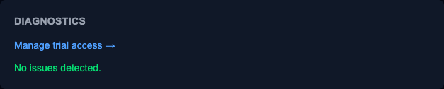
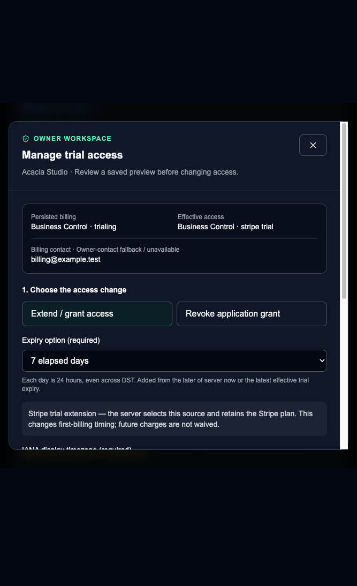
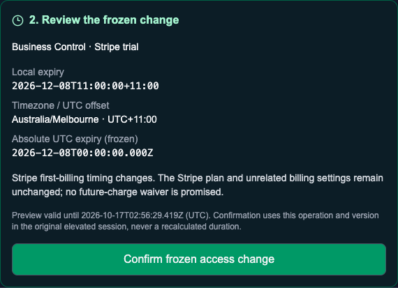
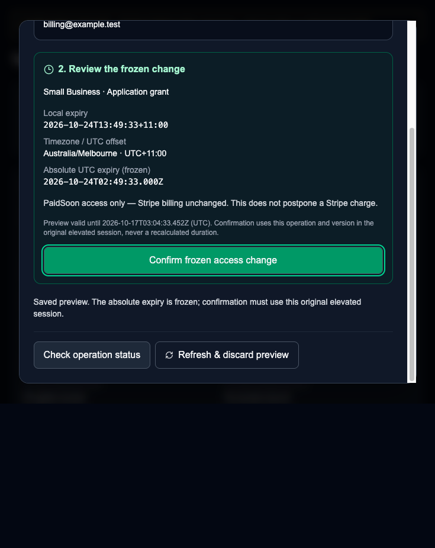
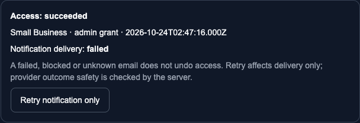
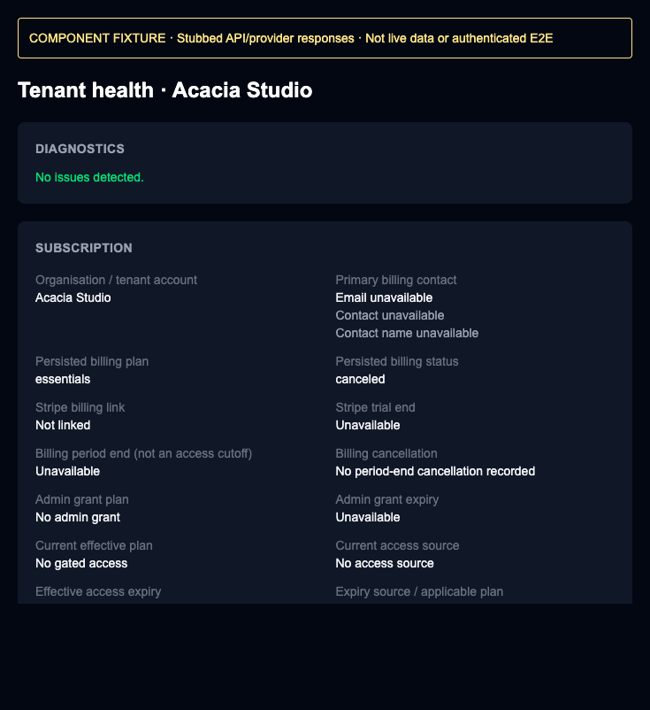

# Admin Setup Runbook

This runbook walks through bootstrapping the PaidSoon platform admin from scratch, including
environment variables, SSH key setup, seeding the first platform owner, and completing the
first login. Refer to [admin-security.md](../admin-security.md) for the full threat model and
guard layer explanation.

If you are setting up a Touch ID Secure Enclave flow end-to-end, use
[admin-touchid.md](./admin-touchid.md).

---

## Prerequisites

- The Supabase project, database schema, and RLS policies are already applied
  ([supabase.md](./supabase.md)).
- The app is running or deployed ([vercel.md](./vercel.md)).
- The operator's Supabase Auth account already exists — they must have signed up via
  the app before you run the seed script. The seed script looks up the user by email
  and will fail if no matching account exists.

---

## §1 — Generate an SSH key pair

The admin challenge-response system supports OpenSSH public key types:

- `ssh-ed25519`
- `ecdsa-sha2-nistp256` (including Touch ID Secure Enclave via `ecdsa-sk`)

Skip this section if you already have a suitable key.

**Software key (local / dev):**

```bash
ssh-keygen -t ed25519 -C "paidsoon-admin" -f ~/.ssh/paidsoon_admin_ed25519
# Leave the passphrase blank or set one — your choice for dev.
# Public key is at: ~/.ssh/paidsoon_admin_ed25519.pub
```

**Hardware key — recommended for production:**

| Token | Command | Notes |
|---|---|---|
| macOS Secure Enclave | `ssh-keygen -t ecdsa-sk -C "paidsoon-admin"` | Requires Touch ID per signing operation |

> OpenSSH security-key key types such as `sk-ssh-ed25519@openssh.com` are not
> supported yet by the current server verification code.

The server only ever stores the public key. You **never** upload or share your private key.

---

## §2 — Environment variables

Add these to `.env.local` for local development, or to Vercel environment variables
for preview/production. See the [README env matrix](./README.md) for the full table.

### Local / dev

```bash
ADMIN_ENABLED=true
ADMIN_REQUIRE_DEVICE_KEY=false   # set false locally to skip the SSH challenge (dev convenience only)
ADMIN_SESSION_TTL_MINUTES=480    # 8 hours
ADMIN_CHALLENGE_TTL_SECONDS=300  # 5 minutes to submit a signed challenge
ADMIN_MAX_FAILED_ATTEMPTS=10
```

### Production (Vercel)

```bash
ADMIN_ENABLED=true
ADMIN_REQUIRE_DEVICE_KEY=true    # MUST be true in production — never ship without this
ADMIN_SESSION_TTL_MINUTES=60     # 1 hour
ADMIN_CHALLENGE_TTL_SECONDS=120  # 2 minutes to submit a signed challenge
ADMIN_MAX_FAILED_ATTEMPTS=5
```

> **`ADMIN_REQUIRE_DEVICE_KEY=false` bypasses the SSH challenge entirely.** Never set this
> to `false` in production. The code enforces this at startup — if `NODE_ENV=production`
> and this flag is `false`, the app throws on startup.

---

## §3 — Seed the first platform owner

The seed script is idempotent — safe to run multiple times for the same email.

It requires `SUPABASE_PROJECT_REF`, `SUPABASE_DB_PASSWORD`, and `SUPABASE_SECRET_KEY`, which
are already in `.env.local` (or set in the shell for a production run).

**Role only (enrol device via UI later):**

```bash
PLATFORM_OWNER_EMAIL=you@example.com \
  node --import tsx scripts/seed-admin-owner.ts
```

**Role + first device in one step (recommended):**

```bash
PLATFORM_OWNER_EMAIL=you@example.com \
ADMIN_SSH_PUBLIC_KEY="$(cat ~/.ssh/paidsoon_admin_ed25519.pub)" \
ADMIN_DEVICE_LABEL="My MacBook 2025" \
  node --import tsx scripts/seed-admin-owner.ts
```

Touch ID Secure Enclave example:

```bash
PLATFORM_OWNER_EMAIL=you@example.com \
ADMIN_SSH_PUBLIC_KEY="$(cat ~/.ssh/id_ecdsa_sk.pub)" \
ADMIN_DEVICE_LABEL="MacBook Air Touch ID" \
  node --import tsx scripts/seed-admin-owner.ts
```

Or use the npm script:

```bash
PLATFORM_OWNER_EMAIL=you@example.com \
ADMIN_SSH_PUBLIC_KEY="$(cat ~/.ssh/paidsoon_admin_ed25519.pub)" \
  npm run seed:admin-owner
```

Expected output on first run:

```
Seeding platform owner for: you@example.com
Found Supabase user: <uuid>
Created platform_owner role.
Enrolled admin device: My MacBook 2025 (SHA256:xxxx…)
Done.
```

---

## §4 — Find your device ID

The challenge page requires your **device UUID** (not the fingerprint). After seeding,
retrieve it with a direct database query:

```sql
SELECT id, label, public_key_fingerprint, status
FROM admin_devices
WHERE admin_user_id = (
  SELECT id FROM auth.users WHERE email = 'you@example.com'
);
```

Run this against the Supabase SQL editor (Dashboard → SQL Editor) or via:

```bash
npx prisma studio
# Navigate to AdminDevice, filter by adminUserId
```

Copy the `id` column value (a UUID) — you will need it in §5.

---

## §5 — Complete the first admin login

### Layer 1 — Supabase session

Navigate to `/sign-in` and sign in with the platform owner email.

### Layer 2 — Platform role check

Navigate to `/admin`. The middleware confirms your `PlatformRole` is `active`. If the
role is missing or the seed script was not run, you will see a 403 page. Re-run the seed
script and reload.

### Layer 3 — SSH challenge (production) / bypassed (dev with `ADMIN_REQUIRE_DEVICE_KEY=false`)

You will be redirected to `/admin/verify`.

**If `ADMIN_REQUIRE_DEVICE_KEY=false` (local dev):**
The verify page will issue an `AdminSession` without a signature. Click through —
no SSH signing is needed.

**If `ADMIN_REQUIRE_DEVICE_KEY=true` (production):**

1. Enter the device UUID from §4 into the **Device ID** field and click
   **Request challenge**.
2. The page shows a base64 nonce. Sign it offline:

   ```bash
   # Replace <nonce> with the exact value shown on screen
   echo -n "<nonce>" | ssh-keygen -Y sign \
     -f <your-enrolled-private-key> \
     -n paidsoon-admin-auth \
     -q
   ```

   For hardware keys, the command is identical — your terminal will prompt for a tap or
   biometric confirmation.

3. Copy the full armoured signature output (including the `-----BEGIN SSH SIGNATURE-----`
   header and footer).
4. Paste it into the **Signature** field and click **Verify**.

On success you are redirected to `/admin/overview` and the `admin_session` cookie is set.
The session is valid for `ADMIN_SESSION_TTL_MINUTES` minutes.

---

## §6 — Invite additional staff

Once logged in as `platform_owner`:

1. Go to `/admin/staff` → **Invite staff member**.
2. Enter the invitee's email and choose a role:
   - `platform_support` — read-only access to tenant data and audit logs.
   - `platform_admin` — can manage staff, tenants, and subscriptions.
   - `platform_owner` — full access; only a `platform_owner` can grant this role.
3. The invitee receives an email with an invitation link. They must sign into the app with
   the matching Supabase account before the invitation is accepted.
4. After accepting, they gain their `PlatformRole`. They still need to enrol a device
   (see §7) before they can pass layer 3.

---

## §7 — Enrol additional devices via the UI

Once you have a valid `AdminSession`, navigate to `/admin/admin-devices`:

1. Click **Enrol new device**.
2. Paste the contents of the new `*.pub` file (OpenSSH `ssh-ed25519` or
  `ecdsa-sha2-nistp256`).
3. Enter a descriptive label (e.g. `Work MacBook Pro — Touch ID`).
4. Submit.

To revoke a device, click **Revoke** next to it. Revoking immediately invalidates all
`AdminSession`s that were issued using that device.

---

## §8 — Verification checklist

After setup, confirm the following:

- [ ] `/admin` redirects to `/admin/verify` when no `AdminSession` cookie is present.
- [ ] An incorrect signature on the challenge returns a 401 and logs an
  `admin_challenge_failed` audit event.
- [ ] After `ADMIN_MAX_FAILED_ATTEMPTS` failures, further challenge requests return 429
  for 10 minutes.
- [ ] Revoking a device logs out any open admin sessions tied to that device.
- [ ] Signing out via `/auth/sign-out` also revokes all `AdminSession`s for the user.
- [ ] Audit events appear at `/admin/overview` and `/api/admin/audit-events`.

---

## §9 — Trial-access operations — in progress, not rolled out

Runtime routes, owner saga/audit and delivery services are present in the working
tree. This is an operator contract, **not permission to enable or run them**.
Pending migrations/CHECKs/full RLS and isolated checks (3.8/3.9/9.3), remaining
UI/end-to-end and release verification still block deployment. Follow the
[release gate](./vercel.md#12-trial-access-and-customer-billing-journal-release-gate).
No new flag/secret is introduced; `ADMIN_ENABLED`/`LIVE` are not trial-safety
switches. Preserve all feature/readiness gates. The working-tree dialog and the
fixture-reviewed steps below are not a shipped workflow or rollout approval.

### Reviewed management workflow (component fixtures only)

Reviewed on **2026-10-17** against the actual `DiagnosticsSection`,
`SubscriptionSection` and `TrialAccessManager` components in the existing local
stub harness at `http://127.0.0.1:4383`. Browser screenshot capture was available
and used. Existing captures were inspected; the blank application-preview and
clipped staff captures were replaced with browser captures, and the delivery
failure capture was refreshed. Images show synthetic Acacia Studio/contact data,
not customer records. Dates and preview deadlines are illustrative, not reusable
instructions or evidence of current eligibility.

The harness mounts actual components but replaces API/provider responses and
navigation refresh. It does not run Next.js authentication, role/session/device
checks, real persistence, Stripe or email delivery. Staff API denial is verified
separately by invoking actual route handlers with mocked infrastructure; hiding
controls in a fixture is not an authorization test. No database/provider was
contacted for this review. Full authenticated end-to-end and rollout verification
remain outstanding.

1. After release approval, open the intended tenant at
  `/admin/tenants/<userId>` under current owner elevation, outside impersonation.
  Check organisation/contact provenance and **persisted billing** separately
  from **effective access**. In Diagnostics, **Manage trial access →** opens the
  same dialog as the **Manage trial access** button below Subscription. This
  entry is present even when no diagnostic exists. The fragment opens management
  only; it never saves a preview or confirms an access change.

  

1. In **Manage trial access**, select **Extend / grant access**. Choose 7, 14 or
  30 elapsed days, or **Specific date / time with offset**. For an explicit
  instant include `Z` or `±HH:MM`, with a matching IANA display timezone. Days
  are 24-hour durations, added from the later of server now or the latest
  effective trial expiry, not necessarily the displayed Stripe trial end.
  Enter the required internal reason (trimmed 1–1000 characters). **Notify
  billing contact** starts off; opt in only deliberately. The reason is
  audit-only and is not included in the customer email. Scroll within the dialog
  to reach fields/actions below the visible portion.

  A suitable Stripe trial retains its plan and has no grant-plan picker.
  **Stripe trial extension** changes first-billing timing, not future-charge
  obligations. An application grant instead requires one of the four public
  plans and explicitly leaves Stripe billing unchanged. Unavailable eligibility
  must be refreshed; paid/restricted accounts show resolution guidance rather
  than permission to bypass billing.

  

1. Select **Save 15-minute preview**. Review **2. Review the frozen change**:
  source, applicable plan, local expiry, IANA timezone/UTC offset, absolute UTC
  expiry and billing effect. Nothing has changed yet. Only then use **Confirm
  frozen access change**, in the original elevated session. Expired/stale
  previews require **Refresh & discard preview**, renewed input and an explicit
  new preview; never silently recalculate an already confirmed duration.

  

  

1. Read access and notification outcomes independently. **Access: succeeded**
  with **Notification delivery: failed** is a completed access change, not a
  reason to grant more days. **Retry notification only** affects delivery alone,
  subject to server safety/retention rules below. Missing email blocks optional
  communication, not access. An unknown email outcome is not proof of failure
  or permission to send a new message/key.

  

1. If the response is lost or pending, retain the original operation. Use
  **Check operation status**, then **Reconcile original operation** only when
  offered. The UI performs at most four automatic read-only status checks,
  two seconds apart, never automatic POST retries. Closing/reopening the dialog
  retains its flow. A recovered unknown preview offers **Retrieve identical
  saved preview**; do not replace its UUID to evade uncertainty. Follow the
  session and provider-window rules below before any recovery.
1. To remove a grant, select **Revoke application grant**, enter a reason,
  review remaining independent access in the saved preview, then **Confirm
  grant revocation**. This removes only the grant: paid, Stripe-trial or valid
  onboarding access may remain. Revocation can remain available even when a
  paid/restricted account cannot receive an extension or grant.
1. Permitted elevated support/admin staff keep the tenant health view but have
  no diagnostics entry, management button or dialog. Direct calls to all trial
  management endpoints, including the old extension URL, return **403** for
  these roles before target reads/provider calls. The removed **Extend trial
  7 days** diagnostic action is not an alternative, and its old `{days}` body
  is not accepted as owner confirmation either.

  

### Preview and confirmation contract

Target the existing `UserProfile.userId` tenant, never debtor/accounting IDs.
Exit impersonation and use active owner elevation on an active enrolled device.
The [DDD inventory/contracts](../DDD.md#owner-trial-route-contract--in-progress-not-rolled-out)
list all six new endpoints and the legacy URL, strict bodies and HTTP mappings.
Every POST needs exact same Origin and no cross-site fetch metadata; no queries
or extra JSON fields. Read-only snapshot eligibility is unavailable, not eligible,
if provider verification fails. Viewing contact does not freeze a recipient.

1. Obtain a fresh management snapshot/version. Preview with a stable new UUID,
  required reason, IANA timezone, optional default-off notification and either
  7/14/30 elapsed days or explicit offset/Z expiry. Application-only intent needs
  a public plan; Stripe intent forbids plan changes. Revoke has no plan/expiry.
2. Review the server-frozen UTC target, local time/offset, source, plan and billing
  effect. The preview lasts 15 minutes. Confirm only `{operationId,expectedVersion}`
  with its `previewVersion`, **same original actor/session**. Stale/expired
  unaccepted previews require refresh/new UUID, never silent expiry recalculation.
3. The old `/api/admin/tenants/[id]/actions/extend-trial` accepts that confirmation
  envelope only for a stored Stripe extension. Old `{days}` (including adding a
  reason to that old body) is rejected. Required reason/time/notify are frozen
  through preview; the adapter cannot grant/revoke or bypass audit/reservations.
4. A completed access change is 200 even when mail fails; inspect delivery
  separately. 202 is uncertainty, not completion. 502 is definitive persisted
  Stripe rejection; 503 is unavailable persistence/verification. Preserve the
  UUID after a lost response and read status rather than starting another change.

### Safe status and recovery

GET `/api/admin/tenants/[id]/trial-access/operations/[operationId]` reads stored
state/current delivery only, with no provider mutation or email. It returns 202
for unresolved access and 502 for stored failed access, otherwise 200. Use bounded
read-only observations, not automatic POST retry loops. `canReconcile` is advisory,
not evidence or permission to replay outside retention.

The **same original actor** may read status or POST reconcile with `{}` using any
currently valid owner elevation, including after re-elevation on a new session.
A different owner cannot take over; expired/revoked/disabled current authority is
still denied. This exception cannot confirm a preview or retry notifications.
Original operation `adminSessionId` remains immutable; recovery appends current
session audit with `originalSessionId` and `recoveringSessionId` (also when equal).
See [audit metadata](../admin-security.md#trial-access-management-boundary--in-progress-not-rolled-out).

Reconcile performs one bounded attempt on frozen Stripe intent, never extra days.
The original reservation survives timeouts, cached 500s, crashes and lease expiry.
Only attributable proof plus current fence can finalize; matching current dates
or an unrelated webhook is not proof. Identical keyed update replay is permitted
only strictly before the durable first attempt +24 hours and while binding/config
remain safe. At/after the boundary, inspect provider evidence; leave unknown
reserved for provider/operator investigation rather than repost, change key or
clear a reservation. Terminal local success is read-only replay; an unconfirmed
local preview returns `trial_recovery_not_available` (409), not confirmation.
Never edit local Stripe trial dates, fabricate billing state/charges, restart or
resume subscriptions, forgive debt with a grant, or auto-fallback after Stripe
failure. See [Stripe §12](./stripe.md#12-owner-trial-recovery--in-progress-not-rolled-out).

### Delivery-only retry

POST the listed notification retry endpoint with `{}` only under the original
actor/session and current owner authority. It never changes access or expiry.
HTTP 200 contains only `operationId` and `notification.status`; it does **not**
mean email was sent. `sent`, `failed`, `unknown`, `blocked`, `superseded`,
`sending`, `pending` and `not_requested` are separate delivery states.
Missing contact stays blocked without silent re-resolution. Confirmed sent mail
is a no-op; obsolete unsent mail is suppressed. Unknown late delivery requires
provider investigation, not a new key/address or edited journal. No provider
reconciliation/retargeting endpoint is supplied by this feature. Follow
[Resend §7](./resend.md#7-trial-access-notifications--in-progress-not-rolled-out)
for the exact retryability and existing configuration prerequisites.

## Troubleshooting

| Symptom | Likely cause | Fix |
|---|---|---|
| Seed script: `No Supabase auth user found` | Operator has not signed up yet | Sign up first via `/sign-up`, then re-run the seed |
| `/admin` returns 403 immediately | `ADMIN_ENABLED` is not `true` | Set `ADMIN_ENABLED=true` in env and redeploy/restart |
| Challenge page throws on startup | `ADMIN_REQUIRE_DEVICE_KEY=false` in production | Set it to `true` in production env vars |
| "Too many failed attempts" (429) | `ADMIN_MAX_FAILED_ATTEMPTS` exceeded in the last 10 min | Wait 10 minutes, then retry; or reduce the failure count in the DB by deleting recent `admin_challenge_failed` audit events (use Supabase SQL editor) |
| Signature rejected despite correct key | Nonce expired | The challenge TTL (`ADMIN_CHALLENGE_TTL_SECONDS`) has passed; request a fresh challenge and sign within the window |
| Device ID not known | Seed script output did not include UUID | Query `admin_devices` table directly — see §4 |
| Hardware key signing fails | Wrong namespace | Ensure `-n paidsoon-admin-auth` matches what the app expects; check `lib/admin/ssh.ts` for the namespace string |
